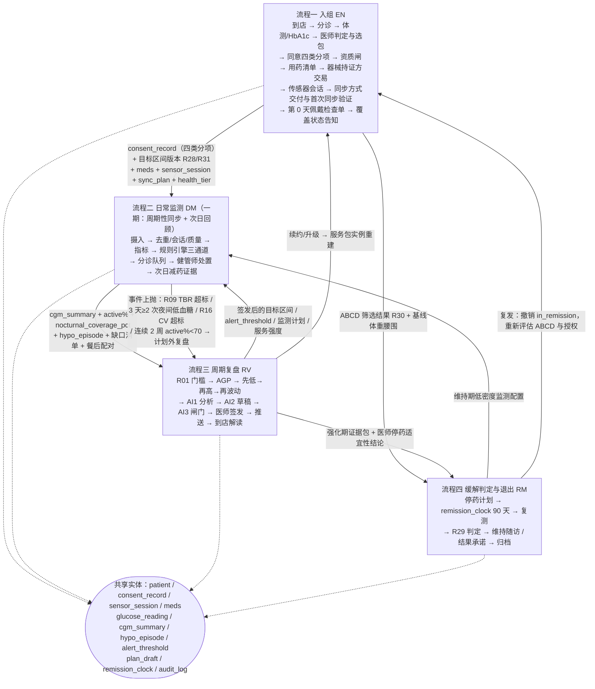
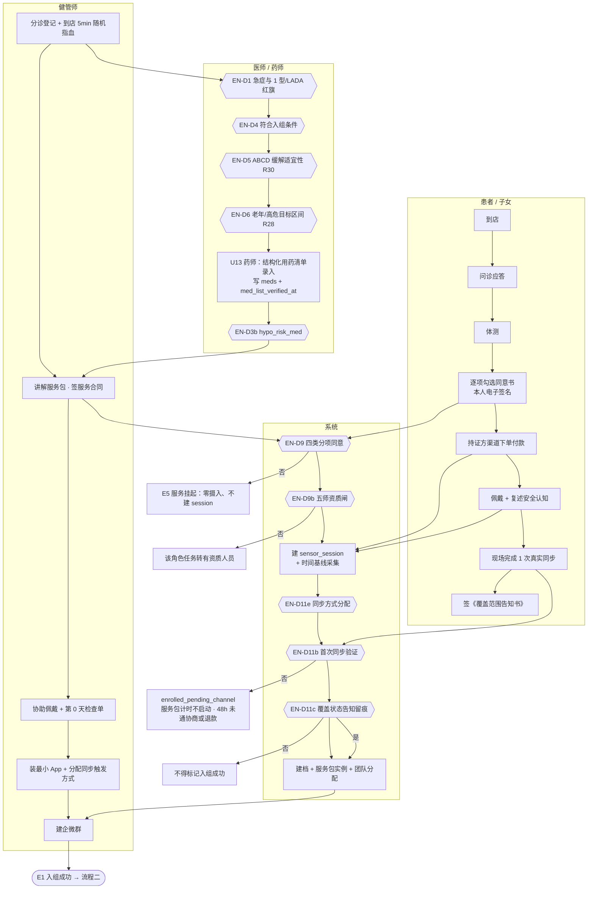
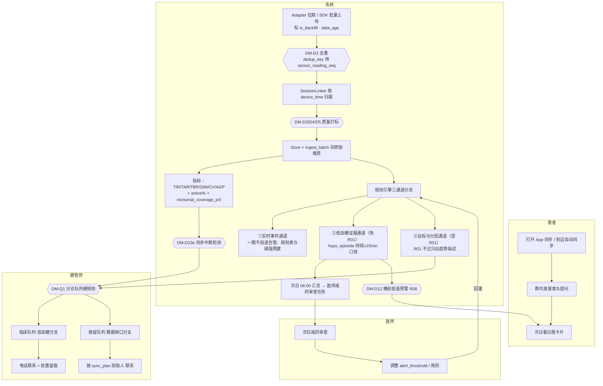
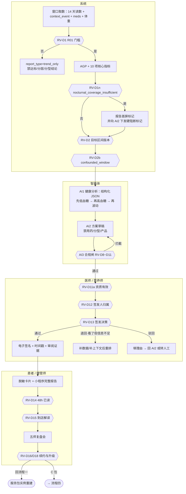
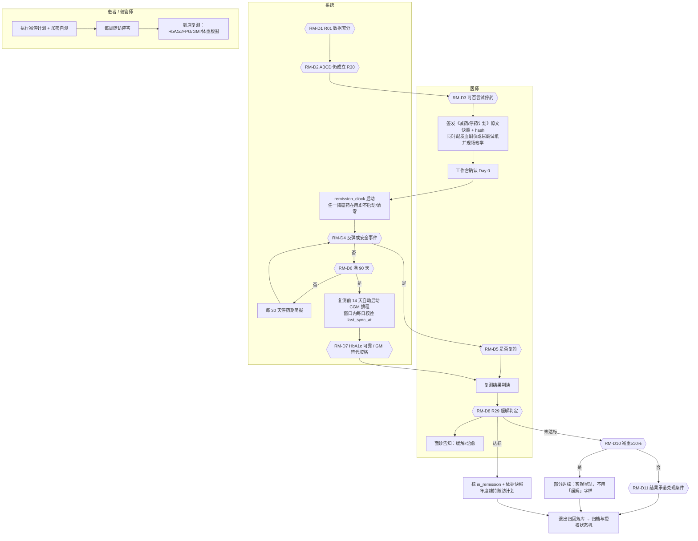
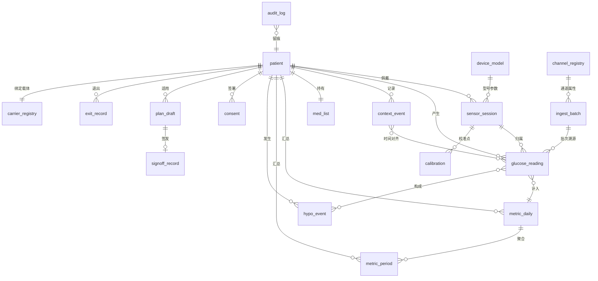
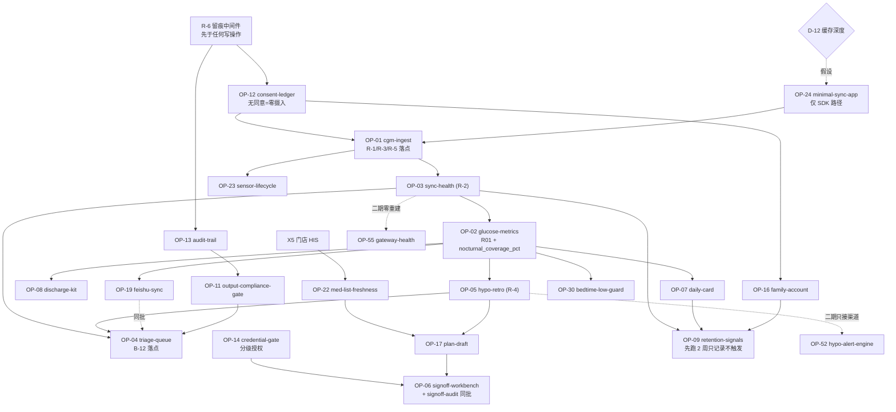

# 控糖场景 产品需求文档（PRD · 一期）

> 文档版本：v1.0　　编制日期：2026-09-05
> 受众：数联天下内部研发（含产品、后端、数据、算法、合规接口人）
> 事实基准：`studio/changes/glycowise/decisions/confirmed-facts.md`。本文与该台账冲突时以台账为准。
> 分期依据：B-13。**本册只写一期。一期与二期的唯一边界是：一期无实时告警。** 通道形态（云云对接 / SDK）是实现选择，不是分期条件。
> 跨期内容在本册只做一行标注（"本期不做，见二期"），不展开。

## 阅读须知

1. **编号有两套，不要混**：`R01–R32` 是临床规则编号（来源 `research/sources/02-CGM临床指标与规则库.md` §8）；`R-1~R-6` 是一期强制预留编号（来源 `carrier-selection.md` §7.5 + 机会评估第 0 层）。行文中一律写全带连字符的形式。
2. 需求编号规则：`FR-5.x` 功能需求、`DR-6.x` 数据需求、`RR-7.x` 规则需求、`NFR-8.x` 非功能需求。
3. 标注 **【假设 · D-xx】** 的需求依赖未确认事实，每处附失效分支。未标注的需求视为前提已确认。
4. 标注 **不可绕过 / 不可降级 / 不经 LLM 自由发挥** 的需求属安全或合规硬项，任何"先上线后补"的排期提议须走变更流程。
5. 被 `confirmed-facts.md` C 类推翻的结论，本文一律不引用原值。若在其他历史文档中读到 60 人、299–399 元、"持续 ≥15 分钟才触发告警"等表述，以本文为准。


## 一、范围与边界

### 1.1 本期目标

⚠ **本段已被 2026-09-05 的范围纠正推翻（台账 C-15），保留原文仅供追溯**：~~把柳州门店已跑通的线下环节与断掉的居家段接上~~。

**修正后**：门店侧五段（分诊、问诊建档、体测、方案、企微群跟进）**同样没有系统承载，需一并实现**，且顺序在 CGM 之前——没有患者档案与体测基线，CGM 数据无处可挂。本 PRD 的功能需求章节只覆盖了 CGM 链路，**门店侧五段的需求待补**。

一期交付四件可验收的东西：

| # | 交付物 | 验收口径 |
|---|---|---|
| 1 | 一份真正达标的 14 天报告 | R01（14 天 + 有效数据 ≥70%）真实通过，TIR/TAR/TBR/GMI/CV/AGP 全部产出；未通过则显式不出结论 |
| 2 | 低血糖客观证据链 → 医师减药审查 | 结构化去强化证据包，含时段分布、与进餐/运动/漏餐关系、黎明现象共存判定，并强制带 eGFR/年龄/病程/跌倒史/既往严重低血糖史字段位（缺失显式标「未取得」） |
| 3 | 一次当面结营解读（30 分钟） | 第 12 天锁定到店预约；未预约进红档、店长可见 |
| 4 | 居家数据自动入平台 | 自动入平台比例 ≥90%，替代健管师手工转录 |

对内收益是消灭健管师每天约 3.5 小时转录工时；对外收益是把「患者早上报个数」换成一段连续可信的记录 + 医师当面解读。

**分期边界只有一条：一期无实时告警（B-13）。** 通道形态是实现选择，不是分期条件——有云云接口（`vendor_api`）就走云云，没有就走移动端 SDK（`sdk_ble_direct`），两条都能做一期。

### 1.2 范围内

对齐 brief.md Plugin Candidates 第 2 层（地基）与第 3 层（价值候选）；第 0 层预留见 §2.4，第 1 层合规闸见第五章。

| 层 | OP 编号 | 能力 | 一期范围要点 |
|---|---|---|---|
| 地基 | OP-01 | `cgm-ingest` 摄入·归一·去重·会话·质量打标 | 必须含 **push/pull 双摄入**（SDK 路径是手机端推：乱序、重传、断点）；R-1/R-3/R-5 落点 |
| 地基 | OP-03 | `sync-health` 同步健康度与断流工单 | R-2 落点；三表 + 三信号 + L1–L4 工单；断流判定用 `data_age`，`flowing` 拆 `flowing_fresh`/`flowing_backfill`。**必须先于 OP-02 上线** |
| 地基 | OP-02 | `glucose-metrics` 指标与 R01 门槛 | 一期唯一可售卖交付物的产生者；新增 `nocturnal_coverage_pct` 并首屏显示 |
| 地基 | OP-24 | `minimal-sync-app` 最小同步 App | **仅 SDK 路径需要**；D-10 云云可得则整条删除（见 §2.3 D-12 分支） |
| 价值 | OP-08 | `discharge-kit` 结营解读包 | 第 7 天中期小结 + 第 12 天强制锁预约 + 人话首页 + GMI 与实测 HbA1c 一致性核查 |
| 价值 | OP-10 | `wear-onboarding` + `skin-check-probe` | 第 0 天检查单逐项打勾未完成不结单；含两问营养风险筛查；第 2/4 天是非题探针 |
| 价值 | OP-25 | `exit-record` 退出归因与留存曲线 | `service_exit_record` 终态实体 + 退出访谈 5 题 |
| 价值 | OP-04 | `triage-queue` + `pipeline-health-bar` | B-12 落点；两层队列；队列为空显式显示「已核对 N 人数据完整」 |
| 价值 | OP-19 | `feishu-sync` 过渡期单向同步 | 与 OP-04 同批上线，上线当天即定飞书下线日期 |
| 价值 | OP-22 | `med-list-freshness` 用药清单新鲜度 | 所有用药分支的共同前提；`med_class_hint` 与 `meds` 严格分离 |
| 价值 | OP-30 | `bedtime-low-guard` 睡前低值预警 | 一期唯一能降低夜间低血糖发生率的能力（事前一级预防）；读数 `age > 60 min` 不得发送 |
| 价值 | OP-06 | `signoff-workbench` + `signoff-audit` | 两者必须同批上线不得拆分；含「看了但信息不足」退回按钮 |
| 价值 | OP-07 | `daily-card-composer` 日报卡片 | 正负内容比 ≥1:1；前 3 天不给达标判断；大字走图片 + 回复数字 |
| 价值 | OP-23 | `sensor-lifecycle` 传感器生命周期 | 到期前 48 h 提醒；换传感器同批补发葡萄糖片 |
| 价值 | OP-05 | `hypo-retro` 回顾性低血糖 + HAAF + 去强化证据包 | R-4 落点；HAAF 状态机仅 B/C 包生效 |
| 价值 | OP-09 | `retention-signals` 流失信号引擎 | 净可用 8 条稳定 + 2 条有条件；须在 OP-03 之后，先跑 2 周只记录不触发 |
| 价值 | OP-16 | `family-account` 子女端 + 服务证据台账 + 降档 | S11 唯一前提；家属授权须建立在患者本人授权链上 |
| 价值 | OP-17 | `plan-draft` 方案草稿智能体 | AI 只到草稿，医师/注册营养师签发后才推送 |
| 价值 | OP-18 | `ppgr-pairing` 餐后响应配对 | 药物混杂校正为前置条件；餐间隔 <2–3 h 不纳入配对 |
| 价值 | OP-28 | `ocr-triage` 截图兜底分诊复核台 | 一期为异常态；跳升规则见 §2.3 |
| 价值 | OP-29 | `bg-meter-ble` 指血仪 GLS 0x1808 兜底 | 依赖 D-07 真机抓包 |

规则引擎一期分三条通道：①实时事件通道（**不启用告警投递**，规则表与阈值仍建）；②低血糖证据通道（**免 R01**，一期核心）；③达标与分层通道（**受 R01**）。

### 1.3 明确不做

本节约束力高于 1.2，研发不得以「顺手」「先埋个开关」为由实现。

| 不做什么 | 为什么 | 研发顺手做了会怎样 |
|---|---|---|
| **采集盒 / 网关硬件**（选型、打样、采购、MDM 车队、押金与回收） | 二期才用；T-02 续航定量未出，选型输入不全；D-09 硬件成本未核实 | 沉没成本落在一批选错型号的设备上；门店还要背上资产台账、押金、回收动线，而一期没有服务对象 |
| **自建 Android / iOS 常驻 App、后台保活、前台服务、电池优化白名单** | 二期才用；届时 SDK 版本可能已迭代 | 一期多一个「看起来能守夜、实际没人接告警」的进程；一线与销售会据此承诺夜间覆盖，违反 B-11 |
| **实时告警链路**（`hypo.level2.alert` 的**通知投递**、升级链、告警通道分离、勿扰穿透、本机强制响铃） | B-13。规则表与阈值一期建（R-4），**但不接任何投递渠道** | 一条无人值守的告警链凌晨发出消息且无人响应，比没有告警更危险：制度上存在、功能上为零，还留下「我们本该知道」的举证 |
| **夜间值班排班与编制** | D-02 是二期前置条件，一期无实时告警自然无夜班对象 | 值班表整夜不会响一次，形成岗位空转与虚假安全感 |
| **双路 BLE 常驻并存 / 主从热备 / 自适应占空比** | A1-8 多路并存显著缩短续航，一期周期同步不触发；B-5 修订属二期 | 触发 A1-8 → 传感器提前耗尽 → 击穿 R01 → GMI 不可用 → C 包结果承诺失据 |
| **任何把血糖数据映射到产品推荐的逻辑** | B-2、A2-4。英纽林是固体饮料，现有「血糖分级 → 产品组合表」本身违法 | 一个字段、一张映射表、一句推荐文案即构成违法功效宣称，写进代码后在任何输出里都可能泄漏 |
| **AI 直接向患者推送分型、分级、用药与疗程结论** | B-3、A2-3 | 构成 AI 自动生成处方，无可推翻空间 |
| **在一期同意书内打包二期载体采集授权** | ⊘1，PIPL 29。单独同意必须具体、场景化 | 二期同意链条整体无效，一期已采数据的合法性一并受质疑 |
| **境外模型调用**（含多模态解析、OCR 复核） | ⊘5，PIPL 38/40 | 触发数据出境评估或标准合同备案，本项目体量不值得，上线后难以回收 |
| **7×24 常驻采集、覆盖时段承诺** | 一期 `carrier_type ∈ {none, patient_phone}`，`coverage_window = 不保证`，`supports_local_forced_alert = false` | 服务包与话术会据此写出不可兑现的承诺 |

**一期结构性无当夜干预能力。** 这不是资源不足的临时状态，是 B-13 分期后的确定状态。因此：

- 服务包合同、门店物料、企微话术、朋友圈、AI 输出，**均不得含任何夜间安全承诺**。硬拦截词表至少含：「24 小时守护」「24 小时看护」「夜间监护」「夜里出事我们会知道」「我们一直看着」。落点在 OP-11 系统出口闸与 OP-15 人工话术库，两侧同时生效。
- 低血糖在一期的价值表述**只能是**：「**次日纠因 + 为医师提供减药证据**」。至心目前靠患者早上口头汇报，而夜间低血糖患者根本不会醒来汇报。
- 「次日纠因」的表述必须带前提限定：**在每日同步达成的前提下**。患者三天同步一次，实际是「三日后纠因」。同步达成率写进 A 包交付验收项。
- **与「实时救援」严格区分**：一期不承诺发现当时正在发生的低血糖，不承诺有人在夜里响应。任何把两者混说的表述，按合规违规处理。

另一个方向的误读：**一期没有实时告警 ≠ 一期数据不全**。硅基传感器本地缓存读数，手机周期性连一次即可回填，5 分钟粒度历史数据完整，R01 可满足，GMI 可用于缓解判定。**一期损失的只有时延。**

### 1.4 与二期的边界

跨期项本期不做。一期义务是把下表最后一列的预留做到位。

| 项 | 一期状态 | 二期承接 | 一期必须预留什么 |
|---|---|---|---|
| 载体采集（OP-51 采集盒 + 自建 App + BLE 直连） | 不做 | 一套 Android 代码两种部署；主从热备 + 自适应占空比 | `glucose_reading.carrier_id` 字段建好（不进键）；`source_confidence`、`clock_drift_ms`、`backfill` 建全 |
| 实时告警引擎（OP-52） | 规则定义与表结构建、**不接投递** | 只需接通知渠道 | R-4：`hypo.level2.alert` 与 `hypo.level2.event` 两规则两表两套阈值物理分开 |
| 载体健康监控（OP-55） | 云侧/患者手机已建成一条 `carrier` | 多插几行 carrier，扩展归因矩阵 | R-2：`carrier` / `carrier_heartbeat` / `carrier_incident` 三表 + 三信号 + L1–L4 工单 SLA |
| 分级升级链（OP-53）与告警通道分离（OP-54） | 不做 | 回执超时链、链尾具名自然人 | 无技术预留；D-02 夜间值班**决策**须在一期启动（决策周期长于开发周期） |
| 载体采集单独同意（OP-58） | 不做，且**禁止预埋** | 届时重新单独取得 | ⊘1：一期同意书按四类分项，不含载体条款 |
| 夜间覆盖真实性闸（OP-59） | 不做 | 载体离线即置 `no_realtime_night_coverage` 并拦截夜间承诺 | 一期以话术闸门（OP-11 + OP-15）承担同一职责的静态版本 |
| 按用药分支处置卡（OP-56） | **内容部分前移一期**（并入 OP-10 第 0 天交付） | 与告警联动的动态处置卡 | α-糖苷酶抑制剂只能用葡萄糖、老年睡前下限 5.6、15-15 法则作为固定科普材料交付 |
| 伪差客观归因（OP-57） | 不做 | 波形 + 体位时段 + 指血确认；误报 24h 归因回访 | 无 |
| 二期实时告警 ROI 基线 | 一期即开始积累 | 用于对比「实时拦下了多少原本只能事后看到的事件」 | R-4 的回顾性事件统计一期就跑 |

---

## 二、约束与前提

### 2.1 不可逾越的硬约束

硬约束的验证手段统一见第八章。

#### B-1 CGM 是第三类医疗器械，平台不做器械交易

- **必须存在**：`device_flow` 流转记录（下单方、持证发货方、发票抬头）；门店侧只留「佩戴指导服务」留痕（现场指导 + 患者/家属自行贴敷 + 健管师核对）。
- **禁止的实现**：我方系统内生成器械订单、收器械款、算器械毛利、开器械发票的任何代码路径；SKU 表不得有传感器物料行；订单金额不得含器械款。
- **禁止的文案**：对外物料不得出现「含 / 赠 / 配传感器」。CAC 补贴科目记为「服务折扣」，**不得记为「器械代付」**。「CGM 成本占比」为内部口径，不得进入对外材料与接口返回值。
- **验证**：SKU 表与收款流水扫描，命中器械类目即阻断发布（见第八章）。

#### B-2 英纽林是固体饮料，服务与产品物理分离

- **必须存在**：服务包合同、收款、物料三条线与产品线在数据模型上无外键关联；产品由医师在 HIS 内单独开具与收款。
- **禁止的实现**：**任何以血糖数据（分级、分型、TIR、TBR、指标标签）为输入、以产品/SKU 为输出的函数、表、规则或提示词**——含「血糖分级 → 产品组合表」、推荐位、草稿里的产品名。
- **禁止的表述**：「MNT」「医学营养治疗」「降糖」「修复胰腺」「逆转」「治愈」「根治」「糖尿病逆转中心」。
- **验证**：见第八章（词库回归集 + 草稿 schema 无产品字段）。

#### B-3 AI 不出处方，只到草稿，医师/注册营养师签发后才推送

- **必须存在**：`draft` → `signed` → `delivered` 三态，**投递层（D16）只接受带有效 `signoff_id` 的内容**；签发依据快照不可变；`credential_gate` 按执业范围授权（营养师签营养、药师签用药审查、医师签用药与分型）。
- **禁止的实现**：绕过签发直接进投递队列的路径；「自动签发」「超时默认通过」「低风险免签」开关；AI 输出直接写入患者可见表。
- **配套**：`signoff-audit` 与工作台同批上线，签发耗时中位 <10 秒触发异常审计；操作留痕含设备/IP/时段。
- **例外**：无建议、无数值的纯陈述型日报可风险分层放行、系统直发；白名单由合规官维护，**不可由研发在代码里扩大**。

#### B-13 分期边界：一期无实时告警

- **必须存在**：`carrier_type ∈ {none, patient_phone}`、`coverage_window = 不保证`、`supports_local_forced_alert = false` 三项一期即建并锁死；`hypo.level2.alert` 规则表存在但 `delivery_channel` 为空且不可配置。
- **禁止的实现**：给 `hypo.level2.alert` 接任何通知渠道；后台保活、前台服务、常驻连接；服务包配置出现「夜间监护」可售条款。
- **验证**：投递层断言 `rule_type='alert'` 产出永不进 D16 队列，违反即抛错并进审计。

### 2.2 已确认事实

A 类事实只能由原始来源方改口才能变更。

| # | 事实 | 依赖它的设计 |
|---|---|---|
| A1-1 | 硅基动感 CGM 接入已商务确认 | 整条数据链路；C-00 |
| A1-2 | 厂商提供**移动端 SDK**（非嵌入式、非裸协议） | C-08；OP-24；**C-12** |
| A1-3 | 数据粒度为**原始读数** | OP-02；32 条规则；OP-18 |
| A1-4 | 同一枚传感器允许多个 BLE 连接并存 | 二期双路冗余（一期不触发） |
| A1-5 | 采样间隔 **5 分钟** | `expected_interval_s = 300`；R-3 分母 **288/天** |
| A1-6 | 读数**默认带传感器侧序号** | **R-1 去重键的唯一锚点**；同 session 序号缺口率自检 |
| A1-7 | 时间戳为**传感器测量时刻** | OP-03 `data_age`；R-3 日界时区 |
| A1-8 | 多路 BLE 并存显著缩短续航 | 二期风险；B-5 |
| A2-1 | CGM 属三类器械，经营须许可证 + 网售备案 | B-1；OP-27 |
| A2-2 | 血糖/用药属 PIPL 敏感个人信息，须单独同意 + PIPIA + 境内存储 | OP-12；⊘1–⊘5 |
| A2-3 | 严禁 AI 自动生成处方 | B-3；OP-06；OP-17 |
| A2-4 | 英纽林为固体饮料，不得宣称降糖/逆转，不得称 MNT | B-2；OP-11；OP-15 |
| A2-5 | 「糖尿病逆转中心」命名与卫健委名称规范冲突 | OP-15；OP-26 |
| A2-6 | 健康管理师不是执业资格，不得作疾病判断与用药指导 | OP-14；健管师权限矩阵 |
| A3-1 | 充分性门槛 **14 天 + ≥70%**，不满足不出达标/分层结论 | R01；OP-02 发布门；OP-08 降级 |
| A3-2 | 规则优先级固定：低血糖 → 高血糖 → 波动 | OP-04 队列第 1 层排序 |
| A3-3 | CGM 不能用于诊断，分层只作服务分层内部标签 | 禁止告知分型；标签不出内部系统 |
| A3-4 | 缓解 = 停药 ≥3 个月 HbA1c<6.5%（GMI 可替代），不用「逆转/治愈」 | C 包判定；**180 天须从停药日起算**；B 包不得出现缓解表述 |
| A3-5 | 老年（≥65）目标切换：TIR>50%、TBR<1%、TAR>13.9 <10% | OP-02 年龄分层；OP-07 |
| A3-6 | 实时告警 = 2 连续读数 + 预测性；「持续 ≥15 min」**仅用于回顾统计** | **R-4 两套口径物理分开**；C-01 |
| A3-7 | 无感知低血糖高危人群阈值上调至 4.4 且保留告警，不可一律静音 | R-4 per-patient 阈值；C-05 |

**C-01 两套口径不得混用**：实时口径 = 连续 2 读数 + 预测性外推，一期建规则不投递；回顾口径 = Danne 2017「持续 ≥15 min」，用于 `hypo_event` 计数与 TBR 统计，事件结束 = 回升 ≥3.9 持续 15 min。**统计定义不得用作告警触发条件。**

### 2.3 假设与其失效影响

#### D-12 传感器芯片侧缓存深度 —— 一期第一风险

| 项 | 内容 |
|---|---|
| 假设内容 | 芯片侧缓存足够深（≥24 h），患者「偶尔打开 App 同步一次」即可完整回填 5 分钟粒度读数 |
| 当前状态 | **未问定**，拆两问：**D-12a** 芯片侧缓存深度（唯一决定丢不丢数据的一层）；**D-12b** SDK/App 本地库缓存深度（只决定手机到云补传，不解决丢失） |
| 依赖它的需求 | OP-24 全部；OP-02 R01 判定；OP-03 断流阈值与工单节奏；OP-09 S2/S3；一期定价 |
| 若不成立的分支 | 缓存浅（≤8 h）→ **最小同步 App 不再是「最小 App」而必须常驻，形态直接跳二期载体**；OP-24 本期作废或降为兜底通道；OP-28 OCR 复核台**从异常态变常态**；R01 长期不达标 → 报告退 `trend_only` → GMI 不可用于缓解判定 → C 包结果承诺失据 |

**C-12：走云云不能规避 D-12。** 厂商给的是移动端 SDK，传感器 → 手机这一跳两条路径相同，都要一个 App 跑 BLE。云云只是把「谁的 App」从我方换成硅基自家，同步依从性一样，而我方**还额外失去对同步过程的可观测性**——只知道数据迟到，不知道患者是否同步过。

「客户端缓存水位预警」不得作为缓解措施：App 不打开就连不上 BLE，读不到水位也推不出预警。有效缓解按优先级：① **服务端按 `last_sync_at` 定时推提醒**；② 到店自动同步 + 老伴代操作通道；③ 「首次同步成功由系统客观判定」设为佩戴当天结单硬门（OP-10）。

#### 其余假设

| # | 假设内容 | 当前状态 | 依赖它的需求 | 若不成立的分支 |
|---|---|---|---|---|
| D-10 | 硅基提供云到云数据授权（OAuth / 定时拉取 / webhook） | 未问定 | OP-01 摄入形态；OP-24 是否存在 | 为否则走 SDK 路径，OP-24 整条保留，是一期最大工作量分叉。**它省的是开发量与 iOS 覆盖，不是 D-12 风险**（催同步人力 30–45 min/人/天 ≈ 0.1 FTE） |
| D-11 | 云侧读数带与 SDK 同一套序号与同命名空间 SN。拆两问：**D-11a** 同一套 `reading_seq`；**D-11b** `sensor_id` 与 `sensor_sn` 同命名空间 | 条件性——走 SDK 时不存在（A1-6 已确认） | **R-1 去重键**；OP-01 唯一索引 | D-11a 为否 → 退到锚定 `sensor_session.started_at` 的采样网格，**一期即验证网格对齐**；D-11b 为否 → 一期即建 `sensor_id ↔ sensor_sn` 映射表并验证，否则 R-1 的键在二期失效 |
| D-07 | 门店拟采购指血仪实现标准 GLS 0x1808 | 需真机抓包 | OP-29；「替代 7 点指血手抄」承诺 | 为否则 OP-29 作废，指血兜底退回人工录入 + OCR |
| D-08 | 至心真实结果数据（3/6 个月 HbA1c、减药率）可取得 | 未取得 | 全部服务包 KPI 目标值 | 不成立则**所有 KPI 目标值均为推算**，只作内部观察指标，不得对外承诺 |

### 2.4 强制预留项 R-1~R-6

**这六条是一期开发的准入条件，不是候选项**，不得混进排序表。

编号区分：**R01–R32 为临床规则，R-1~R-6 为强制预留**。

| # | 一期必须怎么做 | 不这样做的代价 |
|---|---|---|
| **R-1** 🔴 **不可逆** | `dedup_key = sha1(patient_id\|vendor\|sensor_sn\|reading_type\|sensor_reading_seq)`，一期即建唯一索引。`vendor_record_id` 仍存但**只作辅助溯源，不进键**。墙钟取整**禁止**进键 | 二期两路数据无共同锚点 → 回填重算历史 → **GMI 基线断裂 → 缓解判定前后对比失效 → C 包 9,800–12,800 元结果承诺失去举证基础** |
| **R-2** 可逆但代价大 | 一期即建 `carrier` / `carrier_heartbeat` / `carrier_incident` 三表，云侧作为 `carrier_type='vendor_cloud'` 一行；三信号（`alive` / `flowing_fresh` / `flowing_backfill`）+ 归因矩阵 + L1–L4 工单 SLA；`glucose_reading.carrier_id` 建字段但**不进键**；`patient.data_flowing = OR(各路)` | 二期须重建整套载体健康度监控；一期失去对云侧拉取中断与患者不同步的可观测性——最大的运营风险 |
| **R-3** 数据层可逆，**已签发文书层不可逆** | 口径三件套一并写死：① 分母 288/天，**取自 `device_model` 不硬编码**；② `quality_flag='ok'` 判定谓词集（warmup、生理范围、噪声）；③ 日界时区——`patient` 增 `home_timezone`（人工设定、不随设备漂移），日聚合按它切，Tidepool 三层时间 `time`/`deviceTime`/`timezoneOffset` 一期建全。三者共一个 `metric_spec_version`，写进 `metric_provenance` 与签发快照。`active% = COUNT(DISTINCT dedup_key WHERE quality_flag='ok') ÷ 期望读数`；`carrier_coverage%` 单独存表，**永不进临床指标**。`active% > 100%` 红色告警 + **同 session 内 `sensor_reading_seq` 缺口率**一期上线 | 口径二期再改 → 历史指标不可比 → 打断缓解判定的基线对比。A1-7 时间戳为测量时刻（UTC 语义），按 UTC 切日会让夜间统计偏 8 小时。已签发文书不可改写，口径一改即不可解释 |
| **R-4** 可逆但会重犯 C-01 | 两条规则、两张表、两套阈值配置**物理分开**：`hypo.level2.event`（回顾：<3.0 持续 ≥15 min）一期实现并进指标与报告；`hypo.level2.alert`（实时：连续 2 读数 + 预测性外推）一期建表与规则但**不接通知渠道**。补三项：① **事件结束**：回升 ≥3.9 持续 15 min；② `hypo.level1.event` 与 `level2.event` 两级并建；③ 阈值表建成 **per-patient 维度**（`patient_id` + 规则类型为主键，默认值全局填充） | 一期只建一条规则 → 二期复用同一份阈值 → 重犯 C-01。不定义事件结束，锯齿波会计成多次事件 → **事件数虚高 → 误导医师减药**。「TBR 达标 + 反复 Level 1 事件」是 HAAF 前驱形态，只算 TBR 看不见。IAH 高危 4.4、老年睡前 5.6、妊娠 3.5，建成全局单值二期同样返工 |
| **R-5** 🔴 **不可逆（比 R-1 更硬）** | 原始载荷不可变留存：`ingest_batch` 保留厂商原始响应体；`glucose_reading.raw_value` / `raw_unit` 一期即建。同时问定：硅基 SDK 是否允许用户在 App 内切 mg/dL 且返回值随之变 | 归一映射错了（单位、时间语义、trend 枚举）唯一补救是回原始载荷重算；**厂商云历史窗口有限，过期即物理不可得**。R-1 错了还能从原始数据重算，raw 没存连重算的输入都没有 |
| **R-6** 存量，事后补不了 | 留痕中间件（OP-13 `audit-trail`）**先于任何写操作上线**；横切、留存 ≥3 年（网安法 ≥6 个月为下限）；含销毁作业与安全事件 24h 上报出口 | 没留痕的时段，OP-11 出口闸、OP-14 资质闸、OP-06 签发的「我们拦住了 / 医师签过」全部无法举证，**等于三条闸门不存在** |

六条的验证方式见第八章。

#### 五条反向约束（同等强制，「必须不做」）

| # | 约束 | 依据 | 研发层含义 |
|---|---|---|---|
| ⊘1 | PIPL 单独同意**不得预埋二期条款**，载体采集届时重新取得（OP-58） | PIPL 29 | 同意模板按期次隔离；一期模板不含 `carrier_collect` 枚举值 |
| ⊘2 | **四类分项单独同意**：敏感信息处理 / 委托处理与对外提供（厂商、外部 RD 会诊）/ 企微会话存档 / 自动化决策，单独取得，**不得一揽子勾选** | PIPL 14/23/25/29 | 同意记录是四行不是一行；UI 不得有「全选」；任一项缺失则对应下游能力关闭而非降级 |
| ⊘3 | **撤回须与同意同样便捷**，明确撤回后存量数据的删除或匿名化时限；**不得以拒绝非必要授权为由拒绝服务** | PIPL 15/16/47 | 撤回入口不深于同意入口；撤回触发并枚举下游停用；非必要授权项不得作开通前置校验 |
| ⊘4 | **子女不得代患者同意**，家属授权必须建立在患者本人授权链之上 | PIPL 14 | `family_grant.parent_consent_id` 非空校验；否则子女端埋点（S11）建立在无效同意上 |
| ⊘5 | **含个人信息的模型调用一律境内，境外模型禁用** | PIPL 38/40 | **写死为架构规则、不做配置项**，不做「出境判定」；`model_call_log` 记录每次调用的模型与部署地 |

## 三、角色与权限

### 3.1 角色清单

一期建模 13 个人类角色（U1–U13）、6 个智能体（AI1–AI6）、11 个系统服务（S1–S11）、12 个外部系统。标「二期」的角色一期不实现，但编号、表结构与权限位一期就占好（R-2 同理）。

| ID | 角色 | 一期职责 | 资格性质 | 一期启用 |
|---|---|---|---|---|
| U1 | 老年 T2D 患者 | 佩戴、周期同步、回填症状与处置标记、签同意 | 数据主体 | 是 |
| U2 | 中年新诊断/糖前期患者 | 同 U1，且是生活事件打卡主力 | 数据主体 | 是 |
| U3 | 子女/家属 | 查看脱敏卡片、代录生活事件 | 受授权第三方，须患者本人授权项④ | 是（一期建正式账号） |
| U4 | 健康管理师 | 建档、分诊处置、结营预约、履约登记 | **职业技能证书，非执业资格**，不得作疾病判断与用药指导 | 是 |
| U5 | 门诊医师 | 入组判定、分层、目标区间、方案签发、去强化审查、缓解判定 | 执业医师，受 S9 闸约束 | 是 |
| U6 | 注册营养师 | 膳食评估与方案签发（不含用药内容） | 注册营养师 | 是 |
| U7 | 店长 | 服务包商务配置、门店清查确认单、退款结案 | 否决者，不入群、不碰血糖与用药 | 是 |
| U8 | 运动康复师 | 运动方案起草，需医师筛查禁忌后双签发 | 康复资质 | 是 |
| U9 | 心理咨询师 | 「指标改善但主观感受差」兜底 | 咨询资质 | 是（低频） |
| U10 | 合规官/DPO | 话术抽检、同意与出境判定、留存销毁、凭证台账 | 合规 | 是 |
| U11 | 数据运维 | `channel_registry`/`device_model` 唯一写者；死信队列、孤儿读数、时钟漂移 | 平台 | 是 |
| U12 | 前台/护士 | 到店指血与化验采样录入 | 门店 | 是 |
| U13 | 药师 | 用药清单录入、`med_class_hint → med_list` 确认 | 执业药师；门店无药师须显式声明由 U5 兼任并承认瓶颈 | 是（组织前提待确认） |
| AI1 | 健康分析智能体 | 只接收结构化指标，不接收 288 点原始序列；禁自由文本诊断 | — | 是 |
| AI2 | 方案生成智能体 | 只生成 `plan_draft`；禁分型分级、用药加减停、疗效承诺 | — | 是 |
| AI3 | 审核智能体 | D6a 出口闸，`gate_token` 唯一签发者，规则须确定性 | — | 是 |
| AI4 | 社群应答智能体 | 一期**只入不出**：仅做识别与抽取，不产生对外回复 | — | 部分（出口关闭） |
| AI5 | 行为分析智能体 | 生活事件与餐后配对，同类餐 <2–3 次不出个体化结论 | — | 是 |
| AI6 | 多模态解析适配器 | OCR 兜底解析；脱敏在送模型之前，部署地受 ⊘5 治理 | — | 异常态（D-10 为否且 D-12 浅时转常态） |
| S1 | 数据摄入服务 | 归一 → 去重（R-1）→ 会话关联 → 质量打标 | — | 是 |
| S2 | 指标计算服务 | TIR/TAR/TBR/GMI/CV/AGP 与 R01 门槛 | — | 是 |
| S3 | 规则引擎 | 三通道（实时事件 / 低血糖证据 / 达标分层），见第七章 | — | 是（通道①只写事件不投递） |
| S4 | 告警分发与升级 | 去抖、限流、路由、三级升级、SLA 台账 | — | **二期**（一期只落 `alert` 记录，不分发不外呼） |
| S5 | 流失预警 | 净可用 8 条信号 + 2 条有条件；「通知被关闭」已被 C-04 证伪剔除 | — | 是 |
| S6 | 传感器会话管理 | `sensor_session` 状态机、`device_model` 目录（含分母 288 与 MARD） | — | 是 |
| S7 | 审计留痕服务 | R-6：先于任何写操作上线；留存 ≥3 年 | — | 是 |
| S8 | 触达与投递 | 无 `gate_token` 或无触达同意 → 硬拒并记审计 | — | 是 |
| S9 | 资质与凭证监控 | 到期预警 + 签发硬门 + 分级授权 | — | 是 |
| S10 | 同意状态机 | 四类分项同意与撤回级联 | — | 是 |
| S11 | 载体采集与在线监测 | **退化为周期同步**：只做同步健康度（`data_age`、`flowing_fresh`/`flowing_backfill`、L1–L4 工单） | — | 退化启用（常驻采集与心跳属**二期**） |
| X1/X1a | 硅基厂商云 / SDK | 数据主通道，二选一（D-10 决定） | 集成 | 是 |
| X3 | 企业微信 | 触达 + **会话存档**（人工话术抽检唯一证据源） | 集成 | 是 |
| X5 | 门店 HIS | 诊断、处方、用药医嘱、检验读入 | 集成 | 是 |
| X6 | 指血血糖仪 | GLS 0x1808 兜底通道 | 集成 | 条件启用（【假设 · D-07】，未抓包前不承诺） |
| X8 | 检验科 | HbA1c/C 肽/抗体，方法学必须区分（POCT vs 实验室法差异可达 0.5%，而缓解阈值是 6.5%） | 集成 | 是 |
| X10/X11 | 家庭蓝牙网关 / 穿戴桥接 | 载体 | 集成 | **二期** |
| X2/X7/X9/X4 | 持证经销商 / 短信外呼 / 聚合中间层 / 飞书 | 引流线索与激活回执 / 不含健康信息的文本 / 第二供应商备选 / 过渡期单向同步 | 集成 | 是（X4 上线即定下线日期） |

一期未启用的三类：**S4 的分发投递与三级升级**、**X10/X11 载体**、以及依附它们的 `duty_roster` 与 `gateway_device` 两组实体。表结构一期建、权限位一期占、业务流程一期不跑。

### 3.2 权限矩阵

记号：`W!` 直接写 · `W→S1` 经摄入服务提交（带操作人身份，服务侧落审计并校验）· `R` 可读 · `R*` 仅脱敏或聚合可读 · `—` 无权限 · **`✗` 明令禁止**（前端不渲染 + 后端字段级 ACL 拒绝 + 命中即写 `compliance_incident`）。

| 实体 | U1/U2 | U3 家属 | U4 健管师 | U5 医师 | U13 药师 | U6 营养师 | U7 店长 | U10 合规 | U11 运维 | AI1/2/4/5 | AI3 |
|---|---|---|---|---|---|---|---|---|---|---|---|
| `glucose_reading` 值字段 | R | R（授权④） | `W→S1` | `W→S1` | — | R | **✗** | R*（审计） | **✗ 值字段** | R（结构化） | — |
| `glucose_reading` 元数据（`dedup_key`/`session_id`/`tz_provenance`/`raw_value`） | — | — | — | — | — | — | **✗** | R | `W→S1` | — | — |
| `glucose_reading.quality_flag` | — | — | `W→S1` | `W→S1` | — | — | **✗** | R | `W→S1` | — | — |
| `metric_daily`（TIR/TAR/TBR/GMI/CV） | R | R*（大字卡片） | R | R | — | R | **✗ 个人级**；R* 聚合 | R* | R | R | — |
| `metric_daily.wear_ratio`/`active%`/`nocturnal_coverage_pct` | R | R | R | R | — | R | R* | R | R | R | R（放行条件） |
| `hypo_event`（回顾口径） | R | R | R | R | R | R | **✗** | R* | — | R | — |
| `hypo_state` | — | — | **R only** | R | R | R | **✗** | R | — | — | — |
| ↳ `closure_blocked_reason` | — | — | **✗** | **✗** | **✗** | **✗** | **✗** | R | **✗** | **✗** | — |
| `med_list`（结构化用药清单） | R | R（授权④） | **✗ W**；R | `W!` | `W!` | R | **✗ 全部** | R* | — | R（规则参数） | R |
| `med_class_hint`（自报/药盒照片） | `W!` | `W!` | `W!` | R | `W!`（确认转正） | **✗** | **✗** | R | — | **✗**（仅 AI6 采集） | **✗** |
| `plan_draft` | — | — | R | `W!` | — | `W!` | **✗** | R* | — | **`W!` 仅 AI2** | R |
| `plan_signed` | R（推送后） | R | R；**✗ W** | `W!` | **✗** | `W!`（不含用药） | **✗** | R（审计） | — | **✗ 绝对禁写** | R |
| `taper_plan`（减停计划） | R（原文） | R | R；**✗ 改写** | `W!` | R | **✗** | **✗** | R | — | **✗ 摘要/改写/复述药名** | R |
| `consent`（四类分项 + 撤回） | `W!` | R（仅本人代签项） | R；**✗ W** | R | — | R | R*（是否已授权） | `W!` | — | R（开闸条件） | R |
| `alert`（一期只落记录不投递） | R | R（授权④） | `W→S4`（响应回填） | `W→S4` | R | R | **✗ 个人级**；R* 响应率 | R* | R | R | **✗ 阻断紧急告警** |
| `alert_threshold` | **✗** | **✗** | **✗ W** | **`W!`（唯一可放宽）** | — | — | **✗** | R | — | **✗** | — |
| ↳ 不变式：**收紧（增加告警量）可自动；放宽（减少告警量）仅医师**，每字段带 `safe_direction` | | | | | | | | | | | |
| `sensor_session` | R（在线/到期） | R | `W!`（配发登记、更换） | R | — | — | R*（数量） | R | `W!`（故障置换） | R | — |
| `service_package`（配置与履约） | R | R | `W!`（履约登记） | R | — | — | **`W!`（商务）** | R | — | R | — |
| `service_exit_record` | R（本人） | R | `W!` | R | — | — | `W!`（退款结案） | R | — | — | — |
| `remission_status` / `remission_assessment` | R（经面诊告知） | R | R | `W!` | — | R | **✗ 用于营销/物料** | R | — | **✗ 主动使用"缓解"** | R |
| `lab_result` | R | R | **✗ W**；R | `W!` | R | R | **✗** | R* | — | R | — |
| `audit_log` | R（本人，PIPL 45） | — | — | R（本人操作） | R（本人） | R（本人） | — | **R 全量** | R*（技术日志） | — | — |
| `compliance_check_log` / `gate_token` | — | — | — | R | — | R | — | R | — | — | **`W!`（唯一）** |
| `banned_term_library` / 话术模板库 | — | — | R | R | R | R | R | **`W!`** | — | R | R |
| `credential` | — | — | — | R（本人） | R（本人） | R（本人） | R（门店级） | **`W!`** | — | — | — |
| `channel_registry` / `device_model` / `metric_registry` | — | — | R | R | — | R | R*（能力等级） | R | **`W!`** | R | — |
| 群内会话原文（X3 存档） | 本人 | — | 参与群 | 参与群 | — | 参与群 | **✗ 不入患者群** | **R*（仅关键词命中片段）** | — | R（AI4） | — |

**单写者原则（写死在代码，不接受配置覆盖）**：

| 字段 | 唯一写者 | 违反后果 |
|---|---|---|
| `quality_flag`、`artifact_suspected` | D1 / S1 | 「哪些读数算有效」是临床判断（C-09），多点写入会让同一份数据在不同视图下结论不一致 |
| `wear_ratio`、`active%`、`effective_data_ratio`、`sufficiency_ok` | D3 / S2 | 多点写入则 R01 门槛可绕过，会静默产出错误达标结论并进医师签发 |
| `dedup_key` | D1 / S1（按 R-1 公式生成，不接受外部传入） | 🔴 不可逆：重算历史 → GMI 基线断 → 缓解判定前后对比失效 |
| `gate_token` | AI3 | 出口闸被绕过 |
| `plan_signed.signed_*` | 持有效 `credential` 的自然人 | AI 出处方，违反 B-3 |

### 3.3 系统拦得住什么、拦不住什么

权限矩阵只约束**系统内的写操作**。一期最大的合规风险发生在系统之外——企微单聊、线下门店、纸质签字。设计阶段就要分清两类，对拦不住的那类配足补偿控制。

| 风险场景 | 系统能拦住的 | 系统拦不住的 | 补偿控制 |
|---|---|---|---|
| 健管师在企微单聊里回答用药问题 | 写 `med_list`/`taper_plan`/`alert_threshold`（字段级 ACL 拒绝 + 表单不渲染） | **她打字**。「只读」意味着她看得见药名剂量，被追问时凭这个回答几乎必然 | 话术库（OP-15）转介模板 + X3 会话存档关键词命中 + 5% 抽检 + 培训留痕 + `referral_record` 记录转介时点与原始问法 + 追责条款写进劳动合同 |
| 店长通过健管师间接获知血糖 | 店长列全部个人级健康字段 `✗`，退出患者群，只给聚合看板 | **组织可见性**：他是健管师的直接上级，口头问一句就能拿到 | 聚合看板做到够用（服务进度、履约、到店率），减少他要问的动机；健管师绩效按 KPI 计提，与个案血糖脱钩；抽检发现即记 `compliance_incident` |
| 子女代患者签同意（⊘4） | 校验同意主体：`consent.subject_id` 必须等于本人 `patient_id`，家属账号提交他人主体的同意直接拒绝 | **线下代签**：子女拿着老人的手机点确认 | 录音回执（存 `consent.evidence_ref`）+ 本人二次确认（次日独立通道回访，失败即置 `consent_unverified` 并冻结摄入）+ 家属与患者账号强制分离登录 |
| 医师「批量全部通过」式签发 | 无批量按钮；签发耗时中位数 <20 秒标 `review_suspicious`；连续 10 份零修改触发质控 | **他确实点了签发**。这是权限被行使的质量问题，不是权限问题 | 签发工作台与 `signoff-audit` 同批上线不得拆分；加「看了但信息不足」退回按钮，给医师一个比秒签更省力的正确出口 |
| 健管师把沉默患者标为「外出」以刷低流失工单 | `away_days` 单次与年度上限，超限需店长审批 | **她的动机**：KPI 与工单量挂钩 | 按健管师维度监测 `away_mode` 使用率分布，离群者进质控抽查池；该时段**不移出 R01 分母** |
| 门店对外宣称夜间安全（B-11） | 出口闸对「夜间监护」「24 小时」「出事我们会知道」做确定性词表硬拦截 | **口头销售话术**。销售话术是最高危违规源，且不经过任何系统出口 | 销售话术单列受控物料、与临床话术分开审批；`store_readiness_check` 作为服务包开通闸前置；合同文本经法务定稿方可销售 |
| 血糖分级 → 产品推荐（B-2） | 双向硬阻断：分层结果不得作为商品推荐接口入参；商品目录不得引用 `health_tier`/`tier_label` | **纸质产品组合表**继续在门店流转 | 门店清查与物料回收进确认单；抽检覆盖实物物料；合同标的只含服务，物料禁出现「含/赠/配传感器」 |

判定原则：**能拦住的靠权限位与出口闸，拦不住的靠话术库 + 会话存档 + 抽检 + 培训 + 事后追责**。人工渠道（D6b）是全矩阵唯一没有出口闸的路径——`D12 → 五师 → 患者` 这条线上 AI3 一个字都管不到，只能事后发现。这点必须显式承认，不得用「闸门覆盖全部对外输出」掩盖（C-10 已推翻）。

### 3.4 话术与输出边界

1. **AI 只到草稿。** AI2 写 `plan_draft`，`plan_signed` 状态转移只接受携带有效 `credential` 的自然人签名。签发前不推送患者、不进触达队列。**不可绕过 · 不可降级 · 不经 LLM 自由发挥。**
2. **禁止血糖分级 → 产品映射。** 双向硬阻断，写死在代码，非可配置策略。
3. **紧急/低血糖处置话术走预审冻结模板，不过运行时词库闸（C-10）。** 这类话术天然含「胰岛素」「磺脲」「停」，词库误命中会吃掉致命内容。一期虽无实时告警投递，睡前低值预警与次日纠因话术仍按此路径治理：模板由医师与合规官联合预审、版本冻结、变更需重新预审，运行时只做变量填充。**不可绕过 · 不可降级 · 不经 LLM 自由发挥。**
4. **AI4 只入不出。** 社群应答只做识别与抽取，出口关闭；危急表述跳过全部分类直接转人工。
5. **药—方案交互路由。** `med_list ∩ {胰岛素, 磺脲} ≠ ∅` 时，下调碳水/热量或上调运动量的草稿强制路由医师签发，不得走营养师单签；`med_list ∋ SGLT2i` 时禁生成极低碳水/生酮结构。`med_list` 为空时按存在这两类药处理。
6. **夜间安全表述红线。** 一期结构性无当夜干预能力，服务包合同、物料、销售话术不得含任何夜间安全承诺。低血糖价值统一表述为「次日纠因 + 为医师提供减药证据」，且须限定为「在每日同步达成的前提下」——患者三天同步一次时实际是三日后纠因，无限定的表述可被举证为虚假宣传。
7. **对 ≥65 岁用户禁用限量类措辞**（控制饮食、限食、节食、代餐、过午不食、管住嘴），并入出口闸硬词库。
8. **对外禁用「逆转」「治愈」「根治」「停药」「医学营养治疗/MNT」**；「缓解」只在医师面诊语境下按共识定义使用；用 GLP-1 或二甲双胍期间的血糖正常一律表述为「用药下达标」。见第六章。


## 四、业务流程

### 4.1 流程总览与衔接

一期四个流程：入组（一次）、日常监测（持续）、周期复盘与方案调整（14 天首报、后月度）、缓解判定与退出（C 包终局）。四者带回流：复盘签发结果回灌监测阈值与目标区间，复发送回入组。

判断点前缀：入组 `EN-Dx`、监测 `DM-Dx`、复盘 `RV-Dx`、缓解 `RM-Dx`；判断者见泳道图。R01–R32 为临床规则，R-1~R-6 为强制预留（见第二章），不得混用。



**衔接契约（缺失即失效）**

| 上游 → 下游 | 交付物 | 缺失后果 |
|---|---|---|
| 一 → 二 | `consent_record` 四类分项齐 | 零摄入，流程二不启动（⊘2、⊘4） |
| 一 → 二 | 目标区间版本（R28 / R31 / 成人） | 阈值套错，达标与分层全错 |
| 一 → 二 | `meds` 清单（U13 药师录入） | R08/R12/R27/R29/R30 静默失效 |
| 一 → 二 | `sync_plan{触发方式, 预期间隔, 协助人}` | DM-D23e 无判定基线 |
| 二 → 三 | `cgm_summary`、`active%`、`nocturnal_coverage_pct` | `active%<70` → 降 `trend_only`；夜窗不足 → 首屏标记 + AI2 硬阻断 |
| 三 → 二 | 签发后 `alert_threshold` 与监测计划 | 规则引擎仍用旧阈值 |
| 三 → 四 | 强化期证据包 + 医师停药适宜性结论 | `remission_clock` 不得启动 |
| 四 → 一 | 复发患者重新入组 | 重评 ABCD（R30）与授权 |

### 4.2 流程一：入组



**判断点表**

| 编号 | 判断条件 | 分支 | 规则/需求 |
|---|---|---|---|
| EN-D2 | 到店 5 分钟内随机指血：G<3.0 / 3.0≤G<3.9 / G>16.7 | L2/L1 处置见第七章 R03/R04；>16.7 查酮体，中–大量阳性或伴恶心呕吐腹痛按疑似 DKA 转急诊、当日禁入组禁佩戴 | R03/R04/R11/R12 |
| EN-D1 | 红旗（命中 ≥1）：起病<40 岁 / BMI<24 / 非计划体重下降 / 既往酮症 / 口服药失效 / 一级亲属 1 型 | 开 GADA·IA-2A + 空腹及餐后 2h C 肽；回报前禁减停药话术、禁推 C 包 | R11、R12 |
| EN-D4 | 已确诊 T2DM 或糖前期 AND 无禁忌（妊娠转 R31 专线、1 型/特殊类型转专科） | 否 → 通用健康教育结束 | R31 |
| EN-D5 | ABCD 四项（抗体、BMI/腰围、C 肽、病程）全满足，判据见第七章 R30 | 全满足 → C 包；部分 → B 包；不满足 → A/B 包并禁用「缓解」措辞 | R30 |
| EN-D6 | age≥65 OR 有严重低血糖史 OR 独居 | 切老年目标（阈值见第七章 R28），落 `health_tier ∈ {良好, 中等, 差}`，睡前下限 5.0 / 5.6 / 8.3 | R28 |
| EN-D3b | `meds ∩ {胰岛素, 磺脲, 格列奈} ≠ ∅` | 设控制下限 + 开 R08 睡前低值预警 + 低值阈值 3.9→4.4 | R08、R27 |
| EN-D3c | `meds` 四项（药名 + 剂型 + 剂量 + 时点）齐全率 =100% AND `med_list_verified_at` ≤30 天，U13 药师录入、健管师不得代填 | 未齐全 → 阻断流程二用药分支（R08/R12/R27 挂起标黄） | FR-4.1、OP-22 |
| EN-D9 | 四类分项**分别**勾选：① CGM 接入 ② 智能体分析 ③ 群内脱敏卡片 ④ 子女查看；默认未勾选、不得捆绑、患者本人签 | 任一未勾 → E5 挂起，零摄入、不建 `sensor_session` | ⊘1–⊘4、PIPL 29/30 |
| EN-D9b | 资质闸：医师执业证 + 多点执业备案、营养师注册证、康复师资质在有效期（到期前 30 天提醒） | 任一无效 → 该账号签发权限冻结，任务转有资质人，不得先建群后补证 | S9 |
| EN-D8 | 器械交易：销售主体为持证方 AND 票据抬头与收货主体=患者本人 AND 门店无器械库存 AND 无销量返佣 | 任一不满足 → 硬阻断（店长核对） | B-1 |
| EN-D11e | 按画像写 `sync_plan`：中年自理 = App 后台唤醒 + 每日提醒，≥1 次/天；老年 = 到店自动同步 + 电话 + 子女协助，间隔按缓存深度取 24h；无智能机 = 云云或指血兜底 | 无 `sync_plan` 不得离店 | FR-4.2、【假设·D-12】 |
| EN-D11b | 门店内 `count(glucose_reading where patient_id=? and ingest_at>入组时点) ≥ 1` | 否 → 置 `enrolled_pending_channel`，服务包不计时，48h 不通由店长协商或退款 | 离店硬闸 |
| EN-D11c | `coverage_disclosed_at IS NOT NULL`，告知书含「一期无当夜干预」与「数据完整可信」两句 | 未留痕 → 不得标记 E1 入组成功 | B-11、B-13 |
| EN-D0 | 存量患者是否补签含「历史数据追溯授权」勾选项的同意书 | 否 → 历史数据不得导入、不得用于模型训练与聚合统计，源表封存 | ⊘1、R-6 |

**第 0 天佩戴检查单（EN-D11c 前完成，逐项打勾留痕）**

| 项 | 内容 | 校验方式 |
|---|---|---|
| C1/C2/C6 | 贴片位置与更换周期、预热期无数据属正常；CGM 慢 5–15 分钟、MARD 8–10%，**症状与数值冲突以症状为准**；皮肤检查与脱落处置；低值告警不得关 | 患者复述 + 签字 |
| C3–C5 | 三张固定科普卡：15-15 法则（15 g 快速碳水 → 15 min 复测 → 重复，3 轮无效就医）；**α-糖苷酶抑制剂者低血糖只能用葡萄糖**（蔗糖、饮料、糖果无效），命中 `meds` 强制打印复述；**老年睡前下限 5.6 mmol/L**（`health_tier=中等`），低于则加 10–15 g 含碳水（非黄瓜） | 纸质 + 电子版，版本号入库 |

C3–C5 是**固定科普材料**，不经 LLM 生成、不改写，走白名单校验（第七章 D6a）。**一期没有实时告警，这三张卡是患者手上唯一的当场处置依据**，交付率纳入门店合规报表。

**与原设计的差异**

| 原设计步骤 | 一期替代 | 说明 |
|---|---|---|
| 载体交付与家中安装（EN-D11d） | **同步方式交付 + 首次同步验证**（EN-D11e + EN-D11b） | — |
| 告知"夜间覆盖已生效" | 告知"一期结构性无当夜干预" | 须同时说清：没有当夜救援 + 数据完整可信 |
| 告警接收人 + 夜间兜底电话为佩戴前置（原 EN-D8b） | 降为"紧急联系人登记"，兜底电话字段保留但不承诺响应 | 不排夜班，一张不会被用的值班表比不配更危险 |
| 用药清单由医师口述 | **U13 药师结构化录入** | `meds` 是五条规则共同输入 |

### 4.3 流程二：日常监测（一期 = 周期性同步 + 次日回顾）

数据到达形态是**一个同步周期后的整段回填**，不是实时流；历史段标 `is_backfill=true` 与 `data_age`，**不进任何实时推送**。次日 06:00 批算、06:30 出队列。



**判断点表**

| 编号 | 判断条件 | 分支 | 规则/需求 |
|---|---|---|---|
| DM-D2 | `dedup_key = sha1(patient_id\|vendor\|sensor_sn\|reading_type\|sensor_reading_seq)` 命中唯一索引 | 命中 → 幂等丢弃；否则入库 | R-1 |
| DM-D3/D4/D5/D7 | 质量打标：生理范围 `1.1 ≤ G ≤ 33.3`；相邻 5 min 变化 >2.5 标 `noise`；`source_confidence < 0.95`（`vendor_api`/`sdk_ble_direct`=1.00、`ble_smbg`=0.98、`manual`=0.95、`ocr`=0.90）进复核；R02 伪差（单点 <3.0 但前后 10 min 回升 ≥1.5，或 15 min 跳变 >5.0）标 `suspect_artifact` | 标记项与复核前读数不进指标、不计 `hypo_episode`；**不抑制低血糖证据通道** | 第七章、R02 |
| DM-D6 | `days≥14 AND active%≥70`，`active% = 去重后 distinct 连续读数 ÷ (天数 × 288)`，288 取自 `device_model` | 不足 → 通道③降为趋势描述，禁达标/分层/分型结论；**通道②不受影响** | R01、C-11、R-3 |
| DM-D6b | `active% > 100%` | 红色告警，判去重失效，冻结当期指标（见 §4.6 X8） | R-3 |
| DM-D6c | `nocturnal_coverage_pct = 夜窗 00:00–06:00 有效读数 ÷ 72`，<70% | 置 `nocturnal_coverage_insufficient`，报告首屏显示，向 AI2 传硬阻断标记 | 第七章 RR、医源性强化路径 |
| DM-E1/E2 | 回顾口径（<3.9 持续 ≥15 min，结束 = 回升 ≥3.9 持续 15 min）与实时口径（连续 2 读数或预测式）**物理分开**，见第七章 | 回顾口径写 `hypo_episode` → 次日医师减药审查；实时口径只落规则表与 `alert_threshold`，`supports_local_forced_alert=false`，**不投递** | R03/R04/R05、C-01、R-4、B-13 |
| DM-D11 | 夜间低血糖 R07（见第七章） | 次晨 06:30 推健管师；3 天内 ≥2 次 → 升级医师复核晚间用药与晚餐 | R07 |
| DM-D12 | **睡前低值预警 R08**：21:00–23:00 均值 < 下限（老年 良好 5.0 / 中等 **5.6** / 差 8.3；非老年 5.0）AND `meds ∩ {胰岛素, 磺脲} ≠ ∅` | 当晚固定模板软提醒（不经 LLM）：10–15 g 含碳水加餐（明确非黄瓜）+ 睡前复测 | R08 |
| DM-D12b | 24 h 内 `level2.event ≥ 1`（HAAF） | 进 `hypo_recurrence_window`：阈值上调 4.4、当日禁运动建议、医师复核（仅 B/C 包） | Endocrine Society 2022 |
| DM-Q1 | **分诊队列硬规则**：`meds ∩ {胰岛素, 磺脲} ≠ ∅` AND 连续 ≥2 晚夜间有效率 <50% | → **临床队列·低血糖分支**（不是挽留队列，不与数据缺口合并排序） | 医源性强化路径对策③ |
| DM-D23e/f/g | `now − last_sync_at > sync_plan.预期间隔 × 1.5`；分级按缓存深度余量 >50% / 20–50% / <20%（深度未问定，按 24 h 取）；同步后缓存首条 `device_time` > 上次末条 + 采样间隔 | 分级处置见 §4.6 X3；溢出丢数标 `data_lost_by_overflow{from,to}`，**计入 R01 分母不得移出**，报告披露（§4.6 X3b） | FR-4.3、【假设·D-12】 |
| DM-D26 | 群内消息命中用药实体（药名 + 剂量/加减停/换药动词） | **硬阻断**，见 §4.6 X5 | 监管细则 §21 |
| DM-D28 | 危急词表命中：交感症状 / 老年不典型（跌倒、叫不醒、胡言乱语、抽搐）/ DKA 词组 | 跳过分类，走固定模板应急话术（不经 LLM）+ @健管师；老年跌倒或意识改变按 Level 3 | C-10 |

**规则引擎三通道分流**

| 通道 | R01 | 投递 | 产物 |
|---|---|---|---|
| ①实时事件通道 | 不受 R01（C-11） | **不投递告警** | 规则表、`alert_threshold`（含 per-patient 维度）；二期直接启用 |
| ②低血糖证据通道 | **免 R01** | 次日 06:00 医师减药审查 + 06:30 健管师队列 | `hypo_episode`、去强化证据包（eGFR/年龄/病程/跌倒史/既往严重低血糖史） |
| ③达标与分层通道 | **受 R01** | 次日日报卡片 / 周期报告 | `cgm_summary`、R18 分层标签 |

**B-12 三处显示区分（"没有数据" ≠ "没有异常"）**

| 端 | 没有异常 | 没有数据 |
|---|---|---|
| 老人端 | "今天平稳" | **不得出现任何平安措辞**；显示"还没收到您的数据，请打开一次 App 同步"+ 一键呼叫 |
| 子女端 | 绿色状态 + 当日摘要 | 数据缺口独立呈现，明示一期不提供夜间实时监护 |
| 健管师队列 | 不入队 | **必须入队**，与"有异常"分两队，不合并排序 |

**与原设计的差异**：主干由实时链路改为"周期同步 → 次日批算 → 队列分诊"；三级升级兜底链（15/25/35 分钟外呼）与夜间值班表**一期不建**——不会响的值班表会让运营把"告警量低"读成"系统正常"。

### 4.4 流程三：周期复盘与方案调整



**判断点表**

| 编号 | 判断条件 | 分支 | 规则/需求 |
|---|---|---|---|
| RV-D1 | `days≥14 AND active%≥70`；分子只计 `source_channel ∈ {vendor_api, sdk_ble_direct, ble_cgm}` 的干净连续读数，分母 = 天数 × (1440 ÷ `expected_sampling_interval`)，OCR/指血/手工不进分子 | 不足 → `trend_only`，页头挂"数据不足"，仍过合规闸 | R01 |
| RV-D1n | `nocturnal_coverage_pct < 70%` | 置 `nocturnal_coverage_insufficient` → **报告首屏显示** + AI2 禁止生成任何强化方向草稿（**不可绕过 · 不可降级 · 不经 LLM 判断**） | 医源性强化路径对策①② |
| RV-D2 | 目标区间：age≥65 或高危 → 老年套；pregnant → 妊娠套；否则成人套（阈值见第七章） | 切换全套阈值 | R28 / R31 |
| RV-D2b | 窗口内有急性病 / 感染发热 / 糖皮质激素 / 住院 / 用药调整 | 标 `confounded_window`：不做 R18 分层、不出个性化饮食结论、不作缓解与续约依据 | 规则库前提 |
| RV-D3 | 低血糖触发（R09/R10 阈值见第七章）或 14 天内 `level2.event ≥ 1` | 报告首行标红 + 低血糖明细置首页 + 直送医师去强化审查；营养师分支等医师审查完成 | R09、R10 |
| RV-D4/D5/D6 | 高血糖（TAR / TIR）、波动（CV）、同类餐重复配对 | 阈值与归因**见第七章** R13/R14/R15/R22、R16、R19/R21；食物响应排序仅内部供营养师参考 | 第七章 |
| RV-D7 | `\|GMI − HbA1c\| < 0.5%`，且 GMI 前提全满足、实测 HbA1c ≤3 个月 | 不满足 → `GMI=null`，报告写"数据条件不满足"，不得用近似值填空 | R17 |
| RV-D8/D9/D10 | AI3 合规闸：① 禁用词（逆转/治愈/停药/疗程/修复胰腺/降血糖/MNT）② 产品名称、品类、购买入口或食用建议 ③ 药名 + 剂量/加减停/换药动词 | ① 拦截重写，2 次仍命中转人工并记 prompt 缺陷；②③ **硬拦截不可重写**，③转"提请医师评估"，不进患者可见内容 | D6a、R32、B-2、B-3、§21 |
| RV-D11a | 资质有效性同 EN-D9b | 无效 → 签发权限冻结，任务转有资质人 | S9 |
| RV-D12 | 分类路由：含用药/分型 → 医师；纯营养 → 营养师；纯运动 → 康复师起草 + 医师筛查禁忌后双签发；纯教育 → 健管师模板库 | 按类型路由签发人 | C-07、C-13 |
| RV-D13 | 签发决策；反橡皮图章：无"批量通过"按钮；单份停留 <20 秒标 `review_suspicious`；同一医师连续 10 份零修改触发质控复核 | 通过 / 改后通过 / **退回「看了但信息不足」** / 驳回 | OP-06 |
| RV-D17 | 安全门（一票否决）：TBR 双阈值达标（见第七章）AND 无未闭环 L2 升级 | 不过 → 不计达标，不得推荐升级 | ATTD 2019 |

**签发工作台**：并排显示 AGP + 指标 + 草稿 + 命中规则编号，医师只做确认/修改，并记录审阅证据（打开时间、AGP 展开次数、停留时长、修改 diff）。**「看了但信息不足」退回**≠驳回：驳回是草稿错，退回是**输入不够**（如 `nocturnal_coverage_insufficient` 或 `meds` 过期），系统自动补数据重排，不计产能损耗。医师工时与 A 体验包发放上限见第九章（C-13）。

**与原设计的差异**：AI2 新增 `nocturnal_coverage_insufficient` 硬阻断；报告首屏加夜窗覆盖标记；工作台加退回按钮与 `review_suspicious`。

### 4.5 流程四：缓解判定与退出



**判断点表**

| 编号 | 判断条件 | 分支 | 规则/需求 |
|---|---|---|---|
| RM-D1 | `days≥14 AND active%≥70` | 不足 → **不得判定**，补足佩戴后重来 | R01 |
| RM-D2 | ABCD 仍成立（同 EN-D5） | 不成立 → 退出缓解路径，说明并调整合同预期 | R30 |
| RM-D3 | 医师判断：强化期 TIR 达标 + R09 未触发 + 减重达预期 + 无急性并发症 | 签发减停计划原文快照；系统与智能体**不得摘要、改写、拆解**，提醒不复述药名剂量 | 医师专属 |
| RM-D4 | 反弹或安全事件：连续 7 天平均 ≥8.6 mmol/L（**此窗口不得标称 GMI**）/ 14 天滚动 GMI ≥7.0% / `TAR>10.0` 连续 7 天 ≥50% / 任一日 G>16.7 持续 ≥1 h / 酮体阳性 / 停药后任一 Level 1 及以上低血糖 / 体重非计划下降 + 血糖恶化 + 酮体阳性 | 立即推医师；后两条复查 GADA·IA-2A 与 C 肽排除 LADA | R11/R12，阈值【待临床确认，建议固化为 R33】 |
| RM-D6 | Day 0（医师确认，不自动推断）起 ≥90 天，且期间 `meds` 中降糖药（含二甲双胍）为空集 | 未满 → 每 30 天简报观察；复药 → `remission_clock` 清零 | R29 |
| RM-D7 | **GMI 替代资格四条全满足**：① 14 天读数 100% 来自 `source_channel ∈ {vendor_api, sdk_ble_direct}` 单一厂商通道，无 OCR/手工/指血补数 ② 全窗口同 `vendor` 同 `sensor_model` ③ `active%≥70` 且 `warmup/out_of_range/noise/reattached` ≤5% ④ 该品牌 MARD 已在 `channel_registry` 登记 | 任一不满足 → **不得用 GMI 判定缓解**，推迟复测或以静脉血 HbA1c/FPG 为唯一依据；固化 `remission_evidence_pack`（原始读数 + 通道占比 + 质量标记 + 传感器序列号） | R17 / R29 |
| RM-D8 | 停用**所有**降糖药 ≥90 天 AND HbA1c<6.5%（或 GMI<6.5% / FPG<7.0）AND R01 通过 | 达标 → `remission_status=in_remission` + 依据快照 + 医师签发 + 年度随访（反弹红线：体重回升 >5% 或 FPG≥7.0 立即复诊） | R29 |
| RM-D10 | 相对基线体重下降 ≥10% | 部分达标：客观呈现，**不使用"缓解"字样** | DiRECT |
| RM-D11 | 佩戴率 ≥70% AND 到店触点 ≥80% AND 方案打卡 ≥60% AND 无外部干扰 | 满足 → 赠 3 个月维持期并留痕；不满足 → 出示依从性数据，争议走客诉 | 【待法务确认】 |
| RM-D12 | 患者是否继续授权 | 否 → 停止处理、解绑厂商通道、退群删卡片；诊疗记录按医疗档案留存（同意书须提前说明该例外），其余按期删除或匿名化 | PIPL 15 |
| RM-D14 | 是否授权二次使用 | 仅匿名化聚合纳入（带样本量、口径、时间窗）；**严禁个案对比与产品功效关联** | R32 |

**GMI 单一来源要求**最易被工程绕过：混合通道（14 天里 3 天走 OCR 兜底）**不满足**，一天都不行——门槛灌水的代价是不成立的疗效结论进了签发文书。

**退出归因与留存曲线**：每个退出状态落一条 `exit_record{exit_reason, exit_stage, last_active_at, 归因来源}`；`exit_reason` 受控枚举：缓解达标 / 部分达标 / 结果承诺兑现 / 依从性不足 / 数据完整性不足致无法判定 / 通道长期降级 / 价格与续约意愿 / 转诊 / 复发回流 / 撤回授权 / 失联。以入组日对齐出**留存曲线**（D14/D30/D90/D180 在服务占比）并按 `exit_reason` 分层——把"数据完整性不足"混进"依从性不足"，等于把产品缺陷记成患者的错。退出访谈（OP-25）7 天内发出。

### 4.6 异常路径

异常路径是一期主要工作量来源。

| # | 异常 | 感知信号 | 分级 | 处置 | 责任角色 | SLA |
|---|---|---|---|---|---|---|
| X1 | **外出断档**（回老家/住子女家） | 连续 24 h 零有效读数 + 患者确认外出 | 中 | 标 `away_mode`：停"未测量"催促、约定返回日期；**该时段照常计入 R01 分母不得移出**；报告披露 `away_days` 与缺口原因；`active%<70` 仍按 R01 降级 | 健管师 | 提醒即时；4 h 无回应转电话；72 h 无数据标"失联"并通知医师 |
| X2 | **传感器脱落** | session 未到期但读数中断 ≥2 h + 患者确认 | 中 | 关 session（`end_reason=fallen_off`）→ 向**持证方**换新（门店不碰货）→ 期间切指血兜底；有效天数 <14 触发 R01 降级 | 健管师 | 24 h 内换新 |
| X3 | **同步中断** | `now − last_sync_at > sync_plan.预期间隔 × 1.5`（DM-D23e）；分级按距缓存深度余量（DM-D23f） | 余量 >50% 低 / 20–50% 中 / <20% 高 | 低：App 提醒 + 次日队列；中：按 `sync_plan.协助人`，老年**打给子女**；高：电话 + 约到店同步，已进复测窗口者加急 | 系统 → 健管师 | 低 24 h；中 8 h；高 2 h |
| X3b | **缓存溢出导致不可追回丢数【假设·D-12】** | 同步回来后缓存首条 `device_time` > 上次同步末条 + 采样间隔（DM-D23g） | **高** | 标 `data_lost_by_overflow{from,to}` 永久留痕；计入 R01 分母不得移出；报告显式披露，不得静默平滑；工单优先级高于同级数据质量。**失效分支**：缓存深度 ≤8 h → 最小同步 App 不再是"最小 App"而必须常驻，形态直接跳二期载体，本条降为兜底通道，OCR 复核台从异常态转常态 | 数据运维 U11 + 健管师 | 检测即时；24 h 内做患者侧节律干预 |
| X4 | **解析错误**（OCR 单位/小数点误读） | 单位标识缺失，或分布不合理（"6.5" 不会是 mg/dL，"126" 不会是 mmol/L） | 高（差 18 倍） | 五重防护：单位缺失硬阻断入库 → 分布合理性校验 → OCR `confidence≤0.9` 强制人工复核（复核前不进指标）→ 留原图与 `raw_value/raw_unit`（R-5）→ `ingest_batch` 整批可回滚。**OCR/manual 通道不得独立触发危急链路**（DM-D7a） | 健管师复核 | 普通 4 h；疑似危急 15 min |
| X5 | **患者在群里问用药** | AI4 意图分类命中用药实体（药名 + 剂量/加减停/换药动词） | 高（合规硬阻断） | 智能体出固定转介话术；**健管师同样不得回答**，只能催医师、做记录；建医师任务并附近 72 h 血糖上下文；医师回复须本人或经其确认后发群。**不可绕过 · 不可降级 · 不经 LLM 自由发挥** | AI4 阻断 + 医师应答 | 转介即时；医师回复 24 h（工作时段 4 h） |
| X6 | **厂商接口中断 / 限流 / 配额耗尽 / 游标不可用** | 连续拉取失败 30 分钟；或返回 429/5xx；或 `vendor_grant` 鉴权错误 | 高 | Adapter 指数退避 + 抖动，不得原速重试；按 `channel_registry` 的 `rate_limit`/`max_window_days`/`is_incremental_cursor` 排程，不硬编码 5 分钟；游标丢失走有界回溯（≤`max_window_days`），不得无界重放；打 `channel_degraded`，向患者发提醒，**服务话术同步降级** | 数据运维 U11 | 告警 30 min；患者告知 4 h；24 h 未恢复转电话 |
| X7 | **原始载荷回填窗口过期** | 厂商云历史窗口 `max_window_days` 已过，且本地 `ingest_batch` 无对应响应体 | **高（不可逆）** | 同 R-5：过期即物理不可得，防线只有一条——`ingest_batch` 存原始响应体 + `raw_value/raw_unit` 一期上线。已发生标 `payload_unrecoverable`，不得用于缓解判定与结果承诺 | 数据运维 U11 | 每日巡检；发现即冻结结论 |
| X8 | **`active% > 100%`（去重失效）** | 去重后 distinct 读数 ÷ (天数 × 288) > 1.0；辅以同 session 内 `sensor_reading_seq` 缺口率异常 | **高（红色）** | 冻结该患者当期指标与全部下游结论（报告、缓解判定），查 `dedup_key` 的 `sensor_reading_seq` 位是否为空或错位；修复后走更正级联重算，`cgm_summary` 标 `stale`，差异触及达标结论生人工待办，**不得静默覆盖** | 数据运维 U11 | 告警即时；4 h 定位；解冻需复核签字 |
| X9 | **夜间覆盖不足** | `nocturnal_coverage_pct < 70%`（夜窗 00:00–06:00，分母 72 点） | 高（医源性风险） | 置 `nocturnal_coverage_insufficient` → 报告**首屏**显示 → AI2 **禁止生成任何强化方向草稿**（硬阻断，不经 LLM 判断）→ 若同时 `meds ∩ {胰岛素, 磺脲} ≠ ∅` 且连续 ≥2 晚夜间有效率 <50%，进**临床队列低血糖分支**。夜间缺口 → TBR 被系统性低估 → 医师在低估低血糖的数据上加药，是老年严重低血糖的经典成因，回顾性低血糖分析挡不住它 | 系统硬阻断 + 医师 | 标记即时；临床队列 24 h 联系 |
| X10 | **医师签发积压** | 队列中 `now − draft_ready_at > 48 h` 的份数；或队列长度 > 医师日产能 × 1.5 | 中 | 工作台 SLA 48 h + 超时提醒 + 兜底医师；分级授权把纯营养、运动、教育路由走（RV-D12）；**根治是给 A 体验包发放量设上限**（C-13，第九章） | 医师 + 店长 | 首报 48 h；月报 72 h；超 96 h 上报 |
| X11 | 数据更正后已发结论未同步 | `reading.retracted` / `corrected` / `session.recomputed` 事件产生，且下游 `cgm_summary` 仍为旧版本 | 中 | 三路级联：撤销未闭环告警 → `cgm_summary` 标 `stale` 重算，差异触及达标结论生人工待办 → 报告出"数据更正说明"新版，`report_version` 单调递增、历史版本不可原地改写 | 系统 + 健管师 | 事件后 1 h 重算 |
| X12 | 门店人员群内违规发言 | 企微存档关键词命中：药名 + 剂量动词 / 逆转·治愈·停药·疗程 / 产品功效句式 | 中 | 即时私信提醒 + 记 `compliance_incident` + 抄送店长；同一人 30 天内 ≥3 次 → 停发言权 + 强制复训。**审核闸只能管住 AI，违规话术更多来自人** | 合规官 U10 | 即时；3 次当日停权 |


## 五、功能需求

### 5.1 能力清单与优先级

#### 5.1.1 分层原则

一期能力按四层组织，**层间不可互换，层内才按 I×F 分数排**：第 0 层六条强制预留（R-1~R-6）是开工准入条件，不是可被挤掉的候选项；第 1 层合规准入闸做对了什么都不会发生、做错一次就够，以用户价值为分子的 ROI 会把它们排到最后；第 2 层地基类（OP-01/03/02/24）分数不高，但第 3 层没有一条能脱离它们成立。

Impact 5 = 每日使用 / 消灭主要痛点 / 影响全部用户，1 = 罕用；Feasibility 5 = 提示词级无外部依赖，1 = 复杂编排或可行性不确定。Effort 小 = 1–2 skill，中 = 2–4 skill，大 = 4+ skill 或需外部 SDK/硬件。**一期状态**取值：必做 / 必做·条件性（依赖未定项）/ 一期异常态（常态在二期或仅在降级路径启用）。

#### 5.1.2 第 0 层 · 强制预留的落点能力（不打分、不排序、不许被挤掉）

| 编号 | 预留内容 | 落点能力 | 覆盖域 | 工作量 | 可逆性 |
|---|---|---|---|---|---|
| R-1 | `dedup_key = sha1(patient_id\|vendor\|sensor_sn\|reading_type\|sensor_reading_seq)`，一期建唯一索引 | OP-01 | D1 | 极小 | 🔴 不可逆 |
| R-2 | 云侧也建成一条 `carrier`：`carrier`/`carrier_heartbeat`/`carrier_incident` 三表 + 三信号 + L1–L4 工单 | OP-03 | D1+D8a | 中（边际成本近零） | 可逆但代价大 |
| R-3 | 口径三件套：分母 288（取自 `device_model`）/ `quality_flag` 判定谓词集 / 日界时区（patient 增 `home_timezone`），共一个 `metric_spec_version` | OP-01+OP-02 | D1+D3 | 小–中 | 数据层可逆，已签发文书层不可逆 |
| R-4 | 实时与回顾两条低血糖规则物理分开（两规则、两表、两套阈值）+ 事件结束条件 + 双级并建 + per-patient 阈值维度 | OP-05 | D2 | 小–中 | 可逆但会重犯 C-01 |
| R-5 | 原始载荷不可变留存：`ingest_batch` 存响应体 + `glucose_reading.raw_value`/`raw_unit` | OP-01 | D1+D13 | 极小 | 🔴 比 R-1 更硬的不可逆 |
| R-6 | 留痕中间件先于任何写操作上线 | OP-13 | D13 | 中 | 存量，事后补不了 |
| ⊘1–⊘5 | 五条反向约束（见第二章）：同意不得预埋二期 / 四类分项单独同意 / 撤回同等便捷且不得拒服务 / 子女不得代患者同意 / 含个人信息的模型调用一律境内 | OP-12+OP-16 | D7 | — | — |

#### 5.1.3 第 1 层 · 合规准入闸（按法律风险敞口排序，不按 ROI）

敞口是**存量不是流量**：合规晚做一个月，留下的是不会随时间消失的违规存量——已入库的无授权数据、已发出的违规话术、已签发的越权方案，**不能"以后补上"**。下表末列即"后置的代价"，是本层不接受延期的唯一论据。

| 编号 | 能力名 | 覆盖域 | 优先级 | 工作量 | 依赖 | 一期状态 | 后置一天的代价 |
|---|---|---|:--:|:--:|---|---|---|
| G1 | OP-12 `consent-ledger` 数据授权与同意 | D7 | 准入 1 | 中 | — | 必做 | 每多一天就多一天无授权处理敏感个人信息的存量，**已入库数据无法事后补授权** |
| G2 | OP-27 `device-flow-compliance` 器械流转合规 | 边界外 | 准入 2 | 小 | 组织 | 必做 | 无证经营三类器械是**刑事风险的起点，不是罚款问题**，第一单即触发 |
| G3 | OP-15 `script-library` 人工话术库与抽检 | D6b | 准入 3 | 中（培训为主） | 组织 | 必做 | 一期对外触达量的绝大多数在人工渠道，D6a 一个字管不到；**每天几百次人工触达，每一次都是独立敞口** |
| G4 | OP-32 `outcome-claim-gate` 结果承诺闸 | D11b | 准入 4 | 小 | 法务 | 必做 | 承诺文本未经法务定稿即销售，**每售一单就留下一份违规广告的书面证据**（广告法 16） |
| G5 | OP-11 `output-compliance-gate` 系统出口闸 | D6a+D16 | 准入 5 | 中 | OP-13 | 必做 | 每一条未经闸门的 AI 输出是一次独立违规事件，**且有完整日志可被举证** |
| G6 | OP-14 `credential-gate` 资质台账 + 分级授权 | D18 | 准入 6 | 小 | — | 必做 | 每一份越权签发都是无资质行医证据；技术极简单，**价值全在不可绕过** |
| G7 | OP-31 `genai-filing` 生成式 AI 备案与深度合成标识 | D14 | 准入 7 | 小 | 外部审批 | 必做（P0 启动 / P1 完成） | **备案有审批周期**，晚启动会直接卡住全部智能体上线，代价不是罚款是工期 |
| G8 | OP-26 `store-readiness-check` 门店清查与开通闸 | D11a | 准入 8 | 小 | 组织 | 必做 | 未清查门店照样能开通 SKU，**"血糖分级→产品组合表"复活一次，B-2 等于从未执行** |
| G9 | OP-33 `adverse-event-report` 器械不良事件上报 | D8a | 准入 9 | 小 | X2 持证方 | 必做 | 我们已在通过 OP-10/OP-23 采集不良事件线索却无出口；**采集了却不上报比不采集更被动——有记录证明我们知道** |
| G10 | OP-21 `emergency-contact-gate` 应急链闭环 | D4 | 准入 10 | 小 | — | 必做 | 低频但致命，无本地施救者 = 危急时链尾为空，**一次致害事件即终结业务** |

> 三个闸门会在一线被绕开，必须加客观证据，否则等于必填文本框：OP-21 加**施救者短信回执独立确认**；OP-10 只保留三项硬证据（防水贴演示拍照、葡萄糖片签收、**首次同步成功由系统客观判定**）；OP-06 的 `signoff-audit` **只对管理者可见、不做个人排名**，并加"看了但信息不足"退回按钮。

#### 5.1.4 第 2 层 · 一期地基

| 编号 | 能力名 | 覆盖域 | 优先级 | 工作量 | 依赖 | 一期状态 |
|---|---|---|:--:|:--:|---|---|
| OP-01 | `cgm-ingest` 摄入·归一·去重·会话·质量打标 | D1+D8a+D17 | 地基 1（I5 F2） | 大 | 硅基通道 D-10/D-11 | 必做 |
| OP-03 | `sync-health` 同步健康度与断流工单 | D1+D8a | 地基 2（I5 F3） | 中 | OP-01；**【假设·D-12】** | 必做 |
| OP-02 | `glucose-metrics` 指标计算与 R01 门槛 | D3 | 地基 3（I5 F3） | 中 | OP-01、OP-03 | 必做 |
| OP-24 | `minimal-sync-app` 最小同步 App | D1 | 地基 3b（范围未定） | 大 | **【假设·D-10/D-12】** | 必做·条件性（**仅 SDK 路径**） |

**顺序不可调换**：OP-01 → OP-03 → OP-02。OP-03 排在 OP-02 之前是评审调序（3→2）的结论——先上 OP-02 会造成一段"平台在算指标、却看不见断流"的窗口，正是 C-09 认定的最危险形态：静默产出错误达标结论并直接进医师签发。且 OP-03 先上线就能产出真实同步间隔分布，反过来给 D-12 与 OP-02 的 R01 判定提供实测依据。

#### 5.1.5 第 3 层 · 一期价值候选（层内按 Score 排）

| 编号 | 能力名 | 覆盖域 | 优先级（I×F） | 工作量 | 依赖 | 一期状态 |
|---|---|---|:--:|:--:|---|---|
| OP-08 | `discharge-kit` 结营解读包 | D11a+D12 | 4（25） | 小 | OP-02 | 必做 |
| OP-10 | `wear-onboarding` + `skin-check-probe` | D8a+D9 | 5（25） | 小 | — | 必做 |
| OP-25 | `exit-record` 退出归因与留存曲线 | D11a | 6（25） | 小 | — | 必做（问卷零开发，week 0 起） |
| OP-04 | `triage-queue` + `pipeline-health-bar` | D12 | 7（20） | 中 | OP-02/03/05 | 必做 |
| OP-19 | `feishu-sync` 过渡期单向同步 | D12+D16 | 7b（15） | 小 | OP-02 | 必做（**与 OP-04 同批**，须设下线日期） |
| OP-22 | `med-list-freshness` 用药清单新鲜度 | D15 | 8（20） | 小 | HIS 读入 | 必做 |
| OP-30 | `bedtime-low-guard` 睡前低值预警 | D2+D16 | 9（20） | 小 | OP-01/02/22 | 必做 |
| OP-06 | `signoff-workbench` + `signoff-audit` | D5+D12 | 10（20） | 中 | OP-14 | 必做（**两者不得拆分**） |
| OP-07 | `daily-card-composer` 日报卡片编排 | D16 | 11（20） | 中 | OP-02、OP-11 | 必做 |
| OP-23 | `sensor-lifecycle` 传感器生命周期 | D8a | 12（20） | 小 | OP-01 | 必做 |
| OP-05 | `hypo-retro` + HAAF 状态机 + 去强化证据包 | D2 | 13（10） | 中 | OP-01/02 | 必做（**HAAF 仅 B/C 包生效**） |
| OP-09 | `retention-signals` 流失信号引擎 | D11a+D12 | 14（15） | 中 | OP-03/07/16 | 必做（先跑 2 周只记录不触发） |
| OP-16 | `family-account` 子女端 + 服务证据台账 + 降档 | D15+D11a | 15（16） | 中 | OP-12 | 必做 |
| OP-17 | `plan-draft` 方案草稿智能体 | D5+D14 | 16（12） | 中 | OP-02/05/11/22 | 必做 |
| OP-18 | `ppgr-pairing` 餐后响应配对 | D9+D10 | 17（6） | 中 | OP-01、OP-22 | 必做（结论门槛内建） |
| OP-28 | `ocr-triage` 截图兜底分诊复核台 | D1+D17 | 18（6） | 中 | 多模态模型层 | **一期异常态**（跳升规则见 FR-5.29） |
| OP-29 | `bg-meter-ble` 指血仪 GLS 0x1808 兜底 | D1 | 19（4） | 中 | **【假设·D-07】** | 一期异常态 |

> OP-20 已拆分：「≥65 岁限量话术硬拦截」并入 OP-11 硬词库，「两问营养筛查」并入 OP-10 第 0 天检查单。OP-56 处置卡的**内容部分**（α-糖苷酶抑制剂只能用葡萄糖、老年睡前下限 5.6、15-15 法则）前移一期，并入 OP-10 第 0 天交付。

#### 5.1.6 反向需求

**FR-5.33（反向需求）· 禁止建设任何把血糖数据映射到产品推荐的功能。** 系统内不得存在以血糖指标、分型、分级、TIR/TAR/TBR、GMI 或任何派生标签为输入、以商品/SKU/套餐/固体饮料为输出的映射表、规则、模型或人工配置界面；不得在患者端、子女端、健管师端、店长端任一界面把临床结论与商品并置展示。此为**双向硬阻断**：既不允许由血糖推产品，也不允许由产品购买记录反向影响临床分层。依据 B-2、食安法 71/73、广告法 17、规则 R32。**该约束写死在代码，不做配置项，不可绕过、不可降级、不经 LLM 自由发挥。**

---

### 5.2 各能力详述

> 各能力的验收用例、判定方法与阈值统一见 §5.4，本节不重复。

#### FR-5.1 OP-01 `cgm-ingest` 摄入·归一·去重·会话·质量打标

**目标**：把硅基 CGM 原始读数无损、可溯源、可去重写入平台（替代抄飞书表，省 3.5 h/天）。唯一单点依赖，R-1/R-3/R-5 落点。

**输入输出**：两条通道——① `vendor_api` 云侧拉取（分页游标 + 增量窗口）；② `sdk_ble_direct` **手机端推送**。范围须明写 **push/pull 双摄入**：SDK 路径天然带乱序、重传、断点三形态。输出实体：`ingest_batch`（含原始响应体全文）、`glucose_reading`（`raw_value`/`raw_unit`/`value_mmol`/`time_utc`/`device_time`/`timezone_offset`/`sensor_reading_seq`/`dedup_key`/`quality_flag`/`source_channel`/`source_confidence`/`clock_drift_ms`/`backfill`/`data_age`/`carrier_id`）、`sensor_session`（`started_at`/`warmup_window`/`closed_at`/`sensor_sn`）。事件：`reading.ingested{data_age, source_channel, confidence}`、`batch.rejected`、`session.opened/.warmup_window/.closed`、`clock.drift_detected`、`readings.backfilled{count, span, max_data_age}`。

**核心逻辑**：适配器 SPI 只做 `fetch→map`。去重键固定为 `sha1(patient_id|vendor|sensor_sn|reading_type|sensor_reading_seq)`（R-1），建唯一索引；`vendor_record_id` 只作辅助溯源，**不进键**。时间三层并存（`time_utc` / `device_time` / `timezone_offset`），日聚合按 patient `home_timezone` 切日（A1-7：SDK 时间戳是**传感器测量时刻**，按 UTC 切日夜间统计偏 8 小时）。归一前先落 raw（R-5）。`quality_flag` 打标：warmup 内排除、生理范围外排除、噪声命中降级。乱序与重传按 `sensor_reading_seq` 幂等合并，断点由批次游标与 `session` 采样网格双重定位。

**边界条件**：① `sensor_reading_seq` 缺失（D-11a 为否）→ 退到锚定 `sensor_session.started_at` 的采样网格，**必须在一期验证网格对齐正确性，不得留到二期**；② 云侧 `sensor_id` 与 SDK 物理 SN 命名空间不同（D-11b 为否）→ 一期建 `sensor_id ↔ sensor_sn` 映射表并验证，否则 R-1 的键在二期失效；③ 中途切 mg/dL → 以 `raw_unit` 为准逐条换算，不批量重写；④ 同一读数经两通道进入 → 发 `reading.superseded{by_channel}` **自动仲裁，不进人工复核**；⑤ 批次校验失败进死信队列并发 `batch.rejected`，不允许部分写入。

#### FR-5.2 OP-03 `sync-health` 同步健康度与断流工单 **【假设·D-12】**

**目标**：让"数据没到"成为可见、可派单、可追责的事件。**必须先于 OP-02 上线**（理由见 §5.1.4）。R-2 落点：一期就把云侧建成一条 `carrier`。

**输入输出**：输入 `reading.ingested` 流、`sensor_session` 状态、拉取任务日志、厂商授权态。输出三表：`carrier`（云侧一行 `carrier_type='vendor_cloud'`，SDK 路径一行 `carrier_type='patient_phone'`）、`carrier_heartbeat`、`carrier_incident`；输出三信号与 L1–L4 工单及 SLA；事件 `data.silent_24h`、`gateway.offline{since}`/`carrier.stale`、`vendor_grant.revoked`。

**核心逻辑**：断流判定**不得**用"最近一次收到数据的时间"（5 天不同步后回填会被判"正常"，而这 5 天没一天能出结论）。改用 **`data_age` = 测量时刻与接收时刻之差**，`flowing` 拆成 **`flowing_fresh`**（`data_age` 在阈值内）与 **`flowing_backfill`**（回填补齐，指标可用但当期结论不可用）两态。归因矩阵须区分四种断流原因并派不同角色：拉取任务挂了→数据运维 U11 / 厂商云没数据→厂商对接 / 传感器到期→健管师催换 / 患者没同步→健管师催同步。L1–L4 按持续时长与用药风险升档。

**边界条件**：① `away_mode` 期间断流工单降级但**不停止计数**，须设单次与年度上限（超限店长审批）并按健管师使用率做离群质控，防掩盖流失；② SDK 路径下"没同步"与"没佩戴"数据上一样，本能力只判"数据没到"，归因由 OP-23 `sensor_session` 与 OP-09 信号合成；③ 云云路径**失去同步过程可观测性**，`carrier_heartbeat` 只有"收到数据"一种心跳，看板须标注其可观测性为低。

**【假设·D-12】失效分支**：本能力假设同步间隔可容忍到"天"级。若缓存深度只有数小时，工单节奏须从"24 h 无数据"收紧到"数小时无数据"，健管师催同步工作量由 15 min/天翻数倍，须重算 C-02 的 32/40/48 人均管理上限。注意 C-12：**走云云并不能规避这条依赖**。

#### FR-5.3 OP-02 `glucose-metrics` 指标计算与 R01 门槛

**目标**：产出一期**唯一可售卖的交付物**——14 天达标报告与 GMI；承载 R-3 口径三件套与医源性强化第一条对策。

**输入输出**：输入 `glucose_reading`（仅 `quality_flag='ok'`）、`sensor_session`、patient 的 `home_timezone` 与 `device_model`。输出 TIR/TAR/TBR/GMI/CV/AGP 及五个契约一等字段：`sufficiency_ok`、`tz_uncertain`、`brand_changed`、`metric_provenance`、**`nocturnal_coverage_pct`**。事件 `metrics.computed`、`metrics.invalidated`、`agp.generated`。

**核心逻辑**：`active%` 一期写死为**去重后 distinct 读数数 ÷ 288**，288 取自 `device_model` 不硬编码（R-3）。`active% > 100%` 触发**红色告警**——去重失效唯一且极灵敏的自检信号；但它只抓"多算"不抓"少算"，必须**配对上线「同 session 内 `sensor_reading_seq` 缺口率」**（区分"传感器没测"与"我们没收到"）。R01（14 天 + ≥70%）**只管结论层不管安全告警**（C-11）：`sufficiency_ok=false` 不出达标/分层结论，但低血糖证据通道照常运行。`nocturnal_coverage_pct`：夜窗 00:00–06:00，分母固定 72 点，分子为窗内 `quality_flag='ok'` 去重读数数；**< 70% 时置 `nocturnal_coverage_insufficient`，并在报告首屏显示，不得只放在数据质量脚注里**。`metric_spec_version` 写进 `metric_provenance` 与每份签发快照；`carrier_coverage%` 单独存表，**永不进临床指标**。

**边界条件**：① 口径变更后已签发文书不可改写（OP-06 快照不可变），调整须走版本化重算并保留旧版本可解释性；② 佩戴 <10 天或有效率 <70% 时结营报告降级为趋势描述；③ 跨品牌切换置 `brand_changed`，跨品牌 GMI 不做直接对比；④ `away_mode` 期间读数**照常计入 R01 分母**——自动移出分母工程上自然、临床上是作弊。

#### FR-5.4 OP-24 `minimal-sync-app` 最小同步 App **【假设·D-10 / D-12】**

**目标**：SDK 路径下"打开即同步上传"的患者侧应用。**仅 SDK 路径需要；若 D-10 云云接口可得，整条删除。**

**输入输出**：输入硅基移动端 SDK 的 BLE 会话与缓存读数；向 OP-01 push 通道推送批次，携带 `sensor_reading_seq`、`device_time`、`data_age`、`backfill`；本地输出同步结果提示与到店同步记录。

**核心逻辑**：**无后台常驻、无保活、无告警链路**（B-13）。三个触发点：患者主动打开、到店由门店 Wi-Fi/信标触发、结营前 48 h 强提醒。批次幂等，断点续传由 `sensor_reading_seq` 定位。首次同步成功由系统客观判定，回写 OP-10 第 0 天检查单（三项硬证据之一）。

**边界条件与失效分支**：① **不实现"缓存水位预警"**——App 不打开就连不上 BLE，该措施恰在最需要时失效，须剔除；② **【假设·D-12】失效分支**：缓存深度浅（≤8 h）则患者需每天多次前台同步，对 U1 不可行——此时它**不是"最小 App"而是必须常驻的 App，形态直接跳到二期载体**，本需求一期作废或降为兜底通道，同时 OP-28 从异常态变常态（见 FR-5.29 跳升规则）；③ iOS 侧不承诺后台能力，不因操作系统区别对待患者（B-6）。

**验收标准**：D-10 结论到位前**不计分、不排期、不占用工程资源**，只保留接口契约；若走 SDK 路径：单次打开完成 24 h 缓存回传成功率 ≥95%，到店自动同步触发成功率 ≥90%，首次同步成功信号可被 OP-10 检查单客观读取，App 内无任何告警、夜间监护文案（OP-11 硬词库扫描全部文案资源）。

#### FR-5.5 OP-05 `hypo-retro` 回顾性低血糖 + HAAF 状态机 + 去强化证据包

**目标**：R-4 落点。一期结构性无当夜干预能力，价值是**次日纠因 + 为医师提供减药证据**，与"实时救援"严格区分。

**输入输出**：输入 `glucose_reading`、`sensor_session`、`meds`（OP-22）、患者档案（年龄、eGFR、病程、跌倒史、既往重度低血糖史）。输出 `hypo.level1.event`/`hypo.level2.event` 两级事件、`hypo_state` 状态机、**去强化证据包**（时段分布、与进餐/运动/漏餐关系、黎明现象共存判定、TBR 分时热图）。事件 `hypo_episode.detected`、`hypo_state.prolonged_risk_set`/`.recurrence_window_opened`/`.closure_blocked`。

**核心逻辑**：**两套口径物理分开——两条规则、两张表、两套阈值。** 回顾口径按 Danne 2017：`level2.event` 为 <3.0 持续 ≥15 min，`level1.event` 为 <3.9 持续 ≥15 min，**事件结束条件 = 回升 ≥3.9 并持续 15 min**；不定义结束条件，锯齿波会被计成多次事件，虚高的事件数**直接误导医师减药**。实时口径（连续 2 读数 + 预测性外推）一期**建表与规则定义但不接通知渠道**。阈值表建成 **per-patient 维度**（`patient_id` + 规则类型为主键，默认值全局填充），承载 IAH 高危 4.4（A3-7/C-05）、老年睡前 5.6、妊娠 3.5 三套阈值。本能力走**低血糖证据通道，免 R01**。HAAF：24 h 内二次低血糖 → 阈值上调 + 生成医师复核任务。

**边界条件**：① **HAAF 状态机仅 B/C 包生效**——A 包 14 天窗口内无法有意义地运行状态机；② 去强化证据包**必须带 eGFR、年龄、病程、跌倒史、既往严重低血糖史**五项，缺任一项标注"证据不完整"并禁止作唯一减药依据；③ 本能力**挡不住医源性强化路径**（它统计"发生过的事件"，不标注"可能没测到"），须与 OP-02 `nocturnal_coverage_insufficient`、OP-17 硬阻断、OP-04 队列硬规则合用；④ "减药"**禁入**承诺条款、KPI 公式与结营举证，红线写死在代码。

**安全标注**：本能力属临床安全链路，**不可绕过、不可降级、不经 LLM 自由发挥**；事件判定全为确定性规则，LLM 不参与阈值判断与事件计数。**把统计定义（持续 ≥15 min）拿去做告警触发条件，是本系统最容易致命的实现错误**（第二章 C-01）。

#### FR-5.6 OP-30 `bedtime-low-guard` 睡前低值预警

**目标**：一期**唯一能真正降低夜间低血糖发生率**的能力（事前一级预防；B-13 三条中原方案唯一漏做的）。

**输入输出**：输入每晚固定时点（21:30–22:30）睡前段读数、`meds`、年龄；输出固定模板加餐话术（10–15 g 碳水）经 D16 投递。

**核心逻辑**：批处理非实时。两档阈值：**老年（≥65）或用胰岛素/磺脲者 <5.6；其余 <5.0**，命中即发固定模板。**读数 `age > 60 min` 不得发送**（基于一小时前数据劝人加餐即误导）。

**边界条件**：话术**不得含"守护""监测""我们在看着"字样**（B-11：不得含任何夜间安全承诺）；模板走**预审冻结**，不经运行时词库闸（C-10）；`meds` 缺失或超期按 OP-22 降级最保守分支，即按"存在胰岛素/磺脲"处理，用 5.6 阈值。

#### FR-5.7 OP-17 `plan-draft` 方案草稿智能体

**目标**：把指标、事件、用药清单编排成结构化方案草稿。**AI 只到草稿，医师/注册营养师签发后才推送**（B-3、A2-3）——这一条无可推翻空间。

**输入输出**：输入 OP-02 指标与标记、OP-05 事件与证据包、OP-22 `meds` 与新鲜度、OP-18 餐后响应；输出 `plan_draft` + `plan.drafted`，进 AI3 出口闸，再进 OP-06 签发队列。**草稿在签发前对患者端与子女端一律不可见。**

**核心逻辑（三条硬护栏，均为确定性规则，不经 LLM 判断）**：
1. **`nocturnal_coverage_insufficient` 置位时，禁止生成任何强化方向草稿**（加药 / 增运动 / 减碳水），只允许维持或减量方向。硬阻断在草稿生成入口，不在事后审核。
2. **`meds ∩ {胰岛素, 磺脲} ≠ ∅` 时，任何下调碳水/热量或上调运动量的草稿强制路由医师签发**，不得由注册营养师签出，发 `plan.med_interaction_routed` 事件（禁令只写"不许说药"，AI 会绕开药直接动饮食运动，同属伤害路径）。
3. **`meds ∋ SGLT2i` 时禁生成极低碳水/生酮结构**（euDKA 风险）。

**边界条件**：① **`meds` 为空时按"存在胰岛素与磺脲"处理**——空不等于没用药；② 草稿不得生成、建议或修改用药清单与减停计划，只承载与提醒，提醒不复述药名剂量；③ 分型分级结论不直推患者，须 `tier.disclosure_approved` 后才可披露；④ 含个人信息的模型调用一律境内，境外模型禁用（⊘5），写死为架构规则不做配置项；⑤ 生成内容须带深度合成可识别标识（OP-31）。

**安全标注**：三条护栏与"只到草稿"约束**不可绕过、不可降级、不经 LLM 自由发挥**。

#### FR-5.8 OP-06 `signoff-workbench` + `signoff-audit` 签发工作台

**目标**：把签发从"逐份阅读撰写"变成"批量确认 + 例外处理"（C-07：180 人规模需 3.5 h/天）。

**输入输出**：输入 OP-17 草稿队列、OP-14 凭证与分级授权、ABCD/体测预填卡。输出 `plan.signed` + **不可变依据快照**（含 `metric_spec_version`）、`signoff_audit_log`（耗时、设备、IP、时段）。事件 `plan.signed`、`plan.evidence_stale`、`plan.revoked/superseded`。

**核心逻辑**：批量签发 + 每日两个 30 min 固定窗口；快照在签发瞬间冻结，口径变更不改写历史签发件；三个出口——签 / 不签 / **"看了但信息不足"退回**。`signoff-audit` 对签发耗时中位数 <10 秒的账号出异常审计，并对共享代签做设备/IP/时段离群检测 + 二次确认。

**边界条件**：**`signoff-workbench` 与 `signoff-audit` 必须同批上线，不得拆分。** 只上工作台不上审计，等于把"秒签"这个比"医师不回"更危险的行为（留下"签发过一份他没看的建议"的书面证据）放进系统。审计**只对管理者可见、不做个人排名**，否则医师退回微信截图口头同意，闸门被绕开。

**缓解有限**：C-13 已推翻"工作台可把医师工时降到 130–155 min"，修正值 **165–180 min**，A:B 包量比 1:2 时回到 **195–210 min = 等于没缓解**。真正缓解只能靠给 A 体验包发放量设上限，**是运营决策不是技术决策**（见第九章）。本需求不得以"缓解医师瓶颈"为验收目标。

**补充验收**：批量签发 20 份耗时较逐份下降 ≥40%（工时口径）；退回产生的 `plan.evidence_stale` 能回流 OP-17 重新生成草稿。

#### FR-5.9 OP-04 `triage-queue` + `pipeline-health-bar` 分诊队列

**目标**：健管师"今天该看谁、为什么、做什么"的单一入口，并落地 B-12 显示规则。

**输入输出**：输入 OP-02 指标与标记、OP-03 断流信号、OP-05 事件、OP-09 流失信号、OP-22 用药新鲜度；输出两层队列与第一屏常驻链路健康条。

**核心逻辑**：**第 0 层红旗弹屏不排队**；**第 1 层按低血糖 → 高血糖 → 营养风险 → 波动 → 数据不足 → 待随访**排序（A3-2）。每条队列项必带"为什么进队列 + 建议动作"两字段，缺任一项不许入队。**硬规则（医源性强化路径对策三）**：`meds ∩ {胰岛素, 磺脲} ≠ ∅` 且**连续 ≥2 晚夜间有效率 <50%** → 进**第 1 层临床队列低血糖分支，不是挽留队列**。**挽留工单与临床红旗必须分链路、分队列、分优先级**：临床红旗永远第 0 层，挽留工单最高第 1 层，不允许商业挽留占用临床响应资源。

**B-12 落点**：队列为空时**显式显示"已核对 N 人数据完整"**而非空列表。"没有数据"与"没有异常"在老人端、子女端、健管师队列**三处不能长得一样**——本处做法：无数据患者进"数据不足"分支，独立视觉标识与计数，不与"无异常"合并。

**边界条件**：`away_mode` 期间 S3/S7/S8/S9 暂停计分，只留 S1/S4；队列存量设上限告警，滞留时长可查。

#### FR-5.10 OP-11 `output-compliance-gate` 系统出口闸

**目标**：互联网诊疗 §21（AI 不出处方）、食安法 71/73（固体饮料功效）、广告法 17（分型直推）三条红线的**系统侧唯一出口**。

**输入输出**：输入一切拟对外的系统生成内容（日报卡片、草稿摘要、群应答、结营报告、App 文案资源）。输出 `gate.passed{gate_token}` / `gate.blocked{reason}` / `gate.override_requested`；D16 投递准入以 `gate_token` 为硬拒条件——**无 token 不投递**。

**核心逻辑**：词库/模式库**数据化、可审计、可版本化**；**确定性匹配为主，LLM 只做召回不做放行**（LLM 做闸门最终裁量明确禁止）。一期硬词库至少三组：① 全局硬拦截"夜间监护 / 夜里出事有人知道 / 24 小时看护"（B-11）；② **≥65 岁限量类话术硬拦截**（OP-20 并入）；③ 功效宣称与结果承诺句式。

**C-10 例外**：**紧急/低血糖处置话术不经运行时词库闸，走预审冻结模板。** 该类话术天然含"胰岛素""磺脲""停"等词，误命中会吃掉致命内容。OP-30 睡前预警话术与 OP-10 第 0 天处置卡**同样按此路径治理**：一次性预审、冻结、版本化，运行时直接取用不过闸。

**边界条件**：闸门变更须跑回归集（200–500 条人工标注集，**双指标：漏检率与误拦率**，漏检率给量化目标并逐版本不升）；`override_requested` 须留痕并二次审批，不得静默放行；人工渠道归 OP-15。

**安全标注**：**不可绕过、不可降级、不经 LLM 自由发挥。** 红线写死在代码，不做配置项。

#### FR-5.11 OP-12 `consent-ledger` 数据授权与同意

**目标**：G1，法律风险敞口第一位。**无同意 = 零数据摄入**，整条业务不启动。

**输入输出**：输入同意范围枚举 7 项、签署与撤回动作、PIPIA 记录；输出 `consent` 状态机（S10）、`consent.granted/.scope_changed/.revoked`、`subject_request.received`、`model_call_log`、`transfer.blocked_cross_border`。

**核心逻辑**：**四类分项单独同意，不得一揽子勾选**（⊘2）：敏感信息处理 / 委托处理与对外提供（厂商、外部 RD 会诊）/ 企微会话存档 / 自动化决策。撤回须与同意同样便捷（⊘3），触发下游级联停用并**枚举下游**（S1/S8/S2/D5/X4，含飞书行回收），强制产出豁免告知。**出境判定覆盖多模态模型调用**：含个人信息的模型调用一律境内，境外模型禁用（⊘5）。

**边界条件**：**不得预埋二期载体条款**（⊘1）——二期载体采集必须届时重新取得授权（OP-58），同意书文本须经法务确认；**子女不得代患者同意**（⊘4），OP-16 的家属授权粒度必须建立在患者本人授权链之上，否则整条子女端埋点（S11）建立在无效同意上；不得以拒绝非必要授权为由拒服务；撤回后存量数据删除或匿名化时限须明确定义并可举证。

#### FR-5.12 OP-13 `audit-trail` 审计留痕与数据生命周期（R-6）

**目标**：R-6 的落点。**没留痕的那段时间，OP-11/OP-14/OP-06 的全部"我们拦住了 / 医师签过"都无法举证，等于那三条闸门在该时段不存在。**

**输入输出**：横切中间件拦截全部写操作，输出 `audit_log`（操作人、角色、凭证、设备、IP、时段、前后值、关联事件）、销毁作业记录与 `security_incident.reported`。

**核心逻辑**：**留痕中间件先于任何写操作上线**。留存 ≥3 年（网安法 21 要求 ≥6 个月，本项目按器械可追溯与 PIPL 51/55 取更长值）；销毁作业按撤回时限与生命周期策略执行；安全事件 24 h 上报。

**边界条件**：留痕不可被业务代码关闭或跳过；存量事后补不了，不接受"先上功能后补留痕"；须指定安全事件责任人并年度演练（见第九章）。

#### FR-5.13 OP-14 `credential-gate` 资质台账 + 签发硬门 + 分级授权

**目标**：G6，系统层面阻断无资质签发。**必须先于 OP-06**——分级授权定义"谁能签什么"，工作台才知道把任务派给谁。

**输入输出**：输入执业资格凭证、执业范围、有效期；输出 `credential.valid/.expiring/.revoked`、签发与引流硬门判定。

**核心逻辑**：凭证台账 + 到期预警 + **无有效凭证不可签**；按执业范围分级授权——注册营养师签营养、药师签用药审查、医师签用药与分型。健康管理师**不是执业资格**（A2-6），不得作疾病判断与用药指导，不给任何签发入口。

**边界条件**：门店有无注册营养师（RD）未确认——**无 RD 则分级授权对医师瓶颈的缓解为零**，须与本地三甲营养科签远程会诊协议（按次付费，成本进 B/C 包）。账号共享代签由 OP-06 `signoff-audit` 补位。

**安全标注**：**不可绕过、不可降级。** 技术极简单，价值全在不可绕过。

#### FR-5.14 OP-22 `med-list-freshness` 用药清单新鲜度

**目标**：**所有用药分支的共同前提**（评审由第 13 位上调至第 8 位）：OP-17 强化禁令、OP-30 阈值分档、OP-05 HAAF、OP-56 α-糖苷酶处置、SGLT2i 禁生酮共读一份 `meds`。

**输入输出**：输入医师建档与 HIS 读入的 `meds`；输出 `meds` 主数据 + `med_freshness_status` + `med_class_hint`（自报/药盒照片）。

**核心逻辑**：`meds` **只由医师建档更新**，其他角色只读。超期未复核或结营报告显示改药 → 自动降级**最保守分支** + 进 OP-04 队列。`med_class_hint` 与 `meds` **严格分离存储**，只用于提示健管师追问，**不得进入任何规则判定**（在规则引擎输入契约中不存在）。

**边界条件**：`meds` 为空或过期时，下游一律按"存在胰岛素与磺脲"最保守分支处理（同 FR-5.7）。

#### FR-5.15 OP-08 `discharge-kit` 结营解读包

**目标**：P4 是 A→B/C 转化死亡点，唯一 100% 由我们控制、失守则前面努力归零。

**输入输出**：输入 14 天指标与 AGP、GMI、实测 HbA1c（若有）；输出第 7 天中期小结、第 12 天预约锁定、解读包文档、`package.completed` 与 S10 信号。

**核心逻辑**：第 7 天中期小结；**第 12 天强制锁定到店预约**，未预约进红档且店长可见；首页是"**三个发现 + 三个动作**"，AGP 图放第二页之后；做 GMI vs 实测 HbA1c 一致性核查并书面告知 GMI 替代局限；**佩戴 <10 天或有效率 <70% 自动降级为趋势描述**，不出达标结论。

**边界条件**：`nocturnal_coverage_insufficient` 置位时该标记须出现在**首屏**；承诺文本受 OP-32 管控，只能承诺过程与服务，**不得承诺 HbA1c 数值或停药**；不得含任何产品推荐（FR-5.33）；首页须过可读性走查（U1 老年样本 10 人中 ≥8 人能复述三个动作）。

---

### 5.3 略写能力

| 编号 | 能力 | 目标与核心逻辑 | 关键边界 | 验收要点 |
|---|---|---|---|---|
| **FR-5.16** | OP-10 `wear-onboarding` + `skin-check-probe` | 第 0 天检查单：隔离敷料、部位轮换、三条禁忌、防水贴演示、葡萄糖片+试纸交付、同步方式交付与验证、**两问营养风险筛查**、**低血糖处置卡交付**（内容见 §5.1.5）；第 2/4 天是非题探针（"痒不痒""葡萄糖片还在吗"，回复 1/2） | 逐项打勾会被批量勾选，故**只保留三项硬证据**：防水贴演示拍照、葡萄糖片签收、首次同步成功由系统客观判定；皮肤问题命中走 OP-33 | 三项硬证据缺一不可结单；探针回复率与皮肤主诉命中数可统计 |
| **FR-5.17** | OP-25 `exit-record` 退出归因 | 退出终态实体 `service_exit_record`；**强制退出访谈 5 题**（哪天停 / 因为什么 / 最难受的 / 有没有告诉过我们 / 什么情况会回来）；看板首指标 = 分阶段留存曲线（5/14/30/90/180 天）按 persona 分层 | 问卷零开发，**week 0 并行轨先行**；无真实退出分布则挽留投资全是盲投 | 访谈完成率 ≥80%；留存曲线可按 persona 与 `health_tier` 分层导出 |
| **FR-5.18** | OP-19 `feishu-sync` 过渡期单向同步 | 平台 → 飞书日汇总**单向**；录入入口只保留平台一处 | **必须与 OP-04 同批上线**（双录入是工作台被弃用第一死因）；并行期 4–8 周每人每天多花 30–45 min；**上线当天定飞书下线日期** | 飞书侧无写入口（权限验证）；下线日期当天写入项目计划 |
| **FR-5.19** | OP-07 `daily-card-composer` 日报卡片 | 强制**正负内容比 ≥1:1**；**前 3 天不给达标判断**；老人端"一个颜色 + 一句话 + 一条行动"，走**大字图片 + 回复数字**（C-06：企微做不到 ≥12mm 按钮与 22pt 字号）；无建议无数值内容可直发 | 日报静默不进锁屏，与告警通道分离；文案全过 OP-11 闸门 | 正负比 <1:1 拒绝率 100%；第 1–3 天卡片"达标/未达标"出现次数 = 0 |
| **FR-5.20** | OP-23 `sensor-lifecycle` 传感器生命周期 | 生命周期看板 + 到期前 48 h 提醒；前 7 天非人为脱落**免费补发 + 重贴**（计入 A 包成本）；换传感器**同批补发葡萄糖片** | S4（空窗 >48 h）依赖它；脱落记录走 OP-33 上报分支 | `sensor.expired` 提醒送达率可核；空窗 >48 h 患者 100% 产出 S4 红档 |
| **FR-5.21** | OP-09 `retention-signals` 流失信号引擎 | 净可用 8 条稳定（S1/S4/S7/S8/S9/S10/S12 + 新增 **S13 `implausibly_flat`**）+ 2 条有条件（S2/S3）+ 1 条待 OP-16（S11）+ 1 条空缺（S6）+ 1 条已证伪（S5，C-04）。分档：黄 48 h / 橙 24 h 必电话 / 红 4 h | **须在 OP-03 之后**，先跑 2 周**只记录不触发**核对误报率；S2/S3 净化条件必须是「同步因素 + 夜间压迫伪差段」两项；**挽留率不得作为独立 KPI** | S13 在 24 h 内 SD <0.5 mmol/L 数据集上 100% 命中 |
| **FR-5.22** | OP-16 `family-account` 子女端 | 独立账号/权限/授权粒度/可撤回；付费·续费·发票·结营报告；**`service-evidence-ledger`「我们替你做了什么」**；`downgrade-offer` 维持包默认降档；多子女"谁已联系上"共享 | **家属授权必须建立在患者本人授权链上，子女不得代同意**（⊘4），否则整条 S11 埋点建立在无效同意上 | 子女端无代患者签署入口；S11 费用犹豫信号可计算 |
| **FR-5.23** | OP-18 `ppgr-pairing` 餐后响应配对 | 结论门槛内建：同人同餐日间 CV≈30%，需重复 **≥2–3 次**才出结论；输出 `meal_response.computed` 或 `ppgr.insufficient_n` | 硬门两条：**药物混杂校正为前置条件**（依赖 OP-22）、**餐间隔 <2–3 h 不纳入配对** | 重复 <2 次只返回 `ppgr.insufficient_n`；餐间隔 1.5 h 配对排除率 100% |
| **FR-5.24** | OP-15 `script-library` 人工话术库 | 两层结构：**先给"能说什么"再给"不能说什么"**；培训 + 会话存档抽检 + 一键申诉当场放行 + 撤回更正模板 | **销售话术必须单列为受控物料，与临床话术分开审批**——A/B/C 包销售话术（"缓解""结果承诺""14 天见效"）是最高危违规源；week 0 并行轨启动 | 违规率须定覆盖率口径：存档全量关键词扫 + 抽检；申诉放行留痕率 100% |
| **FR-5.25** | OP-32 `outcome-claim-gate` 结果承诺闸 | C 包可售前置 ABCD 硬门 + **承诺文本法务定稿**（只能承诺过程与服务，**不得承诺 HbA1c 数值或停药**）+ GMI 替代局限书面告知 + 退款条款前置披露 | 独立于 OP-11 的广告合规敞口，出口闸兼管不了；C 包 9,800–12,800 元承诺 = 对疗效的保证性表示（广告法 16） | 承诺文本未法务定稿的 SKU 不可开通销售（系统硬门） |
| **FR-5.26** | OP-31 `genai-filing` 生成式 AI 备案 | 算法备案 + 安全评估；核验第三方模型备案资质；AI 生成内容可识别标识；OP-11 闸门日志即内容安全证据 | **备案有审批周期，P0 启动 / P1 完成**，晚了卡住全部智能体上线 | 备案回执可归档；AI 生成内容带可识别标识（抽检 100%） |
| **FR-5.27** | OP-26 `store-readiness-check` 门店准入闸 | 《清查下架确认单》实体化 + 开通闸：**未清查不得开通 SKU** | 否则 B-2 等于从未执行；组织并行轨 week 0 启动 | 未清查门店开通拒绝率 100% |
| **FR-5.28** | OP-27 `device-flow-compliance` 器械流转 | 门店不碰货不收款；"当面佩戴"改为**佩戴指导服务**（现场指导 + 患者/家属自行贴敷 + 核对留痕）；设备由持证方直发 | 均无三类经营许可，第一单即触发 | 门店无收款与库存动作（走查 + 留痕） |
| **FR-5.29** | OP-28 `ocr-triage` 截图兜底分诊复核台 | **按决策影响分诊，不是提高置信度**。六条强制复核：① 落在告警阈值 ±1.0 带内（<4.9 或 >12.9）② >33.3 单位可疑 ③ 跨零点/日期歧义 ④ 与同刻指血差 >20%（`ocr_value_disputed`）⑤ 同图时间序列非单调或时间戳倒错 ⑥ 整图置信度 <0.7；其余抽检 5%，`ocr_value_disputed` 率超阈值时该批次/患者全部读数拉回复核 | **一期为异常态**；⚠ **跳升规则：D-10 为否 + D-12 浅 → 从异常态变常态**（见 FR-5.4 失效分支）；**不得用"复核通过率"当质量指标**，真实指标只能是 `ocr_value_disputed` | 强制复核量 ≤ 总量 20%，被砍部分对决策影响数 = 0；`source_confidence` 的 0.95 阈值须用人工标注集实测错误率校准 |
| **FR-5.30** | OP-29 `bg-meter-ble` 指血仪兜底 | 标准 Bluetooth GLS 0x1808 读取门店指血仪，替代 7 点指血手抄 | **【假设·D-07】**：拟采购机型是否实现标准 GLS 未验证，需真机抓包；若否本需求作废，指血退回人工录入并进 OP-28 复核规则④ | 抓包通过后方可排期；读数落库带 `source_channel='bg_meter'` |
| **FR-5.31** | OP-21 `emergency-contact-gate` 应急链闭环 | 1–2 名**本地可到场**施救者 + 门牌地址为入组必填；施救者培训；不可及时到场者明写"唯一处置是 120"；缺失不开通 | 会被成单压力绕开，必须加**施救者短信回执独立确认**；**须同时保证手边有速效碳水**（与 OP-10 葡萄糖片签收、OP-23 补发同链），缺后者前者无效 | 无回执账号不可开通服务包；异地施救者用例 100% 落到"唯一处置是 120" |
| **FR-5.32** | OP-33 `adverse-event-report` 不良事件上报 | OP-10 皮肤探针与 OP-23 脱落记录增上报分支，与持证方（X2）联动，留痕进 OP-13 | 器械不良事件监测办法 14/19：**严重 10 日 / 一般 30 日**；皮肤问题发生率约 45%，**采集了却不上报比不采集更被动** | 严重事件 10 日内上报可举证；上报记录 100% 进留痕 |

---

### 5.4 验收标准

本节只列**判定功能可否上线**的强制闸口用例；其余用例与测试方法见第十章 AC 表。

| 能力 | 验收项 | 判定方法 | 阈值 |
|---|---|---|---|
| OP-01 | 去重键唯一性（R-1） | 注入 500 条含 30% 重复的批次 | 重复行落库数 = 0 |
| OP-01 | 原始载荷可回放（R-5） | 抽 100 个 `ingest_batch` 回放重算 | 重算结果一致率 100% |
| OP-02 | 指标口径正确性 | 与 iglu 对拍 20 个数据集 | TIR/TAR/TBR/CV 偏差 <0.1pp；GMI 偏差 <0.05% |
| OP-02 | `active% > 100%` 告警 | 注入重复读数使 `active%`=104% | 红色告警触发率 100% |
| OP-02 | 夜间覆盖标记 | 夜窗 40/72 点有效数据集 | `nocturnal_coverage_pct`=55.6%，`nocturnal_coverage_insufficient` 置位，**报告首屏可见** |
| OP-03 | 回填不误判为正常 | 5 天不同步 + 第 6 天回填 | 第 1–5 天每天出工单；第 6 天态为 `flowing_backfill` 而非 `flowing_fresh` |
| OP-03 | carrier 结构复用（R-2） | 模拟二期新增载体 | 新增行不需新建表结构 |
| OP-04 | 医源性强化硬规则 | 用胰岛素 + 连续 2 晚夜间有效率 45% | 100% 进临床队列低血糖分支，不进挽留 |
| OP-05 | 事件结束条件（R-4） | 40 min 锯齿波 | 计为 1 次 `level2.event` |
| OP-06 | 同批上线 | 发布包检查 | `signoff-audit` 与工作台同一发布单元 |
| OP-11 | C-10 例外路径 | 含"磺脲"的处置模板 | 投递成功率 100%（不过运行时闸） |
| OP-13 | 写路径全覆盖（R-6） | 架构测试 + 抽 100 条写操作 | 未经中间件写路径数 = 0；留痕完整率 100% |
| OP-17 | 强化阻断 | 20 个 `nocturnal_coverage_insufficient` 用例 | 强化方向草稿数 = 0 |
| 全局 | 反向需求 FR-5.33 | 全库检索：以血糖派生字段为输入、SKU 为输出的映射 | 命中数 = 0（代码 + 配置 + 界面各查一次） |
| 全局 | 夜间承诺 | 全部对外文案（系统 + 话术 + 合同）扫描 | 夜间安全承诺表述数 = 0 |

## 六、数据需求

### 6.1 核心数据实体

#### 6.1.1 实体关系图



#### 6.1.2 实体清单（归属域 / 单写者 / 生命周期）

| 实体 | 归属域 | 单写者 | 生命周期 |
|---|---|---|---|
| `patient` | D15 | U5/U13 写临床字段，U4 写非临床字段 | 入组建档 → 服务期 → 退出后转留存态，随留存策略销毁 |
| `glucose_reading` | D1 | **S1（全域唯一物理写者）** | 摄入即写入，`value_raw`/`unit_raw` 终身不可变；更正走 retract + 新增 |
| `sensor_session` | D8a | **S6** | `pending` → `warmup` → `active` → `closed(end_reason)`；归属为晚绑定属性，支持回填后重算 |
| `ingest_batch` | D1 | **S1**（OCR 通道由 AI6 触发、仍由 S1 落盘） | 每次拉取/上传开一批 → `succeeded`/`partial`/`rejected`；可整批回滚；`raw_response` 永不删改 |
| `calibration` | D8a | **S6** | 指血读数落在 CGM 会话内即生成；一期语义是「验 OCR/指血一致性」，硅基免校准不做数值修正 |
| `context_event` | D9 | U1/U2/U3/U4/AI4 | 记录即写；可由本人或健管师更正，更正留痕 |
| `med_list` | D15 | **U5/U13（唯一）**，健管师禁写 | 随处方变更版本化追加，永不原地覆盖 |
| `metric_daily` | D3 | **S2（唯一计算者）** | 每日 06:00 批算；上游读数回流（corrected/superseded/retracted）触发 `metrics.invalidated` 后重算并新增版本 |
| `metric_period` | D3 | **S2（唯一计算者）** | 24h / 7d / 14d 滚动窗口；14d 窗口供 AGP、GMI 与缓解判定 |
| `hypo_event` | D2 | **S3（唯一）** | 回顾口径事件：起点确认 → 持续中 → 结束（回升 ≥3.9 持续 15 min）；只由规则引擎生成，任何人不得手工插入 |
| `plan_draft` | D5 | **AI2（唯一）** | 生成 → 合规闸 → 待签发 → 已签发/已废弃；未签发绝不推送患者 |
| `signoff_record` | D5 | **U5/U6/U8（唯一；AI 绝对禁写）** | 签发即冻结，含不可变依据快照与 `review_evidence` |
| `consent` | D7 | **S10（唯一，U1/U2 本人签署）** | 授予 → 变更范围 → 撤回；快照 + hash + 条款版本，全生命周期留存 |
| `carrier_registry` | D1 | **U11（唯一）** | 逐患者载体画像；一期取值退化且恒定，仅用于度量同步间隔与拦截夜间承诺话术 |
| `channel_registry` | D1 | **U11（唯一）** | 通道级属性主数据，变更走变更单 |
| `device_model` | D8a | **U11（唯一）** | 每款型号一行，接入新厂商前必须先建行，否则采样率分母取不到值 |
| `audit_log` | D13 | 全域只进不出 | append-only，留存下限 ≥3 年 + 到期销毁并出具销毁凭证 |
| `exit_record` | D11a | **U4/U7（唯一）** | 服务退出时一次性写入，是脱落率/退款率/90 天完成率的唯一来源 |

> **DR-6.1（单写者原则，硬约束）** 一个字段只能有一个域写。同一个量被多个域各算一遍，漂移方向永远是乐观的。一期强制落实三条：`quality_flag` / `artifact_suspected` 只有 **S1** 写；`wear_ratio` / `active%` / `effective_data_ratio` / `nocturnal_coverage_pct` 只有 **S2** 写（S3 只读不重算，D8a 只发事件不落标记）；`channel_registry` / `device_model` 只有 **U11** 写。违反此原则的写路径在评审阶段即拒绝合入，数据库层面用行级写权限强制。

### 6.2 字段级定义

#### 6.2.1 `glucose_reading`

| 字段 | 类型 | 必填 | 约束 | 说明 |
|---|---|---|---|---|
| `reading_id` | UUID | Y | PK | 平台主键 |
| `patient_id` | UUID | Y | FK patient | FHIR subject |
| `reading_type` | enum | Y | `cgm`/`smbg`/`cgm_scan`/`calibration`/`lab_venous` | CGM 与指血同表异类型 |
| `specimen_source` | enum | Y | `interstitial_fluid`/`capillary_blood`/`venous_blood` | OMH 枚举子集 |
| `value_mmol` | decimal(4,1) | Y | 1.1–33.3 之外置 `out_of_range` | 规范值，存储标准 |
| `raw_value` | decimal | Y | **写入后禁止 UPDATE** | 厂商原始数值（R-5） |
| `raw_unit` | enum | Y | `mg/dL`/`mmol/L`，**写入后禁止 UPDATE** | 厂商原始单位（R-5） |
| `payload_raw` | jsonb | Y | **写入后禁止 UPDATE** | 该条读数对应的厂商原始报文片段 / OCR 结构化结果 |
| `loinc_code` | varchar(16) | Y | CGM 默认 `99504-3`，指血 `41653-7` | FHIR 导出用 |
| `time_utc` | timestamptz | Y | 语义 = **传感器测量时刻**（A1-7） | 三层时间之一 |
| `device_time` | timestamp | Y | 设备/App 本地时间 | 三层时间之二 |
| `tz_offset_min` | smallint | Y | 国内默认 480 | 三层时间之三 |
| `clock_drift_ms` | int | N | 绝对值 >300000（5 min）触发运维告警 | 与服务器时钟差 |
| `tz_provenance` | enum | Y | `device`/`vendor`/`profile_default`/`inferred` | 非 device/vendor 占比超阈值 → S2 置 `tz_uncertain` |
| `sensor_reading_seq` | bigint | Y | 同 `sensor_session_id` 内单调递增 | 传感器侧序号（A1-6），去重键主成分 |
| `sensor_sn` | varchar(64) | Y | — | 传感器序列号 |
| `vendor` | varchar(32) | Y | `sibionics`/`sinocare`/… | 厂商 |
| `sensor_session_id` | UUID | N | FK sensor_session；晚绑定，可重算 | 归属会话 |
| `upload_id` | UUID | Y | FK ingest_batch | 批次溯源 |
| `vendor_record_id` | varchar(64) | N | — | 厂商侧记录 ID，仅作辅助幂等，**不作去重键** |
| `dedup_key` | char(40) | Y | **UNIQUE INDEX**，见 DR-6.3 | sha1 摘要 |
| `quality_flag` | enum | Y | `ok`/`warmup`/`noise`/`out_of_range`/`suspect_duplicate`/`manual_unverified`/`superseded`/`retracted`；**只有 S1 写** | 有效性判定唯一标记位 |
| `artifact_suspected` | bool | Y | 默认 false；**只有 S1 写** | R02 伪差命中位 |
| `source_channel` | enum | Y | FK channel_registry | 一期主通道 `vendor_api` 或 `sdk_ble_direct` |
| `source_confidence` | decimal(3,2) | Y | 设备直传 1.0；OCR/LLM ≤0.90 | <0.95 须人工复核后方可进指标 |
| `data_age_sec` | int | Y | 由 `received_at − time_utc` 计算 | 拆 `fresh`/`backfill`，见 DQ-09 |
| `trend` | enum | N | Nightscout direction 枚举 | 一期不驱动告警 |
| `rate_mmol_per_min` | decimal(4,2) | N | 最近 15 min 线性拟合 | slope，二期实时通道用 |
| `meal_relation` | enum | N | OMH 11 值 + `bedtime` | 餐时关系 |
| `created_at` / `received_at` | timestamptz | Y | append-only | 平台时间与载体接收时刻 |

> **DR-6.2（三层时间，硬约束）** 每条读数必须同时落 `time_utc` / `device_time` / `tz_offset_min` 三个字段（可选补 `clock_drift_ms`）。`time_utc` 的语义**固定为传感器测量时刻**（A1-7 已由厂商确认），**不是载体接收时刻，也不是平台入库时刻**。载体接收时刻记在 `received_at`，两者之差即 `data_age_sec`。任何按本地时间切分的统计（夜间窗、AGP 时段、餐后配对）一律用 `device_time` + `tz_offset_min` 还原本地时刻，禁止用服务器时区推断。

> **DR-6.3（R-1 去重键，🔴 不可逆预留）**
> `dedup_key = sha1(patient_id | vendor | sensor_sn | reading_type | sensor_reading_seq)`，建 UNIQUE INDEX，插入冲突即幂等丢弃并 `ingest_batch.dup_count += 1`。
> **本条明确废弃 05 技术方案 §1.6 与 §3.1 中基于 `time_utc 取整到分钟` 的旧去重键**（行为矩阵 A96 沿用的也是旧键，同步作废）。废弃理由：
> ① 旧键把时间当锚点。二期双路并存时，盒子与手机的时钟存在毫秒级偏差，同一条读数取整到分钟后可能落进相邻两分钟，去重直接失效，同一读数入库两次；
> ② 去重失效表现为 `active% > 100%`，而修复手段只能是**回填重算历史**；
> ③ **历史一重算，GMI 基线就断**，缓解判定依赖的「干预前 vs 干预后」对比随之失效——这是 R-1~R-6 中唯一不可逆的一条。
> 因此序号键必须**一期就用**，不能等二期迁移。`vendor_record_id` 只作次级幂等辅助，`sensor_reading_seq` 缺失的兜底通道（`ocr_upload` / `manual_entry`）走独立哨兵值命名空间，且这些读数默认 `quality_flag=manual_unverified`，复核前不进指标。

> **DR-6.4（R-5 原始值不可变留存，🔴 比 R-1 更硬的不可逆）** 厂商云的历史窗口一旦过期，原始载荷**物理不可得**，事后没有任何补救途径。因此：
> - `ingest_batch.raw_response` 存**完整原始响应体**（HTTP 状态、响应头、响应体全文，超限走对象存储并存指纹）；
> - `glucose_reading.raw_value` / `raw_unit` / `payload_raw` 逐条留存厂商原值与原单位；
> - 上述字段**写入后不得 UPDATE、不得 DELETE**。更正一律走 retract + 新增修正记录，不得原地改。
>
> 强制手段（三层，缺一不可）：① 这些列所在的分区表建为 **append-only**，不建 UPDATE/DELETE 路径；② 数据库层面对应用账号只授 `INSERT` + `SELECT`，`UPDATE`/`DELETE` 权限仅归运维紧急账号且每次使用产生 `audit_log` 与工单；③ 每日校验作业对 `(reading_id, sha1(raw_value||raw_unit||payload_raw))` 做基线比对，出现变更即 P0 告警。

#### 6.2.2 `sensor_session` 与 `device_model`

| 字段 | 类型 | 必填 | 约束 | 说明 |
|---|---|---|---|---|
| `session_id` | UUID | Y | PK | — |
| `patient_id` | UUID | Y | FK patient | — |
| `vendor` / `sensor_sn` | varchar | Y | `(vendor, sensor_sn)` 唯一 | 序列号绑定 |
| `device_model_id` | varchar(32) | Y | FK device_model | 采样率、预热、寿命从此取 |
| `started_at` | timestamptz | Y | — | 会话开始 |
| `warmup_end_at` | timestamptz | Y | `= started_at + device_model.warmup_minutes` | 此前读数一律 `quality_flag=warmup` |
| `expected_end_at` | timestamptz | Y | `= started_at + device_model.lifetime_days` | 一期硅基 14 天 |
| `ended_at` | timestamptz | N | — | 实际结束 |
| `end_reason` | enum | N | `expired`/`fell_off`/`replaced`/`error`/`unknown` | — |
| `status` | enum | Y | `pending`/`warmup`/`active`/`closed` | 状态机 |
| `reattributed_at` | timestamptz | N | — | 回填后重算归属的时刻 |

`device_model`（U11 唯一写者）：`{device_model_id, vendor, model_name, sampling_interval_min, warmup_minutes, lifetime_days, calibration_free(bool), native_unit, physio_range_min, physio_range_max, mard_pct, brand}`。**接入任何新型号前必须先建行**；`sampling_interval_min` 是指标分母的唯一来源，代码中不得出现硬编码的 288。

#### 6.2.3 `ingest_batch`

| 字段 | 类型 | 必填 | 约束 | 说明 |
|---|---|---|---|---|
| `upload_id` | UUID | Y | PK | 批次主键 |
| `patient_id` | UUID | N | FK patient | 批量拉取可为空，逐条读数仍必填 |
| `source_channel` | enum | Y | FK channel_registry | — |
| `requested_window_start` / `_end` | timestamptz | Y | — | 本次请求的数据窗口 |
| `cursor_before` / `cursor_after` | varchar(128) | N | — | 增量游标，断点续传依据 |
| `requested_at` / `received_at` | timestamptz | Y | — | — |
| `http_status` | smallint | N | — | 云云通道 |
| `raw_response` | text / blob_ref | Y | **append-only，禁止 UPDATE/DELETE** | R-5 原始响应体 |
| `raw_response_sha1` | char(40) | Y | 校验作业基线 | — |
| `parser_version` | varchar(32) | Y | — | 解析器版本，重放必需 |
| `record_count` / `dup_count` / `rejected_count` | int | Y | `record_count ≥ dup_count + rejected_count` | 摄入统计 |
| `status` | enum | Y | `succeeded`/`partial`/`rejected`/`rolled_back` | 可整批回滚 |
| `reject_reason` | varchar(255) | N | — | 与 DQ 规则编号对应 |

#### 6.2.4 `metric_daily` / `metric_period`

`metric_daily`（S2 唯一写者，按 `patient.home_timezone` 切日界）：

| 字段 | 类型 | 必填 | 约束 | 说明 |
|---|---|---|---|---|
| `metric_daily_id` | UUID | Y | PK | — |
| `patient_id` | UUID | Y | FK | — |
| `local_date` | date | Y | `(patient_id, local_date, metric_spec_version)` 唯一 | 日界按 `patient.home_timezone` 划 |
| `expected_points` | smallint | Y | `= 1440 / device_model.sampling_interval_min` | 硅基 5 min → 288 |
| `distinct_points` | smallint | Y | 去重后 `quality_flag=ok` 的 distinct 读数数 | — |
| `active_pct` | decimal(5,2) | Y | `= distinct_points / expected_points × 100`；**>100 触发红色告警** | R-3 自检信号 |
| `wear_ratio` | decimal(5,2) | Y | 同上口径的窗口版 | 只有 S2 写 |
| `nocturnal_expected_points` | smallint | Y | `= 360 / sampling_interval_min`，硅基 = **72** | 夜窗 00:00–06:00 本地时 |
| `nocturnal_coverage_pct` | decimal(5,2) | Y | `= 夜窗内 ok 读数 distinct 数 / 72 × 100` | 见 DR-6.6 |
| `nocturnal_coverage_insufficient` | bool | Y | `= nocturnal_coverage_pct < 70` | 报告首屏标记位 |
| `tir_pct` / `tar_l1_pct` / `tar_l2_pct` / `tbr_l1_pct` / `tbr_l2_pct` | decimal(5,2) | Y | 分母 = `distinct_points` | 阈值见第七章 |
| `mean_glucose_mmol` / `sd` / `cv_pct` | decimal | Y | — | — |
| `gmi_pct` | decimal(4,2) | N | 仅 14d 窗口输出，日粒度不出 GMI | 防止误用 |
| `tz_uncertain` / `brand_changed` | bool | Y | 置位时禁出按本地时间切分的结论 / 禁出跨期比较 | 输出契约一等字段 |
| `metric_provenance` | enum | Y | `self_computed`/`vendor_reported` | 两者永不混入同一序列 |
| `metric_spec_version` | varchar(16) | Y | **必填，不可为空** | 见 DR-6.5 |

`metric_period` 在 `metric_daily` 之上聚合，主键 `(patient_id, window_type ∈ {24h,7d,14d}, window_end_local_date, metric_spec_version)`，额外字段：`days_covered`、`sufficiency_ok`（`days_covered ≥ 14 AND wear_ratio ≥ 70`）、`agp_percentiles`（jsonb，5/25/50/75/95 分位）、`nights_covered`、`nights_insufficient`（夜间覆盖不足的晚数）。

> **DR-6.5（R-3 指标口径三件套，共版本）** 三件套必须同版本发布、同版本记录：
> ① **分母**：`expected_points = 1440 / device_model.sampling_interval_min`，取自 `device_model`，**不硬编码 288**（接入 15 min 采样的第二家厂商时，硬编码会把佩戴良好的患者算成 wear_ratio 33%）；
> ② **`quality_flag` 判定谓词集**：进入指标分子的读数当且仅当 `quality_flag = 'ok' AND artifact_suspected = false AND source_confidence ≥ 0.95 AND sensor_session_id IS NOT NULL`；`warmup`/`noise`/`out_of_range`/`suspect_duplicate`/`manual_unverified`/`superseded`/`retracted` 一律排除；跨会话不混算；
> ③ **日界时区**：取 `patient.home_timezone`（新增字段，默认 `Asia/Shanghai`），不取服务器时区、不取读数时区众数。
> 三者共用一个 `metric_spec_version`，**任何指标记录必须携带该版本号**；口径变更即版本号递增，并按 7.7 节的回放机制重算受影响历史结论。

> **DR-6.6（`nocturnal_coverage_pct` 定义）** 夜窗 = 本地时间 00:00:00–05:59:59，分母固定为 `360 / sampling_interval_min`（硅基 = 72 点），分子为夜窗内通过谓词集的 distinct 读数数。`nocturnal_coverage_pct < 70%` 时置 `nocturnal_coverage_insufficient = true`。该标记的下游后果是硬性的，见 7.4 节 RR-7.12~RR-7.14。**这个字段不是运维指标，是临床安全字段**：夜间缺口会让 TBR 被系统性低估，而低估的 TBR 会让医师在一个看不见低血糖的数据集上加药。

#### 6.2.5 `hypo_event`（回顾口径，S3 唯一写者）

| 字段 | 类型 | 必填 | 约束 | 说明 |
|---|---|---|---|---|
| `hypo_event_id` | UUID | Y | PK | 行为矩阵中记作 `hypo_episode`，同一实体 |
| `patient_id` | UUID | Y | FK | — |
| `level` | enum | Y | `level1`（3.0 ≤ G < 3.9）/ `level2`（G < 3.0） | `level1.event` 与 `level2.event` **并建**，不合并 |
| `started_at_utc` / `started_at_local` | timestamptz / timestamp | Y | 首个满足阈值的读数时刻 | — |
| `ended_at_utc` | timestamptz | N | 满足「回升 ≥3.9 且持续 ≥15 min」的首个时刻 | 未结束则为空 |
| `duration_min` | int | N | `ended_at − started_at` | — |
| `min_value_mmol` | decimal(4,1) | Y | 事件内最低值 | — |
| `is_nocturnal` | bool | Y | `started_at_local ∈ [00:00, 06:00)` | R07 输入 |
| `threshold_profile_id` | UUID | Y | FK `alert_threshold` | **per-patient 阈值维度**，无感知低血糖高危者阈值上调至 4.4 |
| `reading_ids` | UUID[] | Y | 构成本事件的读数 | 可追溯到原始点 |
| `confirmed_by_rule` | varchar(8) | Y | 固定为回顾通道规则号 | 与实时通道规则号不可互串 |
| `artifact_excluded` | bool | Y | R02 命中的单点不构成事件 | — |

#### 6.2.6 `consent`（S10 唯一写者）

| 字段 | 类型 | 必填 | 约束 | 说明 |
|---|---|---|---|---|
| `consent_id` | UUID | Y | PK | — |
| `patient_id` | UUID | Y | FK | — |
| `subject_signer` | enum | Y | **只允许 `self`**；`child`/`staff` 取值在一期**禁止落库** | ⊘4 不得代同意 |
| `scope_code` | enum | Y | `data_ingest`/`service_use`/`family_view`/`third_party_saas` 四类，**逐项独立成行** | ⊘2 四类分项单独同意 |
| `granted` | bool | Y | — | 每项独立勾选，不得合并勾选 |
| `terms_version` | varchar(32) | Y | — | 条款版本 |
| `terms_snapshot_hash` | char(64) | Y | 签署时条款全文快照的 sha256 | 举证用 |
| `granted_at` / `revoked_at` | timestamptz | Y / N | — | — |
| `revoke_channel` | enum | N | 撤回入口与授予入口**同层级同步数** | ⊘3 同等便捷 |
| `storage_region` | enum | Y | 固定 `cn`，其他取值禁止落库 | 境内存储与处理 |
| `model_call_region` | enum | Y | 固定 `cn` | ⊘5 含个人信息的模型调用一律境内 |
| `phase_scope` | enum | Y | 固定 `phase1`；`phase2` 取值一期禁止落库 | ⊘1 不得预埋二期条款 |
| `automated_decision_opt_out` | bool | Y | 默认 false，可随时开启 | PIPL 24 |

#### 6.2.7 `carrier_registry`（U11 唯一写者）

| 字段 | 类型 | 必填 | 一期取值 | 说明 |
|---|---|---|---|---|
| `carrier_id` | UUID | Y | — | PK |
| `patient_id` | UUID | Y | — | 逐患者一行 |
| `carrier_type` | enum | Y | **只允许 `none`（云云）/ `patient_phone`（周期同步）**；`gateway_box` 一期禁止落库 | 通道决定数据能不能算，载体决定人能不能救 |
| `coverage_window` | enum | Y | **恒为 `not_guaranteed`** | 一期无夜间覆盖 |
| `supports_local_forced_alert` | bool | Y | **恒为 false** | 企微做不到本机强制响铃（C-06） |
| `last_sync_at` | timestamptz | Y | — | **一期该表的核心用途**：度量同步间隔 |
| `sync_interval_p95_h` | decimal(5,1) | Y | — | 缓存溢出风险的观测量 |
| `bound_sensor_sn` | varchar(64) | N | — | — |
| `heartbeat_interval_sec` / `last_seen` / `firmware_version` / `is_primary` | — | N | 一期不投递、建表留空 | 二期启用 |

> 一期这张表不是为了调度，是为了让「我们看不见」在系统里有一个字段可查、可拦话术。任何夜间/实时安全承诺一律查 `carrier_registry`，查到 `coverage_window = not_guaranteed` 即由 D6a 硬拦截（见 7.6）。

#### 6.2.8 `med_list`（U5/U13 唯一写者，健管师禁写）

| 字段 | 类型 | 必填 | 约束 | 说明 |
|---|---|---|---|---|
| `med_list_id` | UUID | Y | PK | 版本化追加，不原地覆盖 |
| `patient_id` | UUID | Y | FK | — |
| `version` | int | Y | 单调递增 | 每次处方变更 +1 |
| `drug_generic_name` | varchar(64) | Y | — | 通用名 |
| `drug_class` | enum | Y | `insulin`/`sulfonylurea`/`metformin`/`sglt2i`/`glp1ra`/`dpp4i`/`agi`/`tzd`/`other` | 规则引擎的集合运算维度 |
| `hypo_risk_flag` | bool | Y | `= drug_class ∈ {insulin, sulfonylurea}` | RR-7.14 与 R08/R27 的判定输入 |
| `dose` / `frequency` | varchar(32) | Y | — | — |
| `started_at` / `stopped_at` | date | Y / N | — | `stopped_at` 是 R29 缓解时钟的起算依据 |
| `source` | enum | Y | `prescription`（U5/U13 录入）/ `lab_import` | — |
| `recorded_by` | UUID | Y | 必须是持证角色 | — |

`med_class_hint`（患者自报/药盒照片，AI6 或 U4 写）**与 `med_list` 严格分离存放**：仅供 S3 开闸使用，永不展示给患者、永不进方案话术、永不用于用药建议。

### 6.3 数据质量规则

判定条件全部可计算；置位字段由对应单写者写；「处置」列的动作是系统必须执行的，不是建议。

| 编号 | 规则名 | 判定条件（可计算） | 置位字段 | 处置 |
|---|---|---|---|---|
| DQ-01 | 去重失效自检 | `metric_daily.active_pct > 100` | `active_over_100`（S2） | **红色告警到 U11，P0 工单**；当日指标不出正式结论；排查 `dedup_key` 是否退化为旧口径 |
| DQ-02 | 序号缺口率 | 同 `sensor_session_id` 内 `max(seq) − min(seq) + 1 − count(distinct seq)` ÷ 期望点数 > 5% | `seq_gap_ratio`（S2） | 记入缺口清单；>20% 时该日 `wear_ratio` 标注不可比 |
| DQ-03 | 时钟漂移 | `abs(clock_drift_ms) > 300000` | `quality_flag=noise`（S1） | 告警运维；该读数不进指标；漂移持续 >24h 触发通道健康度工单 |
| DQ-04 | 预热期 | `time_utc < sensor_session.warmup_end_at` | `quality_flag=warmup`（S1） | 不进指标分子，也不计入分母口径的有效点 |
| DQ-05 | 超量程 | `value_mmol < device_model.physio_range_min` 或 `> physio_range_max`（默认 1.1 / 33.3） | `quality_flag=out_of_range`（S1） | 不进指标；不触发任何规则 |
| DQ-06 | 伪差（R02） | 单点 `<3.0` 且前后 10 min 内回升 ≥1.5 mmol/L；或 15 min 内跳变 >5 mmol/L | `artifact_suspected=true`（S1） | 不构成 `hypo_event`；建议指血复核；进健管师复核队列 |
| DQ-07 | 突变噪声 | 相邻采样点变化 >2.5 mmol/L | `quality_flag=noise`（S1） | 不进指标，仅提示，不触发告警 |
| DQ-08 | 乱序与重传 | 批次内 `sensor_reading_seq` 非单调，或已存在同 `dedup_key` 记录 | `dup_count += 1`（S1） | 幂等丢弃，不覆盖已有行；乱序按序号排序后再入 SessionLinker |
| DQ-09 | `data_age` 与 flowing 拆分 | `data_age_sec ≤ 2 × sampling_interval_min × 60` → `fresh`；否则 `backfill` | `data_age_class`（S1） | **`flowing` 状态必须拆成 `flowing_fresh` 与 `flowing_backfill` 两态**：一期主链路是 backfill，若两态合一，看板会把「昨夜的数据今早才回填」显示成「数据正常流动」，掩盖同步中断 |
| DQ-10 | 断点续传 | `ingest_batch.cursor_after` 为空 且 `status ≠ succeeded` | `batch.resume_required` | 下次拉取从 `cursor_before` 重放；重放批次标 `is_replay=true`，不影响 `dup_count` 告警基线 |
| DQ-11 | 孤儿读数 | `sensor_session_id IS NULL` 持续 >30 min 未被 SessionLinker 绑定 | `orphan_reading`（S1） | 不进指标；触发 `device.serial_observed` 让 S6 补开会话；>24h 未解决升 L2 工单 |
| DQ-12 | 24h 数据静默 | 患者最近读数 `received_at` 距今 >24h | `data.silent_24h` 事件 | 提醒健管师联系患者；`carrier_registry.last_sync_at` 同步更新，进同步间隔统计 |
| DQ-13 | 佩戴率不足 | `metric_period(14d).wear_ratio < 70` 或 `days_covered < 14` | `sufficiency_ok=false`（S2） | R01 生效：只出趋势描述，禁出分层/达标结论。**低血糖证据通道不受此限**（见 7.1） |
| DQ-14 | 夜间覆盖不足 | `nocturnal_coverage_pct < 70` | `nocturnal_coverage_insufficient=true`（S2） | 报告首屏显示，不可折叠不可关闭；触发 7.4 的三条对策 |
| DQ-15 | 来源可信度不足 | `source_confidence < 0.95` | `quality_flag=manual_unverified`（S1） | 须健管师在工作台确认后方可进指标 |
| DQ-16 | 通道重复 | 同一 `(patient_id, sensor_reading_seq)` 出现于多通道 | 低优先通道记 `quality_flag=superseded`（S1） | 按 `channel_registry.source_confidence` 排序保留高优先者，产出 `reading.superseded{by_channel}` |
| DQ-17 | 时区来源不可信 | 窗口内 `tz_provenance ∉ {device, vendor}` 占比 >20% | `tz_uncertain=true`（S2） | 任何按本地时间切分的统计（夜间低血糖、时段 AGP、餐后配对）**不出正式结论** |
| DQ-18 | 品牌变更 | 窗口内出现两个不同 `device_model.brand` | `brand_changed=true`（S2） | 禁止输出跨期比较结论（跨品牌误分类率约 19%），趋势描述仍可出 |

### 6.4 留存、审计与授权

#### 6.4.1 授权（PIPL 对齐）

血糖与用药属敏感个人信息（PIPL 28/29/30/55）。一期落到数据层的是五条反向约束：

| 编号 | 要求 | 数据层落点 | 反例（禁止实现） |
|---|---|---|---|
| DR-6.7 | **单独同意** + PIPIA | `consent` 表逐项成行，签署页每类单独勾选框；`pipia_record` 六类触发事件 15 工作日内重评 | 一个「我已阅读并同意全部条款」总勾选框 |
| DR-6.8 | **四类分项同意**（⊘2） | `scope_code ∈ {data_ingest, service_use, family_view, third_party_saas}`，四行独立 `granted` | 勾选数据接入即默认开通家属查看 |
| DR-6.9 | **撤回同等便捷且不得拒绝服务**（⊘3） | 撤回入口与授予入口同层级、同步数；撤回后其余服务项继续履约，不得整体停服；`consent.revoked` 强制产出一次**豁免于触达封锁**的告知（"监测已于 X 时停止"）给患者与健管师 | 撤回需打客服电话 / 撤回即整包终止 |
| DR-6.10 | **不得代同意**（⊘4） | `subject_signer` 只允许 `self`；子女账号在同意页只有「协助阅读」权限，签署动作必须由患者本人的身份凭证完成 | 子女代签、门店前台代签 |
| DR-6.11 | **境内存储与处理；含个人信息的模型调用一律境内，境外模型禁用**（⊘5） | `storage_region` / `model_call_region` 固定 `cn`；出境判定中间件覆盖厂商云、**多模态模型调用**、聚合中间层、手机健康平台桥接四条路径，命中即 `transfer.blocked_cross_border` 硬拒 | 用境外多模态模型解析含姓名的血糖截图 |
| DR-6.12 | **同意不得预埋二期条款**（⊘1） | `phase_scope` 固定 `phase1`；载体采集（S11 常驻形态）授权必须在二期届时**重新取得**，不得打包进一期同意书 | 一期同意书写"及后续可能开通的实时监护服务" |

撤回后的处置指令枚举化并指名下游：停止拉取（D1）、停止触达（D16）、指标标记不可用（D3）、方案标记 revoked（D5）、外部副本回收（飞书行删除，X5）。每条处置执行结果回写 `audit_log`，未闭环项转人工交接。

#### 6.4.2 留存与销毁

| 编号 | 要求 |
|---|---|
| DR-6.13 | 留存**下限 ≥3 年**：`audit_log`、`consent`、`ingest_batch.raw_response`、`signoff_record` 自产生日起至少保留 3 年（PIPL 处理记录留存要求） |
| DR-6.14 | 留存**上限与销毁作业**：超过留存上限的数据由定期销毁作业清除，销毁动作本身写 `audit_log` 并出具销毁凭证。只有下限没有上限等于无限期留存，同样违规 |
| DR-6.15 | 安全事件（泄露、篡改、丢失）**24 小时内**上报合规官并启动对外告知评估，事件全过程留痕 |

#### 6.4.3 审计留痕（R-6）

> **DR-6.16（R-6，硬约束）** 留痕中间件必须**先于任何写操作上线**。存量数据的操作痕迹事后补不了——没有痕迹的那段时间，在监管视角等同于没有合规证据。上线顺序固定为：留痕中间件 → 同意状态机 → 摄入服务 → 其余一切写路径。

中间件拦截点（六个，全部为写路径必经）：

| 拦截点 | 覆盖范围 |
|---|---|
| ① 持久层写拦截 | 所有 `INSERT`/`UPDATE`/`DELETE`，含批量作业与数据修复脚本 |
| ② 领域事件发布拦截 | 所有 `*.ingested` / `*.computed` / `*.detected` / `consent.*` 事件 |
| ③ 出口投递拦截 | S8 每次投递前后（`gate_token` 校验、`delivery_receipt`） |
| ④ 模型调用拦截 | AI1–AI6 每次调用的模型名、部署地、prompt 版本、输入摘要 hash、输出摘要 hash（`model_call_log`） |
| ⑤ 跨境出口拦截 | 任何将个人健康信息传出境内的处理活动，命中即拒并留痕 |
| ⑥ 权限提升拦截 | 运维紧急账号的 `UPDATE`/`DELETE` 使用，必须绑定工单号 |

`audit_log` 字段表（append-only，全域只进不出）：

| 字段 | 类型 | 必填 | 说明 |
|---|---|---|---|
| `audit_id` | UUID | Y | PK |
| `occurred_at` | timestamptz | Y | 服务端时间，不接受客户端传入 |
| `actor_type` | enum | Y | `user`/`system`/`agent`/`external` |
| `actor_id` | varchar(64) | Y | U1–U13 / S1–S11 / AI1–AI6 / 外部系统标识 |
| `actor_role` | varchar(32) | Y | 动作发生时的角色快照，不做外键关联（角色会变） |
| `action` | varchar(64) | Y | 动作码，与行为矩阵 A 编号对齐 |
| `entity_type` / `entity_id` | varchar(64) / varchar(64) | Y | 被操作实体 |
| `field_diff` | jsonb | N | 变更字段的前后值；敏感字段存 hash 不存明文 |
| `intercept_point` | enum | Y | ①–⑥ |
| `consent_scope_checked` | varchar(32) | N | 本次操作依据的同意项 |
| `gate_token_id` | UUID | N | 出口投递类动作必填 |
| `model_name` / `model_region` / `prompt_version` | varchar | N | 模型调用类动作必填，`model_region` 非 `cn` 即拒 |
| `result` | enum | Y | `allowed`/`blocked`/`failed` |
| `block_reason` | varchar(255) | N | 被拦截时必填 |
| `trace_id` | varchar(64) | Y | 链路追踪，串起同一请求的多个拦截点 |
| `retention_until` | date | Y | `= occurred_at + 留存期`，销毁作业依据 |


## 七、规则需求

### 7.1 规则引擎三通道与 R01 作用范围

S3 规则引擎分三条通道，通道归属决定一条规则是否受 R01 门槛约束。

| 通道 | 包含规则 | 受 R01？ | 一期投递 | 依据 |
|---|---|---|---|---|
| ① 实时事件通道 | R02 → R03/R04 → R05/R06 → R11、R12、R23–R26 | 否 | **不投递**（一期建表） | 5 分钟粒度原始流与 slope，佩戴第 1 天生效 |
| ② 低血糖证据通道 | R07、R09、R10、`hypo_event` 计数与汇总 | **否（免 R01）** | **投递，一期核心** | 低血糖是**存在性证据**，不需代表性 |
| ③ 达标与分层通道 | R13–R18、R22、R29、R30 | **是** | 投递 | 需要代表性才成立的统计结论 |
| — 归属补全 | R19–R21 挂①；R28/R31 是②③前置参数；R32 归 D6a | — | R19–R21 走次日复盘 | — |

> **RR-7.1（C-11，硬约束）** R01 **只管结论层，不管安全告警**。R01 不满足时禁止输出的只有「分层标签、达标结论、缓解判定」；**不得**据此抑制低血糖证据通道的任何输出。只戴 8 天的患者 TBR<3.0 达 5% 是无可争议的用药过量证据，把它压在 R01 后面，等于让「数据不够」成为「不看低血糖」的理由，全平台将永远不会触发一次去强化审查。
> 文案上区分两句话：「**我们不敢说你达标**」（受 R01）与「**我们确认你低过**」（免 R01）。
> **不可绕过 · 不可降级 · 不经 LLM 自由发挥。**

### 7.2 临床规则全表（R01–R32）

级别：**H** 硬阻断（必须输出并升级人工，阻止其他推荐）/ **S** 软提醒（可覆盖）/ **G** 门槛（不满足则降级输出）。一期状态：**启用** / **建表不投递**（规则与阈值一期建，投递归二期）/ **不适用**。变量：`slope` 取最近 15 min 线性拟合；窗口默认 14 天；`active%` 见 DR-6.5；`meds` 取自 `med_list.drug_class`。

| # | 规则名 | 触发条件（可计算） | 动作 | 级别 | 依据 | 通道 | 一期状态 |
|---|---|---|---|---|---|---|---|
| R01 | 数据充分性门槛 | `days<14 OR active%<70` | 仅输出趋势描述，禁止输出分层/达标结论；提示补足佩戴 | G | ATTD 2019；CDS 2021 | ③（作用于③，不作用于①②） | 启用 |
| R02 | 传感器伪差 | 单点 <3.0 但前后 10 min 回升 ≥1.5；或 15 min 内跳变 >5 | 标 `artifact_suspected`，建议指血复核，不计入事件 | S | Danne 2017 | ① | 启用（作为 DQ-06 落在摄入侧） |
| R03 | Level 2 低血糖实时 | 连续 2 个读数 `G<3.0`（+ 预测性外推） | 推送患者+健管师+群：15 g 碳水，15 min 复测；老年/独居加电话 | H | IHSG；ADA 2026 6.15 | ① | **建表不投递** |
| R04 | Level 1 低血糖实时 | 连续 2 个读数 `3.0≤G<3.9` | 推送：15 g 碳水，15 min 复测 | H | 同上；15-15 法则 | ① | **建表不投递** |
| R05 | 即将低血糖预测 | `G<5.0 AND slope≤−1`，或 `G + slope×20min < 3.9` | 提前提示补 10–15 g 碳水；暂停运动 | H | Aleppo 2017 | ① | **建表不投递** |
| R06 | 快速下降箭头 | `slope ≤ −2` 且 `G<7.0` | 提示 15 min 后复看，不进食大量碳水以免反跳 | S | Aleppo 2017 | ① | **建表不投递** |
| R07 | 夜间低血糖事件 | 本地 00:00–06:00 内 `hypo_event` 且 `is_nocturnal=true` | 次日晨推送健管师；3 天内 ≥2 次 → 医师复核晚间用药/晚餐 | H | Endocrine Society 2022；老年指南 2024 | ② | 启用（次日节奏） |
| R08 | 睡前低值预警 | 睡前窗口 21:00–23:00 均值 < 下限（老年良好 5.0 / 中等 5.6 / 差 8.3；非老年 5.0）且 `meds ∩ {insulin, sulfonylurea} ≠ ∅` | 建议 10–15 g 含碳水加餐（**非黄瓜**）；复测 | S | 老年指南 2024；德心经验（修正） | ② | 启用（作用在次日推送的当日复盘上） |
| R09 | 14 天 TBR 超标 | `tbr_l1_pct ≥ 4`（老年/高危 ≥1）或 `tbr_l2_pct ≥ 1` | 报告首行标红「低血糖优先」；提交医师审查降糖药（去强化） | H | ATTD 2019；老年指南 | ② | 启用 |
| R10 | 低血糖无感知线索 | 14 天内 Level 2 事件发生时无 `symptom_tag`/`treatment_action` ≥2 次 | 提示医师评估 IAH；建议低值阈值 3.9→4.4 | S | Endocrine Society 2022 | ② | 启用 |
| R11 | 严重高血糖 | `G>16.7` 持续 ≥1 h，或 `G>13.9` 且患者报口渴/多尿/恶心 | 提示查血酮；有酮体或症状 → 就医；停运动与产品推荐 | H | CDS；Colberg 2016 | ① | **建表不投递**（次日复盘中以提示形式出现） |
| R12 | SGLT2i 酮症警觉 | `meds ∋ sglt2i` 且（极低碳水标记 OR 长时间运动 OR 恶心/乏力）且 G 不高 | 提示查血酮（血糖正常也可能酮症） | H | 药物机制 | ① | **建表不投递** |
| R13 | TAR L2 超标 | `tar_l2_pct ≥ 5`（老年 ≥10） | 报告标注；生成「时段/餐次贡献」分析交医师 | S | ATTD 2019 | ③ | 启用 |
| R14 | TAR L1 超标 | `tar_l1_pct ≥ 25` | 饮食/运动/服药时机建议（草稿） | S | ATTD 2019 | ③ | 启用 |
| R15 | TIR 未达标 | `tir_pct < 70`（老年/高危 <50） | 达标差距换算成小时（每 5% ≈ 1.2 h）；建议复诊 | S | ATTD 2019；CDS 2024 | ③ | 启用 |
| R16 | 血糖波动大 | `cv_pct > 36`（H）；`33 < cv_pct ≤ 36`（S） | 提示波动源于低血糖或餐后，联动 R09/R19 | H/S | ATTD 2019；CDS 2021（中国 33%） | ③ | 启用 |
| R17 | GMI 与 HbA1c 不一致 | `abs(gmi_pct − hba1c) ≥ 0.5` 且两者同方法学配对 | 以实测 HbA1c 为准；标注可能贫血/血红蛋白变异 | S | Bergenstal 2018 | ③ | 启用 |
| R18 | CGM 分层（德心映射） | 按 02 文档 §3.2 表计算 L0–L4（需 R01 通过、非老年、非妊娠） | 输出**内部服务分层**供 AI2；对外措辞「提示区间，需医生确认」 | S | 02 §3；CDS 诊断切点 | ③ | 启用（见 7.5） |
| R19 | 餐后高响应 | 单餐 `ΔP≥2.8` OR `P≥10.0` OR `R2h≥1.7` | 记录该餐；同类餐 ≥2 次出饮食建议草稿 | S | 02 §4.2；Howard 2022 | ① | 启用（次日复盘） |
| R20 | 餐后极高响应 | `ΔP≥4.4` OR `P≥13.9` | 联动 R13；推送健管师 | S | ATTD 分级 | ① | 启用（次日复盘） |
| R21 | 餐次数据混叠 | 与上一餐/加餐间隔 <2 h | 该餐不计入个人食物排序 | G | Howard 2022 | ① | 启用 |
| R22 | 黎明现象 | 03:00 最低值到 07:00 上升 ≥1.1 且无夜间加餐，14 天中 ≥50% 天数 | 提示医师（基础胰岛素/晚餐调整） | S | 临床常规定义 | ③ | 启用 |
| R23 | 运动前低值 | 运动打卡前 `G<5.0` | 先补 15–30 g 碳水，复测 ≥5.0 再动 | H | Colberg 2016 | ① | **建表不投递** |
| R24 | 运动前高值 | `G>13.9` | 查酮体；阳性禁运动；阴性仅低–中强度 | H | Colberg 2016 | ① | **建表不投递** |
| R25 | 运动中下降 | 运动期间 `slope≤−1.5` 或 `G<4.4` | 提示停止并补碳水 | H | ADA 2026 | ① | **建表不投递** |
| R26 | 餐后步行提醒 | 餐开始后 15–30 min 且 `slope>1` | 推送「走 10–20 min」 | S | Sci Rep 2025；Sports Med 2018 | ① | **建表不投递** |
| R27 | 运动后延迟低血糖 | 当日 ≥45 min 运动且 `meds ∩ {insulin, sulfonylurea} ≠ ∅` | 当晚睡前目标 >5.6；夜间低值阈值上调至 4.4（写 `alert_threshold`） | S | Colberg 2016【待核实】 | ② | 启用（阈值写入生效，告警投递归二期） |
| R28 | 老年目标切换 | `age ≥ 65` | 全部阈值切换老年三层表：TIR>50%、TBR<3.9 <1%、TAR>13.9 <10%、CV≤36% | G | 老年指南 2024 | ②③ 前置参数 | 启用（见 7.5） |
| R29 | 缓解判定 | 停用全部降糖药 ≥90 天 且（HbA1c<6.5% 或 GMI<6.5%）且 R01 通过 | 标记缓解并安排每年 HbA1c；否则**禁止**用「缓解」字样 | H | ADA 2021；中国共识 2021 | ③ | 启用 |
| R30 | 缓解适宜人群筛选 | ABCD：抗体阴性 AND（BMI≥25 或腰围男>90/女>85）AND 空腹 C 肽≥1.1 ng/ml AND 病程≤5 年 | 输出「可进入缓解路径」草稿转医师 | S | 中国共识 2021 | ③ | 启用 |
| R31 | 妊娠模式 | `pregnant = true` | 目标范围切 3.5–7.8；TIR>70%、TBR<3.5 <4%；**禁用德心分层与任何产品推荐** | G/H | ATTD 2019 | ②③ 前置参数 | 启用（见 7.5） |
| R32 | 产品推荐合规闸 | 任何涉产品的输出文本 | 见 7.6 RR-7.19 | H | 广告法；食安法 | D6a 出口闸 | 启用 |

### 7.3 C-01：实时口径与回顾口径物理分开

**把统计定义拿去做告警触发条件，是本系统最容易致命的实现错误。** Danne 2017 的「持续 ≥15 min」是**事件统计定义**；用它做实时触发，从跌破阈值到发出告警至少延迟 15 分钟，叠加载体上报间隔后端到端 20–40 分钟，对 Level 2 低血糖临床不可接受。

> **RR-7.2（R-4，硬约束）** 两套口径必须**物理分开**：两条规则、两张表、两套阈值。

| 维度 | 实时口径 | 回顾口径 |
|---|---|---|
| 规则号 | R03（Level 2）/ R04（Level 1）/ R05（预测） | 回顾事件规则（R07/R09/R10 的输入） |
| 触发条件 | **连续 2 个读数**跌破阈值即触发；R05 追加预测性外推 `G + slope×20min < 3.9` | **持续 ≥15 min** 跌破阈值方计一次事件；单点不算事件（可能是压迫伪差） |
| 事件结束 | 回升 >3.9 后发「解除」，去抖 30 min | **回升 ≥3.9 且持续 ≥15 min** |
| 落表 | `alert_event`（S4 唯一写者） | **`hypo_event`（S3 唯一写者）** |
| 阈值来源 | `alert_threshold`，**per-patient 维度**；无感知高危者低值 3.9→4.4 且不可静音 | 独立行，**per-patient 维度**，与实时阈值不共用一行 |
| 分级 | 两条独立规则，**`level1.event` 与 `level2.event` 并建**，不得按「level2 是 level1 子集」合并实现 | 同左；`hypo_event.level` 两值分别成行 |
| 用途 | 救援触发 | `hypo_event` 计数、TBR 统计、夜间分析、医师减药证据 |
| 一期状态 | **建表不投递**（阈值、per-patient 维度、状态机一期建） | **启用，一期低血糖证据通道的全部产出** |

> **RR-7.3** 两套阈值不得共用同一行记录，也不得由同一段代码读取；两条规则位于不同模块。评审逐条核对：任何一处出现「用 15 min 持续判断实时触发」或「用 2 连续读数计事件数」，即为阻断级缺陷。
> **不可绕过 · 不可降级 · 不经 LLM 自由发挥。**

> **RR-7.4（阈值方向语义）** `alert_threshold` 每字段带 `safe_direction`。**收紧/放宽不等于数值上下**：低值 3.9→4.4 是收紧（更早报警），高值 13.9→16.7 是放宽。S3 只能自动收紧，**只有 U5 可放宽**，每次变更写 `threshold_change_log`。

> **RR-7.5（一期表述纪律）** 一期结构性无当夜干预能力。可以说「我们能看出您夜里低过、并让医师据此调药」，**绝不能说**「夜里出事我们会知道 / 会有人管」。服务包与所有对外话术不得含任何夜间安全承诺（B-11 在一期是确定状态）。

### 7.4 一期医源性强化路径的三条对策

**路径**：夜间缺口 → TBR 被系统性低估 → 医师在低估了低血糖的数据上加药 = 老年严重低血糖的经典成因。它危险在于看起来一切正常：报告有数据、指标算得出、医师照常签发，而没测到的夜间低血糖不留任何痕迹。回顾性低血糖分析挡不住它——它统计「发生过的事件」，不标注「可能没测到」。

> **RR-7.12（覆盖度标记与首屏显示）**
> 触发条件：`metric_daily.nocturnal_coverage_pct < 70`（定义见 DR-6.6，夜窗 00:00–06:00 本地时，分母 72 点）。
> 动作：置 `nocturnal_coverage_insufficient = true`；报告**首屏**显示固定文案「本报告夜间数据覆盖不足（X%），夜间低血糖可能未被记录，低血糖相关指标可能被低估」。
> 显示约束：**不可折叠、不可关闭、不可隐藏、不进入任何「简洁模式」裁剪范围**。健管师工作台与医师签发页同样显示。
> 级别：H。

> **RR-7.13（AI2 强化方向硬阻断）**
> 触发条件：`nocturnal_coverage_insufficient = true`（当前报告窗口内任一天命中即算命中）。
> 动作：**AI2 禁止生成任何强化方向草稿**。阻断在编排层执行——命中即不调用模型，而不是调用后再由模型自行判断是否输出。
> 「强化方向」的可判定枚举（草稿中出现下列任一意图即属强化方向）：
> ① 上调降糖药剂量；② 增加给药频次；③ 新增降糖药；④ 下调每日碳水或总热量；⑤ 上调运动量（时长/频次/强度）；⑥ 缩紧目标区间；⑦ 提前给药时点以增强降糖覆盖。
> 允许方向：维持不变、去强化（减量/减频/停药草稿）、补测建议、佩戴依从性改善。
> 约束：**硬阻断，不经 LLM 判断，无人工绕过开关**——不提供「我确认数据可用」之类的越过按钮；医师若认为可强化，走线下处方路径自行担责，系统不提供草稿。
> 级别：H。

> **RR-7.14（临床队列低血糖分支）**
> 触发条件：`med_list` 中存在 `hypo_risk_flag = true` 的在用药（即 `meds ∩ {insulin, sulfonylurea} ≠ ∅`）**且** 连续 ≥2 晚 `metric_daily.nocturnal_coverage_pct < 50`。
> 动作：进**临床队列低血糖分支**，任务指派 U5 并抄送 U4，内容为「夜间数据缺口 + 高危药，评估是否需减药或加测」。
> 反向约束：**不得进挽留队列**。高危药患者夜间失联是临床事件不是流失线索，路由给运营挽留会把安全问题降级成续费问题。
> 级别：H。**不可绕过 · 不可降级 · 不经 LLM 自由发挥。**

### 7.5 人群切换与分层规则

> **RR-7.15（R28 老年切换）** `age ≥ 65` 时全部目标阈值切到中国老年糖尿病指南 2024 三分层表：TIR>50%、TBR<3.9 <1%、TAR>13.9 <10%、CV ≤36%；睡前下限按 `health_tier` 取 5.0 / 5.6 / 8.3。切换是**前置参数**而非独立规则，R09/R13/R15 读切换后的阈值。用低血糖高风险药的老年患者须设控制**下限**，HbA1c 不应过低。级别 G。

> **RR-7.16（R31 妊娠模式）** `pregnant = true` 时目标范围切换到 3.5–7.8，TIR>70%、TBR<3.5 <4%、TBR<3.0 <1%；**禁用德心分层（R18）与任何产品相关输出**。级别 G/H。

> **RR-7.17（R18 分层的对外措辞）** R18 输出的 L0–L4 是**内部服务分层标签**，写入 `patient_profile.tier_label` 且必与 `disclosure_approved` 同表、默认 false。
> - CGM 测组织间液葡萄糖，有 5–15 min 滞后与 MARD 约 8–10% 误差；诊断切点基于静脉血浆，**没有任何指南允许用 CGM 做诊断**（A3-3）。
> - 对外唯一允许的措辞模板：「CGM 提示您的血糖处于 X 水平区间，建议由医生结合静脉血/糖化确认」。
> - **不得诊断化**：禁止「您已确诊为」「诊断为糖尿病前期」「属于中度糖尿病」等表述；禁止把 L0–L4 直接展示为等级名称。分层冲突取更严重一级。老年患者改用 R28 目标，不用此表。
> 级别 S（结论层），措辞约束级别 H。

### 7.6 合规规则（出口闸）

出口闸门 D6a 作用于所有系统生成的对外文本；D6b 管人工话术与线下物料。

| 编号 | 规则 | 判定与动作 | 级别 | 依据 |
|---|---|---|---|---|
| RR-7.18 | **不出处方** | AI 输出含药物名 + 剂量/频次调整即判处方性内容，硬拒并转 `plan_draft` 走签发路径。AI 只到草稿，**医师/注册营养师签发后才推送** | H | 互联网诊疗监管细则第 21 条（A2-3） |
| RR-7.19 | **R32 产品推荐合规闸** | ① 产品相关文本**不得与 R18 分层结论、R29 缓解字样同句出现**（同句 = 同一自然句或同一卡片同一段落）；② 必须附「固体饮料，不替代药物」；③ **一期禁止任何血糖数据 → 产品推荐的映射功能**：不建映射表、不建推荐接口、不在方案草稿中按血糖水平推荐 SKU。服务与产品物理分离（B-2） | H | 食安法 71/73；广告法 17；B-2 |
| RR-7.20 | **不得功效宣称** | 词库硬拦截：降糖、修复胰腺、控糖有效、医学营养治疗/MNT、辅助降糖、稳定血糖等。`context_event.event_type` 禁用 `MNT`，改用 `supplement_checkin` | H | 食安法 71/73；广告法 17；总局 2021 年第 46 号 |
| RR-7.21 | **不得保证治愈或承诺有效率** | 词库硬拦截：治愈、根治、保证、有效率 X%、100% 见效、无效退款式功效承诺 | H | 广告法 16 条 |
| RR-7.22 | **缓解措辞** | 「缓解」仅在 R29 通过时可用；**任何情况下禁用「逆转」「治愈」**（Virta 的「逆转」允许保留二甲双胍，与 ADA/中国共识的「缓解」定义不同，词与数字均不可混用） | H | A3-4；ADA 2021；中国共识 2021 |
| RR-7.23 | **≥65 岁限量话术硬拦截** | `age ≥ 65` 时出口文本出现「多吃/加量/补足/一天 N 份」等固体饮料加量表述即硬拒；老年输出统一走「简约治疗、去强化」表述 | H | 老年指南 2024；A2-4 |
| RR-7.24 | **一期夜间承诺全局硬拦截** | 出口文本命中「夜间监护 / 夜里出事有人知道 / 24 小时看护 / 实时预警」即硬拒。一期 `coverage_window` 恒为 `not_guaranteed`，无需逐患者开关 | H | B-11；B-13 |
| RR-7.25 | **不做器械交易** | 出口文本与服务合同不得含 CGM 器械销售、租赁、代购表述；只存 `device_transaction_ref` 订单号引用 | H | B-1；A2-1 |
| RR-7.26 | **健管师执业范围** | U4 输出不得含疾病判断与用药指导；命中即转 U5/U6 | H | A2-6 |

> **RR-7.27（C-10，紧急/低血糖处置话术）** 低血糖处置话术**不过运行时合规词库闸**。原因：处置话术天然含「胰岛素」「磺脲」「停药」等词，词库误命中会吃掉一条致命告警——用一个合规机制制造一次临床事故。
> 替代路径：**预审冻结模板**。低血糖处置话术（15-15 法则、睡前加餐、就医指征）由 U10 与 U5 上线前逐条预审，通过后冻结为不可变模板（含 hash），运行时**只做变量填充与原文渲染，不做词库过滤、不经 LLM 改写、不做摘要**。模板变更走变更单并重新预审。一期低血糖处置话术出现在次日复盘、R08 睡前预警与健管师工作台，同样按此路径治理。
> **不可绕过 · 不可降级 · 不经 LLM 自由发挥。**

> **RR-7.28（B-12 显示规则）** 「没有数据」与「没有异常」在老人端、子女端、健管师队列三处**不能长得一样**。规则化表达：`sufficiency_ok = false` 或 `data.silent_24h` 命中时，三端一律走「无数据」视觉态（灰底 + 明示文案 + 补数按钮），禁止复用「一切正常」绿色态。级别 H。

### 7.7 规则治理

#### 7.7.1 `rule_registry`（规则可追溯性）

每条规则必须可追溯到指南出处，无出处不得上线。

| 字段 | 类型 | 必填 | 说明 |
|---|---|---|---|
| `rule_no` | varchar(8) | Y | R01–R32；与 R-1~R-6 强制预留编号是两套体系，行文与代码一律写全带连字符形式 |
| `rule_version` | varchar(16) | Y | 语义化版本；阈值变更即递增 |
| `rule_name` | varchar(64) | Y | — |
| `channel` | enum | Y | 四值：`realtime`/`hypo_evidence`/`attainment`/`compliance_gate` |
| `severity` | enum | Y | `H` / `S` / `G` |
| `phase1_status` | enum | Y | `enabled` / `built_not_delivered` / `not_applicable` |
| `predicate_expr` | text | Y | 可执行判定表达式，与代码同源，禁止两处各写一遍 |
| `threshold_set` | jsonb | Y | 阈值集合，含 per-patient 维度定义 |
| `source_citation` | text | Y | 依据文献：指南名 + 年份 + 条目号 + 链接 |
| `evidence_grade` | enum | Y | `high`/`moderate`/`low`/`unverified`；`unverified` 不得作 H 级 |
| `effective_from` / `effective_to` | date | Y / N | 生效日 / 失效日 |
| `reviewer_id` | UUID | Y | 审核人：临床规则 U5，合规规则 U10 |
| `change_ticket` | varchar(32) | Y | 变更单号 |
| `affects_metric_spec` | bool | Y | 是否触发指标口径版本递增 |

#### 7.7.2 指南更新维护机制

| 编号 | 机制 |
|---|---|
| RR-7.29 | **年度复核**：每年对 `rule_registry` 全表做指南对照复核，逐条确认 `source_citation` 指向的指南是否已更新；结论写入变更单，无论是否有改动 |
| RR-7.30 | **事件驱动复核**：下列任一情形 15 个工作日内启动复核——依据指南发新版、监管发文、临床不良事件、`evidence_grade` 下调、接入新厂商型号 |
| RR-7.31 | **灰度与回放**：规则或阈值变更先影子运行 ≥14 天，用历史读数**回放**新旧两版并比对命中差异；差异率 >10% 或 H 级规则命中方向反转，须 U5 + U10 联合评审后方可上线 |
| RR-7.32 | **阈值变更的历史重算**：必须**重算受影响的历史结论**并标注新 `metric_spec_version`；不得原地覆盖旧结论，新旧版本并存，报告页明示「本结论按 vX 口径重算」。已签发的 `signoff_record` 永不重算，重算结果作为新记录呈交医师 |
| RR-7.33 | **口径与规则的版本联动**：`rule_registry.affects_metric_spec = true` 的变更必须同步递增 `metric_spec_version`（DR-6.5），两个版本号在报告页同时可见 |

#### 7.7.3 上线前置：02 文档 §9「待核实清单」7 条

下列 7 项上线前必须逐字补齐，列为**治理前置项**：未闭环前依赖它的规则一律 `evidence_grade = unverified`，**不得作为 H 级规则投递**。

| # | 待核实项 | 阻塞的规则 | 责任 |
|---|---|---|---|
| 1 | 《中国2型糖尿病运动治疗指南（2024版）》运动前阈值、「餐后 1 h」表述、CGM 运动条目 | R23–R26 | 临床 |
| 2 | Colberg 2016 Table 3 逐字（<90 mg/dL 补 15–30 g；250–350 查酮体；>350 禁高强度） | R23、R24、R27 | 临床 |
| 3 | Riddell 2017 T1D 运动分层 | R23–R25 | 临床 |
| 4 | Battelino 2023 共识的夜间窗口（疑为 00:00–05:59）与 TITR 表述 | R07、DR-6.6 夜窗定义 | 临床 |
| 5 | 《持续葡萄糖监测临床应用专家共识 2024》《AGP 报告共识 2023》读图步骤与目标值 | R13–R16、AGP 输出 | 临床 |
| 6 | IDF 2024 1h-PG 立场（≥8.6 中间高血糖、≥11.6 糖尿病） | R19、R20 的 1 h 峰值参考切点 | 临床 |
| 7 | 中国 CGM 引导个性化饮食 RCT（2025）全文与终点 | R19 建议话术的证据强度标注 | 临床 |

> 第 4 项影响最直接：`nocturnal_coverage_pct` 夜窗当前取 00:00–06:00（分母 72 点）。若共识确认为 00:00–05:59，分母不变、边界逐字对齐；若为其他窗口，DR-6.6 与 RR-7.12~RR-7.14 须同步修订并递增 `metric_spec_version`。**【假设 · 待核实】**

## 八、非功能需求

### 8.1 性能与时延

一期是周期性同步 + 次日回顾。端到端「读数产生 → 进入报告」的时延主导项是**患者同步频率**，不是系统处理速度。系统侧再快，患者三天不同步，读数就是三天后才进平台。因此本节把指标拆成两类：**一期可承诺值**（系统侧，从 `ingest_batch` 落库时刻起算）与**二期目标值**（含载体上报链路，一期不承诺）。

| 编号 | 指标 | 一期承诺值 | 测量口径 | 备注 |
|---|---|---|---|---|
| NFR-8.1 | 摄入批次处理时延 | 单批 ≤2000 读数，P95 ≤ 30 s、P99 ≤ 90 s（从批次接收到 `glucose_reading` 可查） | 服务端埋点，`ingest_batch.received_at → committed_at` | 含归一、去重、会话归属、`quality_flag` 打标 |
| NFR-8.2 | 日指标计算完成时点 | 每日 06:00 前完成前一自然日全量患者的 `cgm_summary` 重算（按 `home_timezone` 切日，R-3） | 批作业结束时间戳 | 迟到读数触发的重算见 NFR-8.4 |
| NFR-8.3 | 健管师工作台查询响应 | 队列首屏 P95 ≤ 1.5 s；单患者 14 天 AGP 渲染数据 P95 ≤ 2.5 s | 前端 RUM + 服务端 APM | 单店并发按 8 名健管师 × 3 并发估 |
| NFR-8.4 | 迟到/回补读数的指标重算 | 落库后 ≤15 min 内标 `stale` 并重算受影响窗口 | 事件到重算完成 | 差异触及达标结论时生成待办，不得静默覆盖（见第六章） |
| NFR-8.5 | 出口闸门判定 | 单次文本判定 P95 ≤ 800 ms（确定性词库匹配为主） | 网关埋点 | 闸门超时按**拒绝**处理，不得放行 |
| NFR-8.6 | 报告生成 | 14 天达标报告 PDF/图片生成 P95 ≤ 20 s | 任务队列 | 结营解读包同口径 |

**不承诺项（写入需求以免被误读为承诺）**：一期**不承诺**「读数产生 → 进入报告」的端到端时延，因为该值由患者同步行为决定，不可由系统保证。对外话术只能表述为「在每日同步达成的前提下，次日给出回顾」，并把**同步达成率**写进服务包交付验收项。

**二期目标值（本期不实现，仅作架构预留的设计输入）**：实时低血糖告警端到端 5–6 分钟，预测性告警为负时延（C-01 修正值）。**该数字不得出现在一期任何承诺、合同、话术或验收标准中。** 一期规则表结构按 R-4 物理分开，为二期留位，但不启用投递。

### 8.2 可用性与降级

| 编号 | 故障场景 | 检测信号 | 降级路径 | 必须停止输出的结论 |
|---|---|---|---|---|
| NFR-8.7 | 厂商接口中断（拉取失败/鉴权失效/限流） | 拉取任务连续失败 ≥3 次或 `carrier.alive=false` | 指数退避重试 → 断点游标续拉；>4 h 转 L2 工单；>24 h 转 L3 并通知健管师 | 中断窗口内的当日达标/分层结论暂缓出具 |
| NFR-8.8 | 解析/归一失败 | `ingest_batch.status=parse_failed` | **整批不入库、原始响应体留存（R-5）**、进重放队列；连续 2 批失败冻结该适配器版本 | 该患者全部结论层输出暂停 |
| NFR-8.9 | 患者同步中断 | `data_age` 超 `sync_plan` 预期间隔 ×1.5 | 按缓存余量分低/中/高三级处置（见第五章 §2.5c）；服务端定时提醒，不依赖我方 App 醒着 | R01 不足即不出达标/分层结论 |
| NFR-8.10 | 缓存溢出丢数 | 回补首条读数晚于上次末条 + 采样间隔 | 标 `data_lost_by_overflow{from,to}`，**永久留痕、不可回补、计入 R01 分母不得移出**，报告显式披露缺口 | 该窗口不得出具缓解判定 |
| NFR-8.11 | 通道整体不可用 | 上述任一持续 >24 h | 启用 OCR 复核台（OP-28）兜底摄入，人工复核后入库并标 `source_confidence=low` | OCR 来源数据**不得**用于缓解判定与 GMI 基线 |

**降级时的输出纪律**（不可绕过）：

- **必须停止**：R01（14 天 + ≥70%）不足时，不出达标结论、不出服务分层、不出缓解判定、不出 GMI 结论。前端显示为「数据不足以下结论」，不是显示为「一切正常」。
- **必须继续**：**低血糖证据通道免 R01**。已采集到的读数即便不满 14 天，仍照常做回顾性低血糖事件识别、HAAF 前驱标注、去强化证据包，供医师次日减药审查。R01 只管结论层，不管安全通道（C-11）。
- **OCR 复核台的形态取决于 D-12**：一期设计为异常态（低频兜底）。⚠ **跳升规则：若 D-10 为否且 D-12 缓存浅，OCR 复核台从异常态变为常态**，需按常态容量（人力、SLA、复核质控抽检率）重做设计，见第九章被阻塞项。

### 8.3 安全与合规

以下各项标注 **不可绕过 · 不可降级**：任何压力测试、演示环境、赶工期的临时开关，都不允许旁路。

| 编号 | 要求 | 判定标准 |
|---|---|---|
| NFR-8.12 | 数据境内存储与处理 | 全部存储与计算资源在境内；跨境传输为零，出境判定在 OP-12 内置校验 |
| NFR-8.13 | **含个人信息的模型调用一律境内，境外模型禁用（⊘5）** | 模型网关白名单制，非白名单端点直接拒绝并告警；调用记录含模型标识与区域 |
| NFR-8.14 | 传输与静态加密 | 全链路 TLS 1.2+；血糖、用药、身份证件字段列级加密；密钥托管与轮换 ≥1 次/年 |
| NFR-8.15 | 最小权限 | 角色—字段可见性矩阵（见第四章），默认拒绝；健管师不可见完整证件号；跨店访问一律拒绝 |
| NFR-8.16 | 签名 URL 短时效 | 报告、截图、媒资访问链接有效期 ≤15 min，一次性、绑定 `patient_id` 与访问者身份，不可转发复用 |
| NFR-8.17 | 审计留痕不可篡改（R-6） | 留痕中间件**先于任何写操作上线**；追加写、哈希链、只读归档；留痕缺失的时间段视同该时段闸门不存在 |
| NFR-8.18 | 安全事件 24 h 上报 | 指定责任人 + 年度演练；发现到上报 ≤24 h，留证可举 |
| NFR-8.19 | 留存与销毁 | 留存 ≥3 年为**下限**，同时设上限与到期销毁作业 + 销毁凭证；撤回同意后存量清理时限须明确并可举证 |
| NFR-8.20 | 签发链路防代签 | 签发操作记录设备指纹、IP、时段；异常时段/异地签发触发二次确认；账号共享代签按违规处置 |

### 8.4 可观测性

一期的可观测性目标只有一句话：**让「没有数据」这件事在任何一处都无法伪装成「一切正常」。**

#### 8.4.1 B-12 最高优先级显示规则

「没有数据」与「没有异常」在老人端、子女端、健管师队列**三处不能长得一样**。这是全册优先级最高的显示规则，不可降级。

| 位置 | 「没有异常」的呈现 | 「没有数据」的呈现 | 反例（禁止） |
|---|---|---|---|
| 老人端 | 绿色对勾 + 大字「今天挺稳的」+ 具体数值 | 灰色空态 + 大字「今天没收到你的数据」+ **单一动作按钮「打开一下就好」** + 实物照片 | 显示空白日历格、显示 0 mmol/L、显示上一日数据不标日期、沿用绿色 |
| 子女端 | 绿色卡片 + 当日 TIR 与事件数 | **黄色**卡片 +「今天没有妈妈的数据，最后一次是 X 月 X 日 X 时」+ 「提醒她同步」按钮 | 与「无异常」同为绿色、无数据时不显示卡片（静默＝家属以为一切正常，这是最危险的一种） |
| 健管师队列 | 患者不进队列 | **进队列**，独立分组「数据断流」，带 `data_age`、缺口时长、缓存余量估计、建议动作 | 与「无异常」同样不进队列、混入常规随访队列、只在报表里可见 |

管线健康条（pipeline-health-bar，OP-04）在工作台顶部常驻，显示当日「在服人数 / 有新鲜数据人数 / 断流人数 / 因 R01 不足无法出结论人数」四个数，四数不相等即为可见的缺口。

#### 8.4.2 数据断流的可观测设计

- `data_age` = 读数**测量时刻**与接收时刻之差（A1-7 保证时间戳为测量时刻），断流判定一律用它，不用「最近一次收到数据的时间」。否则患者 5 天不同步、第 6 天一次性回填，系统会判「正常」，而这 5 天里没有一天能出结论。
- `flowing` 拆为 `flowing_fresh`（`data_age` ≤ 2×采样间隔 + 5 min）与 `flowing_backfill`（回补数据，`backfill=true`）。**只有 `flowing_fresh` 能解除断流工单**；回补数据入库不触发历史告警。
- R-2：云侧也建成一条 `carrier`。**载体健康度三表**（`carrier` / `carrier_heartbeat` / `carrier_incident`）+ **三信号**（`carrier.alive` / `ble.linked` / `carrier.flowing`）+ **L1–L4 工单**一期就跑。一期 `patient.data_flowing = OR(各路)` 只有一项，二期自然扩展。

> 🔴 **已知观测盲区（C-12，必须写入验收记录）**：走云云路径时，我方**失去同步过程的可观测性**——只知道数据迟到，不知道患者是否同步过。`ble.linked` 在云云路径下恒为空，三信号退化为两信号，归因矩阵中「活着但听不见传感器」与「患者没打开 App」两种情形不可区分。因此云云路径下断流工单的话术不得指向具体原因，只能表述为「数据没进来」，并由健管师电话归因。**这是接受的、不可用技术手段消除的盲区**，只能靠 D-10 谈判要求厂商提供同步回执，或改走 SDK 路径。

#### 8.4.3 一期医源性强化路径的安全看板（本期最重要的三个数）

夜间缺口 → TBR 被系统性低估 → 医师在低估低血糖的数据上加药 = 老年严重低血糖的经典成因。这条路径**看起来一切正常**：报告有数据、指标算得出、医师照常签发。回顾性低血糖分析（OP-05）挡不住它——它统计「发生过的事件」，不标注「可能没测到」。因此必须靠观测把「没测到」显性化。

| 编号 | 指标名 | 采集方式 | 阈值 | 触发动作 | 责任角色 |
|---|---|---|---|---|---|
| NFR-8.21 | `nocturnal_coverage_pct` | 指标层按患者按日计算：夜窗 00:00–06:00 去重后 distinct 读数 ÷ 72 | <70% 置 `nocturnal_coverage_insufficient` | **报告首屏显示**（非脚注）；同步进工作台患者卡 | U11 数据运维（指标）/ U4 健管师（跟进） |
| NFR-8.22 | `nocturnal_coverage_insufficient` 患者数 | 每日看板，按门店、按服务包、按 persona 分层 | 占比 >20% 触发店长复盘；>35% 冻结该店新签 A 包 | 日报 + 周会固定议题 | U7 店长 / U11 |
| NFR-8.23 | 被该标记阻断的强化方向草稿计数 | OP-17 草稿生成器埋点，记录被硬阻断次数与患者 | 该值持续为 0 且 NFR-8.22 >0 → 判定阻断逻辑失效，P0 排障 | 每周核对两数一致性 | U11 / 研发 |
| NFR-8.24 | 进入临床队列低血糖分支的患者数与**处置闭环率** | OP-04 队列埋点：`meds ∩ {胰岛素, 磺脲} ≠ ∅` 且连续 ≥2 晚夜间有效率 <50% | 闭环率 <90%（48 h 内有医师处置记录）告警 | 未闭环项每日升级至店长 | U5 医师 / U7 店长 |

这三个数是本期最重要的安全看板。NFR-8.23 的意义容易被忽略：它是**阻断逻辑本身的活性自检**——只有当「标记数 >0 而阻断数 =0」这种组合被主动检出，才能发现硬阻断被某次改动绕过。硬阻断为确定性判定，**不可绕过、不经 LLM 判断**。

#### 8.4.4 其余观测项

| 编号 | 指标名 | 采集方式 | 阈值 | 触发动作 | 责任角色 |
|---|---|---|---|---|---|
| NFR-8.25 | `active_pct` >100% 红色告警 | 指标层：去重后 distinct ÷（天数×288） | 任一患者任一日 >100% | **P0 红色告警**，暂停该患者结论层输出，排查去重键 | U11 / 研发 |
| NFR-8.26 | `sensor_reading_seq` 缺口率 | 同 session 内序号连续性扫描 | 单 session >5% 告警；>15% 暂停该 session 指标发布 | 排查漏摄入（与 8.25 互补：一个抓多算，一个抓少算） | U11 |
| NFR-8.27 | `metric_spec_version` 分布 | 每次指标发布带版本号，看板按版本分桶 | 同一患者同一窗口出现 ≥2 个版本 | 阻止跨版本对比，标记「口径变更」并重算 | U11 |
| NFR-8.28 | 留痕覆盖率 | 写操作数 ÷ 留痕条数 | <100% 即告警（目标恒等） | 缺口时段标记为「闸门举证不可用」 | U10 合规官 |
| NFR-8.29 | 出口闸拦截数与误拦率 | 闸门日志 + 200–500 条人工标注回归集 | 漏检率 =0 为硬目标；误拦率 ≤5% | 每次词库/模型变更必跑回归集，未跑不得发布 | U10 |
| NFR-8.30 | 人工渠道违规率 | 会话存档全量关键词扫 + 抽检（覆盖率口径须定义） | 出现夜间安全承诺类命中即 P0 | 话术库整改 + 当事人复训 | U10 / U7 |
| NFR-8.31 | 同步达成率 | `last_sync_at` 服务端时钟统计 | 单患者 7 日内同步天数 <4 天 | 进催同步工单；写入 A 包交付验收项 | U4 |


## 九、依赖、排期与风险

### 9.1 外部依赖

| 编号 | 依赖 | 依赖内容 | 关键前置 | 降级路径 |
|---|---|---|---|---|
| X1 | **硅基动感** | 移动端 SDK（A1-2）或云云接口（D-10 待定）；原始读数、5 min 采样、传感器序号、测量时刻时间戳 | D-10 / D-11a / D-11b / D-12a 问定；合同须写死原始点数据可得性、授权撤回 ≥90 天通知期、版本兼容与升级通知 | 接口不可用 → OCR 复核台（OP-28）兜底 + 指血仪（OP-29）；厂商单方停供 → 切三诺适配器 |
| X2 | **三诺（第二供应商，B-9）** | 抗单点锁定；用 A/B 组清单完整问一遍，重点问是否给原始逐点读数 | 平行推进，**不阻塞一期上线** | 谈不成则一期单供应商运行，风险记入 9.4 R-04 |
| X3 | **企业微信** | 群机器人、单聊、身份映射、**会话存档**（合规抽检唯一证据来源） | 会话存档须作为 OP-12 七项同意的**独立一项**，定义访问权限、留存期、仅限抽检用途 | 存档不可用 → 人工渠道违规率无法测（NFR-8.30 失效），须临时改为线下录音抽检并限制话术自由度 |
| X4 | **飞书（过渡期）** | 多维表格单向同步，每日 06:30 batch_create，**只写不读** | 与 OP-04 同批上线，**上线当天就定下线日期**；须过同意项与脱敏 | 同步失败退回工作台唯一事实源；撤回同意须能回收飞书行 |
| X5 | **门店 HIS** | 用药清单读入（OP-22 前提）、英纽林开具与收款在 HIS 内单独完成（B-2） | 接口或导出文件二选一 | 无接口 → 健管师手工录入 + `med_list_updated_at` 新鲜度硬门：超 30 天未更新则所有用药相关分支停止输出 |
| X6 | **合作医院/检验科** | HbA1c 结果回流（C 包缓解判定输入） | 明确方法学 | 见 X8 |
| X7 | **短信/语音外呼供应商** | 催同步提醒、应急联系人回执 | 内容模板预审冻结 | **内容硬约束：不得含血糖数值、疾病名、用药名**，只能写「您管理的一位服务对象需要您处理，请打开企微查看」；供应商不可用 → 降级为企微单聊 + 电话 |
| X8 | **检验科方法学差异** | POCT 与实验室法 HbA1c 差异可达 **0.5%**，而缓解阈值是 **6.5%** | 每条 HbA1c 记录必须带 `assay_method`（POCT/实验室法）与检验机构 | **缓解判定只采纳实验室法结果**；POCT 只能作筛查提示，不得作为缓解结论依据。门店做不了静脉检验时，C 包 ABCD 硬门须外送，否则硬门是空的 |

### 9.2 能力间依赖与建设顺序



**分批上线表**

| 批次 | 能力 | 前置 | 理由 |
|---|---|---|---|
| P0 准入 | R-6/OP-13 留痕、OP-12 同意、OP-14 资质台账、OP-26 门店清查、OP-27 器械流转、OP-31 生成式 AI 备案启动 | 无 | 留痕缺失的时段无法举证，存量事后补不了；无同意即零摄入 |
| P1 地基 | OP-01 → **OP-03 → OP-02**（顺序不可换）、OP-23、OP-24（仅 SDK 路径） | P0 | 先 OP-03 后 OP-02，否则出现「平台在算指标却看不见断流」的窗口，正是 C-09 认定的最危险形态。OP-31 备案在本批完成 |
| P2 临床与合规 | OP-05、OP-22、OP-30、OP-11、OP-21、OP-32、OP-33 | P1 | 低血糖证据通道免 R01，可与结论层并行；OP-22 是所有用药分支共同前提 |
| P3 交付 | OP-02 报告发布门、OP-08、OP-10、OP-07、OP-17 → **OP-06 + signoff-audit（同批，不得拆分）** | P2 | 无 OP-02 即无可售交付物；秒签比不签更危险，审计必须与工作台同时到 |
| P4 一线 | **OP-04 + OP-19（同批）**、OP-16、OP-25 | P3 | 双录入窗口是工作台被一线放弃的第一死因；OP-19 上线当天定下线日期 |
| P5 观察 | OP-09（先跑 2 周只记录不触发）、OP-18、OP-28、OP-29 | P4 | 未净化的信号会用无效工单淹没健管师，最终整个挽留功能被关掉 |

**组织并行轨（week 0 启动，不占研发资源但决策周期长）**：OP-25 退出访谈问卷（零开发，本周即可收数据）、OP-15 话术库编写与培训、OP-26 门店清查、OP-27 器械流转合同与动线改造、OP-31 生成式 AI 备案（有审批周期，P0 启动 / P1 完成）、D-02 夜间值班决策启动（二期前置条件，但业务侧编制决策周期长于开发周期，现在不启动会卡二期）。

### 9.3 被阻塞项

| 待确认 | 阻塞什么 | 解除判定条件 | 阻塞期间先做什么 |
|---|---|---|---|
| **D-12a 芯片侧缓存深度**（一期第一风险） | OP-24 形态定型；OP-02 的 R01 达标承诺；OP-03 工单节奏；C 包结果承诺 | 厂商书面给出「缓存小时/天数 + 断连后可否断点回补」；**D-12a 与 D-12b 必须分开问**（前者决定丢不丢，后者只决定补传） | 按 24 h 保守假设做同步中断分级；服务端定时提醒、到店自动同步、老伴代操作通道三条不依赖该答案；把「首次同步成功由系统客观判定」设为佩戴当天结单硬门 |
| **D-10 云云接口是否存在** | OP-24 是否整条删除（大工作量）；催同步人力 15 vs 45–60 min/天；OP-28 是否跳升为常态 | 厂商书面答复接口形态、延迟、配额、游标续传 | 适配器 SPI 按 push/pull 双摄入设计，两条路径共用归一与去重；**不得把云云当作规避 D-12 的理由（C-12）** |
| **D-11a/D-11b 云侧序号与命名空间** | R-1 去重键（🔴 不可逆） | 两问同时为「是」才成立：读数带同一套 `sensor_reading_seq`，且传感器标识与 SDK 同一命名空间 | 走 SDK 路径时不存在此问题；若走云云且答案为否，退到 `sensor_session` 采样网格，**且必须一期就验证网格对齐** |
| **D-07 指血仪 GLS 0x1808** | OP-29 兜底通道「替代 7 点指血手抄」的承诺 | 真机抓包确认标准 GATT 服务 | OP-29 排在 P5，不阻塞主线；先用手工录入 + OCR |
| **D-08 至心真实结果数据** | 服务包 KPI 校准（3/6 个月 HbA1c、减药率目标值目前**全为推算**） | 业务侧提供历史队列数据或首批 30 人真实结果 | KPI 一律标注「推算值，待校准」；不得写入对外承诺；首批患者从第一天起统计结营到店率与转化率 |
| **D-09 采集盒硬件成本** | 二期成本模型 | 采购询价 | 一期不涉及；载体文档中价格为量级估算，**不得作预算依据** |

### 9.4 风险与对策

| 编号 | 风险 | 触发信号 | 影响 | 概率 | 对策 | 责任人 |
|---|---|---|---|---|---|---|
| **R-01** | **一期医源性强化路径**：夜间缺口 → TBR 低估 → 医师加药 | `nocturnal_coverage_insufficient` 患者占比上升；低血糖分支患者数上升 | 老年严重低血糖，**最高临床风险** | 中高 | NFR-8.21–8.24 三个数上看板；OP-17 硬阻断强化方向草稿；OP-04 队列硬规则。三条均**不可绕过、不可降级、不经 LLM 判断** | U5 医师负责人 + U11 |
| **R-02** | **C-13 医师瓶颈是运营约束不是技术约束** | 单店医师日签发工时 >180 min；A:B 包量比逼近 1:2 | 签发排队 → 草稿积压 → 秒签或不签 | **高** | 见下方配额规则。软件杠杆已用尽（3.5 h → 165–180 min），**唯一有效手段是给 A 包发放量设上限** | U7 店长 + 运营负责人 |
| **R-03** | **D-12 缓存浅 → 最小同步 App 形态跳到二期载体** | 厂商答复缓存 ≤8 h | OP-24 从「最小 App」变成必须常驻的 App，一期交付物缩水；OCR 复核台从异常态变常态 | 中 | 立即触发范围重议：OP-24 降级为兜底通道，OCR 按常态容量配人；对外交付物改口径，去掉 14 天达标报告的无条件承诺 | 技术负责人 |
| **R-04** | 厂商接口/协议随固件静默失效 | 解析失败率跳变；字段枚举出现未知值；`active_pct` 或序号缺口率异常 | 线上全挂且无预警 | 中 | 合同写死版本兼容与提前通知期（B7/C8）；适配器版本冻结机制（NFR-8.8）；R-5 原始载荷留存使可回溯重算；三诺作第二供应商 | 技术对接 |
| **R-05** | **C-03 A 包净亏 456–521 元 CAC** | A→B/C 转化率 <30% | 定价结论悬空，A 包变纯亏 | 高 | 明确认定为获客补贴并设总量上限；OP-08 作不可削减的强制交付条款；结营到店率进健管师 KPI 并从第一批统计；**须先确认 456–521 是否含交付人工** | 运营/财务 |
| **R-06** | 双录入窗口导致工作台被一线放弃 | 飞书与工作台并行 >8 周；健管师每日 +30~45 min | 工作台前两个月增益被吃光，回退到飞书 | 高 | OP-19 与 OP-04 **同批上线**，上线当天就定飞书下线日期并公示；下线前每周核对双端一致率 | U7 店长 |
| **R-07** | **一期夜间安全承诺失控（销售话术越界）** | 会话存档命中「夜里出事有人知道 / 24 小时看护 / 夜间监护」 | 虚假宣传 + 临床期待落空，一期**结构性无当夜干预能力** | **高**（销售话术是最高危违规源） | 话术库（OP-15）作**受控物料**，销售物料一律走预审冻结模板；OP-11 全局硬拦截该三类表述；会话存档全量扫 + 抽检；**服务合同条款逐条审查，删除任何夜间响应表述**；命中即 P0 复训 | U10 合规官 |
| **R-08** | 账号共享代签 / 医师秒签 | 同一设备短时间连续签发；签发耗时低于阅读下限 | 留下「签发过一份他没看的建议」的证据 | 中 | `signoff-audit` 与 OP-06 同批不得拆分；设备/IP/时段留痕 + 二次确认；加「看了但信息不足」的退回按钮 | U10 + U5 |
| **R-09** | 断流工单淹没健管师 | 单人日均工单 >15 条 | 挽留功能被一线关掉 | 中 | OP-09 先跑 2 周只记录不触发；OP-03 先于 OP-09 净化佩戴率类信号；工单按 `data_age` 分级，L1 只记录不派单 | U4 组长 |
| **R-10** | 诊室数量成为第三个瓶颈 | 单店每天到店场次 >12、诊室占用冲突 | 到店动线堵死，结营解读到店率下降 | 中 | 核单店诊室数（未核）；结营解读改预约制并锁第 12 天；必要时错峰或增设解读位 | U7 店长 |

**R-02 的可执行上限规则（A 包发放配额计算式）**

设：`D` = 单店在岗且有签发权的医师人数；`h` = 每名医师每天可支配于签发的分钟数（排除门诊与行政后的净值，建议按 90 min 取，不得超过 180 min）；`W` = 每周工作日数（按 5.5）；`ρ` = 安全缓冲系数（取 0.8，留出请假与突发）；`t_A` = A 包单人全周期医师签发工时（首诊草稿签发 + 结营解读签发，按 30 min/单）；`N_BC` = 在服 B/C 包患者数；`t_BC` = B/C 包周均签发分钟/人（按 4 min 估，随复诊节奏校准）。

```
每周签发工时预算  H = D × h × W × ρ
存量占用          U = N_BC × t_BC
每周 A 包发放上限  Q_A = max(0, (H − U) / t_A)
```

算例：`D=2`、`h=90`、`W=5.5`、`ρ=0.8` → `H = 792 min/周`；在服 B/C 共 120 人、`t_BC=4` → `U = 480 min`；则 `Q_A = (792−480)/30 ≈ 10 单/周`。

配套硬规则三条：① `Q_A` 由系统在 OP-11/OP-26 的开通闸中**强制执行**，超额时新签 A 包直接不可开单，不依赖店长自觉；② `t_A`、`t_BC` 每月用 `signoff-audit` 的真实签发耗时中位数回填校准，不得沿用估算值；③ 当医师日签发工时连续 3 天 >180 min，`ρ` 自动降至 0.6，直至回落。


## 十、验收标准与待确认

### 10.1 本期验收标准

下表是一期上线的准出条件。**每一项都要有可执行的判定方法与数字阈值**；判定方法写不出来的项不列入验收，改为运营观测项。全部项通过方可开放服务包销售。

| 编号 | 验收项 | 判定方法 | 通过阈值 | 责任方 |
|---|---|---|---|---|
| AC-01 | 居家血糖数据自动入平台比例 | 首批试点患者 30 天内，`source_channel ∈ {ble_cgm_sdk, vendor_api}` 的读数条数 ÷ 全部入库读数条数（含 OCR、指血、手工录入） | **≥90%** | 数据接入 + 健管师团队 |
| AC-02 | R01 达标率 | 完成 A 包 14 天周期的患者中，`sufficiency_ok = true`（14 天 + 有效数据 ≥70%）的比例 | **≥80%**（试点期）；低于 60% 即触发 D-12 失效分支复核 | 数据接入 + 运营 |
| AC-03 | `active% > 100%` 告警零漏报 | 构造去重失效用例集：①同一 `sensor_reading_seq` 重复推送 ②同一时段截图与 BLE 双通道重叠 ③断点重传导致的乱序批次 ④`sensor_sn` 变更后序号回绕。每类 ≥5 例注入测试库 | **漏报 0 例**；告警在注入后 1 个计算周期内产生 | 平台研发 |
| AC-04 | `nocturnal_coverage_insufficient` 首屏显示 | 构造夜窗（00:00–06:00，分母 72 点）有效率 <70% 的样本报告，人工核对老人端卡片、子女端卡片、医师签发卡片、PDF 报告四处 | 四处**首屏**均可见，且不在数据质量脚注里；缺任一处即不通过 | 平台研发 + 临床 |
| AC-05 | 强化草稿硬阻断 | 用例级：置 `nocturnal_coverage_insufficient = true` 后请求 AI2 生成草稿，覆盖加药方向、增运动量方向、减碳水方向三类提示词各 10 条（含诱导式表述） | **30/30 全部被阻断**，且阻断发生在 LLM 调用之前（检查调用日志，不得有模型调用记录） | 平台研发 + 临床 |
| AC-06 | 留痕覆盖率（R-6） | 对全部写操作接口做静态清单，逐条比对 `audit_log` 是否有对应记录；再以 24 h 流量抽样比对写操作条数与审计条数 | **100%**；差额 >0 即不通过 | 平台研发 + 合规 |
| AC-07 | 原始载荷留存完整性（R-5） | 抽取 1000 条 `glucose_reading`，验证 `raw_value`/`raw_unit` 非空且可回溯到 `ingest_batch` 的原始响应体；再随机取 20 个 `ingest_batch` 验证响应体可完整读出 | **完整率 100%**（🔴 不可逆项，不接受任何缺失） | 平台研发 |
| AC-08 | 同意四类分项与撤回链路 | 四类同意（数据采集与处理 / 敏感信息处理 / 家属查看授权 / 会话存档）逐项独立开关测试；撤回测试验证：撤回入口层级 ≤ 签署入口层级、撤回后下游级联（停止摄入、停止触达、飞书行回收）在 1 个工作日内完成、**撤回后服务不被拒绝** | 四项可独立开关；级联 4/4 生效；撤回操作步数 ≤ 签署步数 | 平台研发 + 合规 |
| AC-09 | 出口闸拦截率与误拦率 | 人工标注回归集 200–500 条（含历史真实违规话术 + 正常话术），每次词库或模型变更必跑 | **漏检率 ≤2%**（漏检才是合规事故）；**误拦率 ≤10%**（误拦高于此则一线会绕开系统） | 合规 + 平台研发 |
| AC-10 | B-12 三处显示可区分 | 构造两种状态样本：①`sufficiency_ok=false`（没有数据）②`sufficiency_ok=true` 且无异常（没有异常）。分别在老人端卡片、子女端卡片、健管师队列三处截图，交 5 名未参与开发的人员盲判 | **5/5 全部判对**，三处均可区分；任一处判错即返工 | UX + 平台研发 |
| AC-11 | 单写者原则 | 代码审计 + 接口测试：以非授权服务身份写 `quality_flag`、`wear_ratio`、`active%`、`dedup_key` | 全部被拒绝，且拒绝记入 `audit_log` | 平台研发 |
| AC-12 | 夜间安全承诺零出现 | 对服务包合同文本、对外物料、销售话术脚本、系统模板库做全量词表扫描（「夜间」「24 小时」「监护」「出事」「值班」等） | 命中数 **0**；命中即阻断服务包开通 | 合规 + 店长 |
| AC-13 | 首次同步成功硬门 | 佩戴当天由系统客观判定首次同步成功（收到 ≥1 条 `source_confidence=1.0` 的读数），未达成不得结单 | 结单前置校验生效，绕过率 0 | 平台研发 + 健管师团队 |

### 10.2 KPI 与其推算性质

**下列全部 KPI 目标值为推算值，须用至心真实结果数据（D-08，3/6 个月 HbA1c 与减药率）校准后方可写入任何对外承诺或绩效考核。** 在拿到 D-08 之前，这些数字只能用于内部排期与资源谈判，不得作为门店考核指标，也不得进入服务包合同。

| KPI | 一期目标值 | 性质 | 校准依赖 |
|---|---|---|---|
| 健管师人均在管患者数 | 分阶段 **32 / 40 / 48** | 推算（430 min 有效工时 + 0.85 休假覆盖系数口径） | D1 时间账实测：导出飞书 6 个月历史 / 2 人 3 天时间日志 / 现场影随 |
| 健管师产能提升 | 20 → 32，约 **+60%**，可辩护区间 18–25 | 推算，**同口径重算值**。对外材料写 +60% 并注明区间 | 同上 |
| 医师日签发工时（180 人规模） | 210 → **165–180 分钟/天** | 推算。⚠ **A:B 包量比为 1:2 时回到 195–210 分钟 = 等于没缓解**（C-13） | 实际签发耗时埋点（`task_duration` 直方图，不是均值） |
| A 体验包单位成本 | **456–521 元**，按建议定价 398 元计**每单净亏 58–123 元** | 推算，且成本口径本身未定（是否含健管师 100 min + 医师 30 min 的交付人工），见 10.3 | 财务口径确认；不含人工则真实成本 656–721，净亏 258–323 |
| A→B/C 转化率 | 30%（20% 为吃紧下限） | 推算 | 首批结营队列 |
| 90 天完成率 / 分阶段留存 | 第 5/14/30/90/180 天留存曲线，按 persona 分层 | 推算（自助 42.7% vs 人工支持 89–92% 的行业值） | 强制退出访谈（零开发，一月出结果） |
| 流失信号 S1–S12 阈值 | 首版推算值 | 推算 | 上线前以「只记录不触发」跑 2 周回校 |
| `signal_coverage_rate` | ≥50%（按 `health_tier` 与年龄分层） | 推算。老年组低于 50% 则流失预警对主流人群无效 | 首批 20–30 人数据 |

三条 KPI 使用纪律：

1. **「减药」不得作为任何自动化指标**——不进承诺条款、KPI 公式、结营举证。红线写死在代码。
2. **健管师绩效须含「TBR 未恶化」一票否决**——TIR 能用低血糖刷出来。
3. **≥65 岁组不得用减重作为门店成效指标**——这是唯一会从组织激励层面批量伤害老人的设计。

工作台补不上合规整改的营收缺口：3 人团队增益约 1.9 万元/月，只覆盖缺口的 5–10%，跑到 48 人也只到 12–22%。**缺口主体靠扩规模与医师容量解决。** 并行期双录入（4–8 周，每人每天 +30~45 min）会吃掉前两个月全部增益，ROI 材料必须写「第 3 个月起兑现」。

### 10.3 待确认清单

| 编号 | 事项 | 阻塞什么 | 负责人 | 问定时点 | 未定时的一期处置 |
|---|---|---|---|---|---|
| **D-12** | 🔴 **传感器芯片侧缓存深度**（须拆两问：D-12a 芯片侧 / D-12b SDK 本地库） | 最长可容忍同步间隔 → R01 能否达标 → GMI 可用性 → C 缓解包结果承诺。⚠ 走云云**不能规避**（C-12），厂商给的是移动端 SDK，患者侧仍是手机经 BLE 同步，且云云路径下还失去同步过程可观测性 | 技术对接 | **开工前**，一期最高优先级 | 所有依赖项标注【假设 · D-12】。**若缓存浅（如 ≤8 h）：最小同步 App 不再是"最小 App"而是必须常驻的 App，形态直接跳到二期载体；本期该需求作废或降级为兜底通道，OCR 复核台从异常态转常态**；同时 AC-01/AC-02 阈值须重新协商 |
| **D-07** | 门店拟采购指血仪是否实现标准 Bluetooth GLS 0x1808 | 兜底通道「替代 7 点指血手抄」承诺的成立前提 | 技术对接 | 采购下单前，需真机抓包 | 兜底通道按「需手工录入」设计，服务包话术不得承诺自动接入指血数据 |
| **D-08** | 至心真实结果数据（3/6 个月 HbA1c、减药率） | 10.2 全部 KPI 目标值的校准；C 包结果承诺的可兑现性 | 业务侧 | 服务包对外定价前 | KPI 全部标注「推算值」，只用于内部排期与资源谈判，**不进合同、不进门店考核** |
| **D-10** | 硅基是否有云到云接口 | 实现选择题（没有就用 SDK），决定最小同步 App 是否存在；决定催同步人力 15 min/天 vs 45–60 min/天 | 技术对接 | 排期锁定前 | 按 SDK 路径排期（工作量上界），云云可得则整条删除。**不得以「走云云」为由降低 D-12 的优先级** |
| **D-11** | 云侧读数是否带同一套传感器序号（含 D-11a 序号、D-11b 传感器标识命名空间） | R-1 去重键（🔴 不可逆项）。两问缺一 R-1 都会塌 | 技术对接 | 仅走云云路径时需要，且须先于第一条数据入库 | 走 SDK 路径不存在此问题（A1-6 已确认）。走云云而两问未定时，**暂不开启云云通道入库**，避免污染不可逆的去重键 |
| **D-02** | 夜间值班责任人（业务侧编制决策） | **二期前置条件**，不阻塞一期上线。但技术侧 6 分钟能知道，没有人被指定在凌晨 3 点看，则二期做完依然端到端归零 | 至心/德心业务侧 | **决策现在启动**（编制决策周期长于开发周期），二期启动前解决 | 一期服务包与话术执行 B-11：不含任何夜间安全承诺（B-11 在一期是**确定状态**，不是临时状态） |
| **D-05** | 双路 BLE 并存把 14 天续航缩短到几天（A1-8 量化值） | 二期 R01 能否满足 → GMI 能否用于缓解判定 → 缓解包结果承诺 | 技术对接 | 二期前问定 | 一期不做双路 BLE，不触发。已立两条硬规则备用：**A 包全程单路**、**缓解判定窗口强制单路** |
| **D-09** | 采集盒硬件成本与采购 | 二期服务包成本模型 | 采购 | 二期启动前 | 当前载体文档中价格均为量级估算，**不得作预算依据** |

另有三项组织侧前提，不在 D 类编号内但同样阻塞落地，须与上表同批问定：**①门店是否有注册营养师、是否有执业药师**（决定 U6/U13 转介链路是否为空，以及分级授权能缓解多少医师工时）；**②A 包成本 456–521 是否含交付人工**（不含则 CAC 达 B 包毛利的 54–68%，定价结论悬空）；**③A 包月度发放量上限**（已从现金流问题升级为医师产能硬约束：每健管师每天 ≤1.07 场、每周 ≤5.4 场，须与定价同时拍板）。
