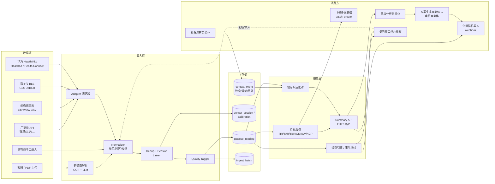
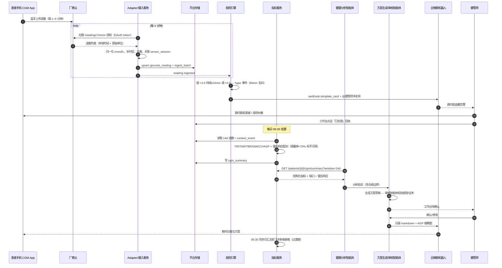

# 05 · CGM 数据接入平台技术方案

> 调研日期：2026-09-04。定位：康养智慧顾问「控糖场景」的数据底座——让居家 CGM / 指血数据自动进平台，替代企微群口头汇报 + 飞书手抄，并向健康分析 / 方案生成智能体、企微群机器人、健管师工作台供数。
> 标注约定：**[已核实]** = 本次通过官方文档/仓库核实；**[未能核实]** = 网络检索未找到公开资料，需 BD/厂商确认，不得作为决策依据。

---

## 0. 结论先行

1. **标准**：内部统一 schema 对齐 **HL7 FHIR CGM IG v1.0.0 (STU1, 2025-09)** 的语义（LOINC 99504-3 单点、97506-0 GMI、106793-3 时间分布），字段命名借鉴 Tidepool（`time / deviceTime / timezoneOffset / deviceId / uploadId`）和 Open mHealth（`specimen_source / temporal_relationship_to_meal`）。存储统一 mmol/L（国内临床习惯），保留原始值与单位。
2. **通道**：国内 CGM 厂商（硅基、三诺、鱼跃、微泰）**均未检索到公开开发者 API**；Dexcom API 明确不含中国区，Abbott 走"机构账号分享"模式。因此 Phase 0 必须以 **截图/PDF 上传 + 多模态解析** 和 **指血 BLE（标准 GATT Glucose Service 0x1808）** 起步，Phase 1 通过 BD 与 1 家国产厂商谈定 **云到云数据授权**。
3. **平台**：摄入层做幂等去重（`device_id + sensor_session_id + device_time` 自然键）、时区归一、传感器会话管理；指标层实现 Battelino 2019 国际共识指标（TIR/TAR/TBR/GMI/CV/AGP），算法参考 iglu（GPL-2，R）与 cgmquantify（MIT，Python），但**自行实现 Python 版**以规避 GPL 传染与 R 运行时。
4. **事件**：低血糖（<3.9 mmol/L）/ 严重低血糖（<3.0）/ 持续高血糖 → 事件总线 → 企微群机器人（webhook，20 条/分钟限频）→ 健管师；同时同步到飞书多维表格（batch_create 1000 条/次，50 QPS）过渡。
5. **路线**：Phase 0（2–4 周）兜底 + 手工；Phase 1（6–8 周）1 家厂商 + 指标 + 告警；Phase 2（8–12 周）多厂商 + 饮食配对 + 智能体方案。

---

## 1. 数据标准调研

### 1.1 HL7 FHIR CGM Implementation Guide **[已核实]**

| 项目 | 内容 | 来源 |
|---|---|---|
| 版本 | `hl7.fhir.uv.cgm` **v1.0.0 STU1**，FHIR R4 (4.0.1)，发布页生成时间 2025-09-24，成熟度 2；需求源自 Argonaut 项目，后与 HL7 O&O 工作组合作 | [hl7.org/fhir/uv/cgm](https://hl7.org/fhir/uv/cgm/) |
| 单点读数 | Profile `cgm-sensor-reading-mass-per-volume`：`Observation.code` 固定 **LOINC 99504-3**（Glucose [Mass/volume] in Interstitial fluid），`valueQuantity` 单位 mg/dL；必填 status/code/subject/effectiveDateTime，value 或 dataAbsentReason 二选一；device 引用可选 | [profile 页](https://hl7.org/fhir/uv/cgm/StructureDefinition-cgm-sensor-reading-mass-per-volume.html) |
| 摩尔单位读数 | `cgm-sensor-reading-moles-per-volume`（mmol/L） | [artifacts](https://hl7.org/fhir/uv/cgm/artifacts.html) |
| 时间分布汇总 | `cgm-summary-times-in-ranges`：code **LOINC 106793-3**，5 个必填 component：极低 104642-4、低 104641-6、目标内 **97510-2**、高 104640-8、极高 104639-0，单位 %，至少两位小数 | [profile 页](https://hl7.org/fhir/uv/cgm/StructureDefinition-cgm-summary-times-in-ranges.html) |
| GMI | `cgm-summary-gmi`：code **LOINC 97506-0** | [profile 页](https://hl7.org/fhir/uv/cgm/StructureDefinition-cgm-summary-gmi.html) |
| 其他汇总 | Mean Glucose（mass/moles）、Coefficient of Variation、Days of Wear、Sensor Active Percentage、CGM Summary PDF | [artifacts](https://hl7.org/fhir/uv/cgm/artifacts.html) |
| 平均血糖 | LOINC **97507-8** Average glucose in interstitial fluid during reporting period（2021-06 随 LOINC 2.70 发布） | [loinc.org/97507-8](https://loinc.org/97507-8/) |
| 报告期 | LOINC 104634-1 CGM device reporting period start | [loinc.org/104634-1](https://loinc.org/104634-1) |
| 提交工作流 | SMART on FHIR / backend services 授权 → 建立患者 ID → 读取 `DataSubmissionStandingOrder`（扩展 `DataSubmissionSchedule`：周期、数据 profile、回溯期）→ 组装 transaction Bundle → `POST [base]/$submit-cgm-bundle` | [IG 首页](https://hl7.org/fhir/uv/cgm/) |

**对本平台的意义**：我们暂不需要对外做 FHIR 服务器，但内部 schema 字段与 LOINC 码一一对应，未来对接医院 HIS / 医保 / 监管上报时可零成本导出 FHIR Bundle。

### 1.2 Open mHealth `blood-glucose` 4.0 **[已核实]**

字段：`blood_glucose{value, unit: mg/dL|mmol/L}`（必填）、`effective_time_frame`（必填，时间点或区间）、`specimen_source`、`temporal_relationship_to_meal`、`temporal_relationship_to_sleep`、`descriptive_statistic`。
- `specimen_source` 枚举：breath / **capillary blood** / **interstitial fluid** / lacrimal fluid / saliva / sweat / urine。
- `temporal_relationship_to_meal` 枚举（11 个）：fasting, not fasting, before meal, after meal, before/after breakfast, before/after lunch, before/after dinner, **2 hours postprandial**。

来源：[blood-glucose-4.0.json](https://raw.githubusercontent.com/openmhealth/schemas/master/schema/omh/blood-glucose-4.0.json)、[specimen-source-2.0.json](https://raw.githubusercontent.com/openmhealth/schemas/master/schema/omh/specimen-source-2.0.json)、[temporal-relationship-to-meal-1.0.json](https://raw.githubusercontent.com/openmhealth/schemas/master/schema/omh/temporal-relationship-to-meal-1.0.json)。

**采用点**：这两个枚举正好覆盖德心门店"7 点指血"（空腹/早餐后 2h/午餐前/…/睡前）的语义，直接作为 `meal_relation` 字段值域。

### 1.3 Tidepool 数据模型 **[已核实]**

- 后端 `tidepool-org/platform`：Go，**BSD-2-Clause**，MongoDB，内置 Dexcom / Abbott / Oura 连接器、任务队列、Prometheus 指标。[github](https://github.com/tidepool-org/platform)
- `cbg`（CGM）类型：`type="cbg"`、`units`（摄入接受 mg/dL 或 mmol/L，**存储统一 mmol/L**）、`value`（mg/dL 整数 0–1000；mmol/L 浮点 0.0–55.0）、`deviceTime` 对 cbg 可选（HealthKit 来源无设备时间）。[cbg 文档](https://developer.tidepool.org/data-model/device-data/types/cbg.html)
- `smbg`（指血）：`subType` = manual / linked（血糖仪直传泵）。[smbg 文档](https://developer.tidepool.org/data-model/device-data/types/smbg.html)
- 公共字段：`time`（UTC）、`deviceTime`（设备本地时间）、`timezoneOffset`、`conversionOffset`、`clockDriftOffset`、`deviceId`、`uploadId`、`guid`、`id`、`_schemaVersion`。
- 同级类型：basal / bolus / deviceEvent / cgmSettings / food。

**采用点**：三个时间偏移字段（时区、换算、时钟漂移）是处理"患者手机时区错/设备时钟漂移"的成熟做法，直接沿用。

### 1.4 Nightscout **[已核实]**

- `nightscout/cgm-remote-monitor`：Node 20+ / MongoDB 4.4+，**AGPL-3.0**；数据源插件：xDrip、Loop、Dexcom Share、**LibreLinkUp connect**、Medtronic CareLink connect、Glooko（实验）。[github](https://github.com/nightscout/cgm-remote-monitor)
- Entry 字段：`sgv`（传感器值 mg/dL）、`mbg`（指血）、`cal`、`date`（epoch ms）、`dateString`、`direction`、`noise`、`filtered/unfiltered`、`rssi`、`device`、`type`、`identifier`、`srvModified`、`utcOffset`；API v3 以 `date` 为唯一时间字段，`created_at` 仅兼容回填。Treatment：`eventType`、`carbs`、`insulin`、`created_at`（`created_at+eventType` 作去重回退键）。[api3/swagger.yaml](https://github.com/nightscout/cgm-remote-monitor/blob/master/lib/api3/swagger.yaml)
- `direction` 枚举：NONE / TripleUp / DoubleUp / SingleUp / FortyFiveUp / Flat / FortyFiveDown / SingleDown / DoubleDown / TripleDown / NOT COMPUTABLE / RATE OUT OF RANGE。[direction.js](https://raw.githubusercontent.com/nightscout/cgm-remote-monitor/master/lib/plugins/direction.js)

**采用点**：趋势箭头枚举直接借用（各厂商 App 都有趋势箭头，语义可映射）。AGPL 意味着不能把 Nightscout 代码嵌进闭源 SaaS，只可作为独立部署的"患者自托管"参考。

### 1.5 手机健康平台

| 平台 | 类型 / 字段 | 状态 |
|---|---|---|
| Apple HealthKit | `HKQuantityTypeIdentifierBloodGlucose`；元数据 `HKMetadataKeyBloodGlucoseMealTime`（`HKBloodGlucoseMealTime` 枚举：preprandial / postprandial）；单位通过 HKUnit 表达 mg/dL 或 mmol/L | **[已核实]** 类型与元数据键存在（[bloodGlucose](https://developer.apple.com/documentation/healthkit/hkquantitytypeidentifier/bloodglucose)、[HKMetadataKeyBloodGlucoseMealTime](https://developer.apple.com/documentation/healthkit/hkmetadatakeybloodglucosemealtime)）；枚举取值页面为 JS 渲染未抓到，按 Apple 文档惯例标注 |
| Google Health Connect | `BloodGlucoseRecord`：`level`（BloodGlucose 单位对象）、`specimenSource`（capillary/venous/arterial/plasma/serum/whole blood 等）、`mealType`、`relationToMeal`（before/after meal、fasting、general） | **[已核实]** [Android 参考](https://developer.android.com/reference/android/health/connect/datatypes/BloodGlucoseRecord)。**注意**：国内无 GMS 的机型上 Health Connect 可用性需实测 **[未能核实]** |
| 华为 Health Kit | 有"写入指尖血糖数据"场景文档，数据类型 `DT_INSTANTANEOUS_BLOOD_GLUCOSE`，通过 DataController 读写 | **[部分核实]** 文档存在（[华为开发者](https://developer.huawei.com/consumer/cn/doc/HMSCore-Guides/blood-glucose-scene-0000001076632804)），页面为 JS 渲染未抓到字段；**是否有 CGM 连续序列类型未能核实**。华为官网另有"华为手表连接三方血糖仪后进行血糖管理"说明，表明华为运动健康 App 已有第三方血糖仪接入生态 |
| 小米运动健康 | 未检索到面向第三方的血糖读取 API | **[未能核实]** |

### 1.6 推荐的平台内部统一 CGM Schema（字段级）

设计原则：(a) 一条记录 = 一次葡萄糖观测，CGM 与指血同表异类型；(b) 三层时间（UTC、设备本地、时区偏移）；(c) 原始值与规范值并存；(d) 溯源到通道 + 上传批次；(e) 与 FHIR/LOINC 可映射。

**表 `glucose_reading`**

| 字段 | 类型 | 必填 | 说明 / 映射 |
|---|---|---|---|
| `reading_id` | UUID | Y | 平台主键 |
| `patient_id` | UUID | Y | 主数据患者 ID（FHIR subject） |
| `reading_type` | enum | Y | `cgm` \| `smbg` \| `cgm_scan`（Libre 扫描式）\| `calibration` \| `lab_venous`。Tidepool cbg/smbg；OMH specimen_source |
| `specimen_source` | enum | Y | `interstitial_fluid` \| `capillary_blood` \| `venous_blood`（OMH 枚举子集） |
| `value_mmol` | decimal(4,1) | Y | 规范值 mmol/L（存储标准） |
| `value_raw` | decimal | Y | 厂商原始数值 |
| `unit_raw` | enum | Y | `mg/dL` \| `mmol/L` |
| `loinc_code` | varchar | Y | 默认 `99504-3`（CGM）；指血用 `41653-7`（Glucose in capillary blood by glucometer，待与临床同事确认） |
| `time_utc` | timestamptz | Y | 事件真实时刻（Tidepool `time`） |
| `device_time` | timestamp | N | 设备/App 本地时间（Tidepool `deviceTime`） |
| `tz_offset_min` | smallint | Y | 时区偏移分钟（Tidepool `timezoneOffset`），国内默认 480 |
| `clock_drift_ms` | int | N | 与服务器时钟差（Tidepool `clockDriftOffset`） |
| `trend` | enum | N | Nightscout `direction` 枚举 |
| `rate_mmol_per_min` | decimal | N | 变化率（Dexcom EGV 有此字段） |
| `meal_relation` | enum | N | OMH `temporal_relationship_to_meal` 11 值 + `bedtime`（对应门店"睡前"） |
| `quality_flag` | enum | Y | `ok` \| `warmup` \| `noise` \| `out_of_range` \| `suspect_duplicate` \| `manual_unverified` |
| `source_channel` | enum | Y | `vendor_api` \| `vendor_export` \| `ble_miniprogram` \| `app_sdk` \| `healthkit` \| `health_connect` \| `huawei_health` \| `ocr_upload` \| `manual_entry` \| `staff_entry` |
| `source_confidence` | decimal | Y | 1.0 = 设备直传；OCR/LLM 解析 ≤ 0.9 并需人工复核 |
| `vendor` | varchar | Y | `sibionics` \| `sinocare` \| `yuwell` \| `microtech` \| `abbott` \| `dexcom` \| … |
| `device_id` | varchar | N | 传感器/血糖仪序列号（Tidepool `deviceId`） |
| `sensor_session_id` | UUID | N | 关联 `sensor_session` |
| `upload_id` | UUID | Y | 关联 `ingest_batch`（Tidepool `uploadId`） |
| `vendor_record_id` | varchar | N | 厂商侧记录 ID（幂等键之一） |
| `dedup_key` | varchar | Y | ~~`sha1(patient_id\|vendor\|device_id\|reading_type\|time_utc 取整到分钟)`~~ → **已作废（2026-09-05，R-1）**：改用**传感器侧读数序号** `sha1(patient_id\|vendor\|sensor_sn\|reading_type\|sensor_reading_seq)`。厂商已确认读数默认带序号（A1-6）。按分钟取整会在双路并存时因两路设备时钟微差落入不同分钟而去重失败；且事后改键需重算历史，会让 GMI 基线断、缓解判定的前后对比失效（R-1 标记为不可逆）。唯一索引 |
| `payload_raw` | jsonb | N | 厂商原始报文 / OCR 结果 |
| `created_at` / `updated_at` | timestamptz | Y | 平台时间 |

**表 `sensor_session`**：`session_id, patient_id, vendor, device_id, sensor_sn, started_at, expected_end_at（14 天）, ended_at, end_reason(expired/fell_off/replaced/error), warmup_minutes, calibration_required(bool)`。
**表 `calibration`**：`calibration_id, session_id, time_utc, smbg_value_mmol, cgm_value_before_mmol, applied(bool)`。
**表 `ingest_batch`**：`upload_id, patient_id, source_channel, received_at, file_ref, parser_version, record_count, dup_count, rejected_count, status`。
**表 `context_event`**（饮食/运动/用药/睡眠）：`event_id, patient_id, event_type(meal/exercise/medication/sleep/mnt_product), time_start_utc, time_end_utc, tz_offset_min, payload(jsonb: carbs_g, food_items, exercise_type, drug, dose), source_channel, confidence`。对齐 Nightscout treatment 与 Tidepool food。

FHIR 导出映射：`glucose_reading(reading_type=cgm)` → Observation(99504-3)；日报表 → `cgm-summary-*` Observation 集合；`context_event(meal)` → NutritionIntake / Observation。

---

## 2. 接入通道对比

### 2.1 厂商现状核实结果

| 厂商 | 核实结果 |
|---|---|
| Dexcom | **[已核实]** 开发者 API v3：`/v3/users/self/{egvs,events,calibrations,devices,dataRange,alerts}`；OAuth；**美国 1 小时延迟、美国以外 3 小时延迟**（与监管对齐，防止用 API 数据做实时临床决策）；单次最大 30 天窗口；60,000 次/应用/小时；生产环境分 US / EU-rest of world / Japan 三区 + sandbox。**中国不在列**。([endpoint overview](https://developer.dexcom.com/docs/dexcomv3/endpoint-overview/)) |
| Abbott FreeStyle Libre | **[已核实]** LibreView 支持医生从患者档案下载原始血糖 CSV（[Abbott FAQ](https://pro.freestyle.abbott/ie-en/home/help-support/faq/question-answer.html?q=LibreViewquestion-35)）；第三方聚合商（如 Junction）采用"患者把 Libre 账号连接到某个 **LibreView 诊所 practice**，聚合商作为 practice 成员拉数"的模式，时间戳为"浮动时间"无时区锚定，备注仅小时级粒度（[Junction 文档](https://docs.junction.com/wearables/guides/abbott-libreview)）；LibreLinkUp 有非官方逆向 API（MIT，alpha，作者声明可能被 Abbott 封禁）（[libre-link-unofficial-api](https://github.com/DRFR0ST/libre-link-unofficial-api)）。**中国区 LibreView / 瞬感宝云端分享能力未能核实** |
| 硅基动感 SiBionics | **[部分核实]** 国内首款 14 天免校准实时 CGM，已推出"数字化全院血糖管理系统"（门诊远程会诊 + 住院中央监护站 + 查房 App），说明厂商有 B 端数据平台与远程数据链路，但**新闻稿未提任何开放 API / HIS 接口规范**（[硅基新闻](https://www.sibionics.com/News/112782.html)）。需 BD 谈定 |
| 三诺 iCan / 三诺指血仪 | **[部分核实]** i3/h3 2023-03 上市，i6 系列 2025-03 上市，二代获欧盟 MDR（[三诺官网](https://www.sinocare.com/zh/cgm.html)）。`open.sinocare.com` 三次抓取均连接失败，**开放平台能力未能核实** |
| 鱼跃安耐糖 / 微泰 AiDEX | **[未能核实]** 未检索到公开 API/SDK 资料 |
| xDrip+（开源接收端） | **[已核实]** GPL-3.0，Android 8–17，支持 Dexcom G6/G7、Libre（NFC/BLE）、Medtrum A6、Medtronic 泵、CareSens Air、Eversense，以及 BLE 指血仪 Contour Next One / Accu-Chek Guide / Verio Flex 等；**未列出国产 CGM**（[xDrip README](https://github.com/NightscoutFoundation/xDrip)） |

### 2.2 通道矩阵

评分：★ 少 → ★★★★★ 多/好。延迟指"数据产生 → 平台可见"。

| 通道 | 适用厂商 | 实现难度 | 延迟 | 稳定性 | 合规要点 | 成本 | 评估 |
|---|---|---|---|---|---|---|---|
| **a. 厂商云 API / OAuth** | Dexcom（海外）、国产厂商需 BD | ★★（有 API 时）/ ★★★★★（无 API 时靠谈判） | Dexcom 海外 3h；国产云到云若有，估 5–15 min | ★★★★ | 患者单独同意（PIPL 第 29 条）；Dexcom 数据在境外，回传涉及跨境（第 38 条）；国产厂商需签数据处理协议 | 开发 2–4 人周/厂商；可能有商务费 | **Phase 1 主通道**（选 1 家国产厂商） |
| **b. 厂商机构端账号 + 导出** | Abbott LibreView（诊所账号）、硅基/三诺 B 端平台（若有） | ★★（人工导 CSV）/ ★★★（自动化抓取，脆弱） | 天级（人工）| ★★（依赖网页/导出格式） | 门店作为"医疗机构"持有患者数据，需明确委托关系；自动化抓取可能违反厂商服务条款 | 低（人力） | 过渡/补数通道，不做主链路 |
| **c. 小程序 BLE 直连传感器** | 需厂商开放蓝牙协议——国产 CGM 协议**均为私有且通常加密**，未见开放 | ★★★★★ | 实时 | ★（无背景运行；小程序 BLE 需前台、连接/断开成对、iOS 需先 getBLEDeviceServices、Android 需定位权限、建议 20 字节分片） | 逆向厂商协议有法律风险 | 高且不可控 | **不现实**，仅当厂商主动提供小程序 SDK 时再评估（[微信 BLE 文档](https://developers.weixin.qq.com/miniprogram/dev/framework/device/ble.html)） |
| **d. App 嵌厂商 SDK** | 视厂商是否提供（未核实到公开 SDK） | ★★★ | 实时（App 前台）/ 分钟级（后台受限） | ★★★ | 需自有 App（目前产品是企微 + 小程序，无原生 App）；SDK 采集需用户授权 | 需要新建原生 App，人力大 | 除非做原生 App，否则不选 |
| **e. 手机健康平台桥接** | Apple HealthKit（Dexcom/Libre 国际版 App 会写入）、Health Connect、华为 Health Kit | ★★★（需原生 App 或华为云侧授权） | 分钟–小时级（取决于厂商 App 是否写入） | ★★★ | 平台各自的审核与授权；华为 Health Kit 需应用上架审核 | 中 | 华为 Health Kit 值得 Phase 2 试点（国内份额、已有三方血糖仪生态）；HealthKit 依赖 iOS 原生 App |
| **f. 截图 / PDF 上传 + 多模态解析** | 全部厂商（App 截图、AGP 报告 PDF、LibreView CSV） | ★★ | 患者上传即得（分钟级），但依赖患者行为 | ★★★（解析准确率需人工复核） | 图片含患者姓名等敏感信息，需脱敏存储；LLM 解析结果标 `source_confidence≤0.9` | 低；按调用计费 | **Phase 0 兜底**，长期保留作为补数 |
| **g. 指血血糖仪 BLE（三诺、鱼跃等）** | 遵循 Bluetooth SIG **Glucose Service 0x1808**（Glucose Measurement / Context / Feature / RACP 四特征）的设备可用标准协议；私有协议设备需厂商文档 | ★★（标准 GLS）/ ★★★★（私有） | 患者同步时（分钟级） | ★★★ | 同 c，小程序 BLE 前台限制 | 低 | **Phase 0/1 并行通道**，替代 7 点指血手抄；先用一款支持标准 GLS 的仪器验证（[GLS 规范](https://www.bluetooth.com/wp-content/uploads/Files/Specification/HTML/GLS_v1.0.1/out/en/index-en.html)） |

**关键判断**：
- 国内 CGM 的"云端数据授权"是唯一可规模化的路径，且必须通过商务谈判而非开发者自助。建议按"医院全院血糖管理系统"已有 B 端能力的厂商优先（硅基已有该系统）。
- 蓝牙直连 CGM 在小程序内不可行；指血仪的标准 GLS 蓝牙可行。
- OCR/多模态兜底是 Phase 0 唯一能 2–4 周落地的自动化。

---

## 3. 平台侧设计

### 3.1 数据摄入服务（Ingestion）

```
Adapter(厂商/通道) → Normalizer(单位/时区/枚举) → Dedup(幂等) → SessionLinker(传感器会话) → QualityTagger → Store(glucose_reading) → EventBus(reading.ingested)
```

| 关注点 | 规则 |
|---|---|
| **幂等 / 去重** | 唯一索引 `dedup_key`；同一 `vendor_record_id` 直接幂等；无厂商 ID 时按 `patient+device+type+time_utc(分钟)` 判重；OCR 通道对同一患者 ±2 分钟内值差 ≤0.2 mmol/L 标 `suspect_duplicate` 不入正表。Nightscout 用 `created_at+eventType` 做回退去重键，思路一致 |
| **时间对齐** | 存 `time_utc` + `device_time` + `tz_offset_min`（Tidepool 三字段）。厂商只给本地时间时按患者档案时区（默认 Asia/Shanghai, +480）换算；Abbott 数据为"浮动时间"，必须补时区。OCR 截图只有"HH:MM"时，日期取上传日并让患者确认，`quality_flag=manual_unverified` |
| **时钟漂移** | 厂商 API 给 `systemTime/displayTime` 之类双时间时计算 `clock_drift_ms`；漂移 > 5 分钟告警到运维 |
| **传感器更换** | 新 `device_id/sensor_sn` 出现 → 关闭旧 session（`end_reason=replaced`），开新 session；前 `warmup_minutes`（按厂商说明书配置，常见 1 小时）读数标 `warmup` 不参与指标；session 到期（14 天）未见新 session → 触发 `sensor.expired` 事件提醒健管师 |
| **校准点** | 指血读数在 CGM session 内出现 → 记入 `calibration` 表并与同刻 CGM 值比对，差异 >20% 标 `quality_flag=noise` 供健管师判断；免校准传感器（硅基）仅记录不修正 |
| **单位** | 一律换算 mmol/L（÷18.016，保留 1 位小数），保留 `value_raw/unit_raw` |
| **批次追溯** | 每次拉取/上传一个 `ingest_batch`，可整批回滚 |

### 3.2 数据质量规则

| 规则 | 定义 | 动作 |
|---|---|---|
| 佩戴率 / 数据完整率 | 报告期内有效读数 ÷ 期望读数（CGM 每 5 分钟 288/天，或按厂商采样率） | **<70% 不出正式指标**（Battelino 2019 共识：至少 14 天、70% 数据） |
| 缺口检测 | 相邻读数间隔 > 2×采样间隔 → gap 事件；gap > 2h 记入"缺口清单" | 看板显示；连续 24h 无数据 → 提醒健管师联系患者 |
| 生理范围 | mmol/L 范围 1.1–33.3（≈ 20–600 mg/dL），超出标 `out_of_range` | 不参与指标 |
| 突变检测 | 相邻 5 分钟变化 > 2.5 mmol/L（≈45 mg/dL/5min）标 `noise` | 不触发告警，仅提示 |
| 来源可信度 | `source_confidence < 0.95` 的读数须健管师在工作台确认后才进指标 | OCR 通道默认 |
| 重复通道 | 同时段既有厂商 API 又有 OCR → 优先 API，OCR 标 `superseded` | 自动 |

### 3.3 指标计算服务（Metrics）

规则口径以 02 报告为准（同事整理）；本节只定义计算层接口与默认公式（国际共识 Battelino et al., Diabetes Care 2019;42(8):1593–1603 **[已核实]**，[ADA 全文](https://diabetesjournals.org/care/article/42/8/1593/36184/Clinical-Targets-for-Continuous-Glucose-Monitoring)）。

| 指标 | 默认定义 | 目标（T2DM 一般成人） |
|---|---|---|
| TIR | 3.9–10.0 mmol/L（70–180 mg/dL）占比 | >70% |
| TBR | <3.9（Level 1）；<3.0（Level 2） | <4%；<1% |
| TAR | >10.0（Level 1）；>13.9（Level 2） | <25%；<5% |
| 平均血糖 | 有效读数均值 | — |
| GMI | GMI(%) = 3.31 + 0.02392 × 平均血糖(mg/dL)（Bergenstal 2018；共识引用） | — |
| CV | SD ÷ 均值 | ≤36% |
| AGP | 按一天内时刻（5–15 分钟桶）聚合 5/25/50/75/95 分位曲线 | 图形 |
| 餐后响应 | 以 `context_event(meal)` 起点，取 0–3h 窗口：峰值、达峰时间、iAUC、2h 值、回落到基线时间 | 由 02 报告定阈值 |
| 夜间低血糖 | 00:00–06:00 内 <3.9 且持续 ≥15 分钟 | — |

计算服务接口：`POST /metrics/compute {patient_id, window:{start,end}, thresholds:{...}, min_wear_ratio:0.7}` → 返回 FHIR-style summary（映射到 106793-3 组件与 97506-0）。窗口：滚动 24h / 7d / 14d；14d 用于 AGP 与 GMI；日报每日 06:00 批算，告警走实时流。

实现策略：Python 自研（pandas / polars），单测对照 iglu 结果（iglu 提供示例数据集，GPL-2 仅用于验证，不复制代码）。

### 3.4 事件系统

```
reading.ingested → RuleEngine(流式) → alert.raised{level, patient, value, trend, window}
                                     → notify.wecom(webhook) / notify.workbench / sync.lark
```

| 事件 | 触发 | 去抖 |
|---|---|---|
| `hypo.level2` | 值 <3.0 mmol/L | 同一患者 30 分钟内只发一次，回升 >3.9 后发"解除" |
| `hypo.level1` | 值 <3.9 持续 ≥15 分钟，或 <3.9 且趋势 ↓/⇊ | 同上 |
| `hyper.sustained` | >13.9 持续 ≥2h | 每 4h 最多一次 |
| `sensor.expired / data.silent_24h` | 见 3.1/3.2 | 每日一次 |
| `postprandial.excursion` | 餐后峰值超过 02 报告阈值 | 每餐一次，日报汇总 |

企微群机器人（**[已核实]**，[开发者文档](https://developer.work.weixin.qq.com/document/path/91770)）：`POST https://qyapi.weixin.qq.com/cgi-bin/webhook/send?key=KEY`；消息类型 text / markdown / markdown_v2 / image / news / file / voice / template_card；**每个机器人 20 条/分钟**；text 2048 字节、markdown 4096 字节；`mentioned_list` / `mentioned_mobile_list` 可 @健管师（markdown_v2 不支持 @）。设计：每个患者专属群一个机器人 key；告警走 `template_card` 或 markdown + @健管师手机号；平台侧对 webhook 做令牌桶（18 条/分钟）与队列，超限降级为日报聚合；webhook key 视为密钥存 KMS。

低血糖告警文案含：患者昵称（不含全名）、当前值、趋势、最近 30 分钟曲线缩略图（image ≤2MB）、建议动作（引用 02 报告"低于 3.9 立即补糖"规则）、一键"已处理"回执（跳工作台）。

### 3.5 与饮食 / 运动 / 用药的时间对齐（事件–血糖响应配对）

1. 事件来源：企微群内患者发的餐食照片 / 文字（社群应答智能体提取 → `context_event`，含时间），健管师工作台录入，MNT 产品服用打卡（早/中/晚/睡前）。
2. 配对算法：对每个 `meal` 事件，取 `[t-30min, t+180min]` 的 CGM 序列；若多餐间隔 <3h 则截断到下一餐开始；输出 `meal_response{baseline, peak, peak_delta, time_to_peak, iAUC_2h, return_to_baseline_min, quality(缺口比例)}`。
3. 运动事件：`[t_start, t_end+120min]` 窗口，输出下降幅度与最低点。
4. 用药 / MNT：作为分层维度（服用 vs 未服用同类餐次对比），供分析智能体做"产品效果"叙述——**注意合规**：固体饮料不得宣称降糖，分析输出限于"血糖响应差异描述"。
5. 时间容差：患者手动记录的餐时误差常达 ±15 分钟，配对时对峰值检测使用 `[t-30, t+180]` 宽窗并在结果中标注 `meal_time_confidence`。

---

## 4. 开源 / 可复用组件评估

| 组件 | 语言 | 许可证 | 成熟度 | 能力 | 建议 |
|---|---|---|---|---|---|
| **iglu** | R | **GPL-2** | 高：CRAN v4.2.2（2025-01-14），PLOS One 论文 | TIR/TAR/TBR、GMI、CV、MAGE、MODD、CONGA、J-index、LBGI/HBGI、GRADE、AGP、episodes；输入 `id,time,gl` | 作为指标**验证基准**（离线对拍），不嵌入生产（GPL + R 运行时）。[CRAN](https://cran.r-project.org/web/packages/iglu/index.html)、[github](https://github.com/irinagain/iglu) |
| **cgmquantify** | Python | **MIT** | 中：56 commits，主要面向 Dexcom G6 CSV；PyPI 名 `cgmquantify-updated` | 20+ 变异性指标、可视化 | 可复用公式与代码片段（MIT 友好），但需改造输入层。[github](https://github.com/brinnaebent/cgmquantify) |
| **diametrics** | Python | **GPL-3.0** | 中：100 commits，有 CI 与 WebApp | 多设备格式（Libre/Dexcom/Medtronic）预处理、TIR、eA1c、CV、GRI、MAGE、LBGI/HBGI、AUC | 参考其设备解析与缺失值填补逻辑，不直接引入。[github](https://github.com/cafoala/diametrics) |
| **GlucoBench** | Python | 数据集 CC-BY 4.0 / GPL-2 | 研究级：ICLR 论文，5 个公开数据集（Colas 208 人、Weinstock 200 人等，5 分钟频率），Gluformer/Latent ODE | Phase 2 血糖预测模型基线与测试数据。[github](https://github.com/IrinaStatsLab/GlucoBench) |
| **Tidepool platform** | Go | **BSD-2-Clause** | 高：2189 commits，生产运行，含 Dexcom/Abbott 连接器 | 数据模型、连接器架构、上传去重 | 借鉴数据模型与连接器模式；BSD 允许摘取代码 |
| **Nightscout** | Node | **AGPL-3.0** | 高：6521 commits，社区庞大 | 实时展示、LibreLinkUp/Dexcom Share/CareLink connect 插件 | 只作独立部署参考；AGPL 不进 SaaS 代码库 |
| **xDrip+** | Android | **GPL-3.0** | 高 | 多传感器接收、BLE 指血仪解析（GLS 实现） | 参考其 Glucose Service 解析实现思路 |
| 非官方 LibreLinkUp API | Node | MIT | 低（alpha，可能被封） | 拉取 LibreLinkUp 实时值 | **不用于生产** |

---

## 5. 与现有规划的衔接

| 消费方 | 数据形态 | 接口 |
|---|---|---|
| **健康分析智能体** | 每日/每周 `cgm_summary`（FHIR-style JSON）+ `meal_response[]` + 质量标记 + 缺口清单 | 内部 REST `GET /patients/{id}/cgm/summary?window=14d`；智能体 prompt 只接收结构化指标，不接收原始 288 点序列（节省 token、避免幻觉） |
| **方案生成智能体** | 上述 + 用药/MNT 服用记录 + 02 报告规则（作为工具 `rules.evaluate`） | 输出方案草稿 → 审核服务智能体 → 健管师确认 → 企微群 |
| **社群应答智能体** | 群内餐食照片/文字 → `context_event` | 反向写入平台 `POST /events` |
| **企微群机器人** | 告警卡片、日报（AGP 缩略图 + 三行指标）、周报 | webhook（3.4 节） |
| **健管师工作台看板** | 患者列表（按告警/佩戴率/TIR 排序）、单人 14 天 AGP、餐后响应列表、OCR 待复核队列、传感器到期清单 | SaaS 多角色工作台新模块；替代飞书"跟进记录表" |
| **飞书多维表格（过渡）** | 每日汇总一行/患者/天（日期、平均、TIR、TBR、最低值、最高值、佩戴率、告警次数、7 点指血映射列）；原 7 点指血列继续保留 | `POST /open-apis/bitable/v1/apps/{app_token}/tables/{table_id}/records/batch_create`：**单次 ≤1000 条，50 QPS**，权限 `base:record:create`，日期字段传毫秒时间戳 **[已核实]**（[飞书文档](https://open.feishu.cn/document/server-docs/docs/bitable-v1/app-table-record/batch_create?lang=zh-CN)）。每日 06:30 批同步，幂等键 = 患者+日期（先 search 后 update/create） |

主数据：患者 ID 以平台主数据为准；企微 external_userid、飞书表格行 record_id、厂商账号 ID 存于 `patient_identity_link` 表。

**合规基线（PIPL，[gov 全文](https://www.cac.gov.cn/2021-08/20/c_1631050028355286.htm) [已核实]）**：医疗健康信息属敏感个人信息（第 28 条），处理须**单独同意**（第 29 条）——在小程序/企微授权页做独立勾选并留痕；向境外提供（如 Dexcom、Abbott 海外云）须满足第 38 条（安全评估 / 认证 / 标准合同），**Phase 0–1 只接入数据留在境内的厂商**。

---

## 6. 分阶段落地路线

| 阶段 | 周期 | 范围 | 依赖 | 风险 | 人力 |
|---|---|---|---|---|---|
| **Phase 0 · 兜底通道 + 手工** | 2–4 周 | (1) 小程序/企微 H5 上传 CGM App 截图与 AGP PDF，多模态模型解析为 `glucose_reading`（标 `ocr_upload`, confidence 0.8）；(2) 健管师工作台最小版：待复核队列 + 手工录入 7 点指血（替代手抄）；(3) 统一 schema 与 `ingest_batch` 落库；(4) 每日汇总同步到现有飞书多维表格；(5) 简单规则告警（录入值 <3.9 → 企微群机器人） | 多模态模型接入（走现有大模型层）；企微群机器人 key；飞书应用权限 `base:record:create` | OCR 误读（数字/单位 mg/dL vs mmol/L）→ 强制人工复核；患者上传意愿低 → 结合健管师群内催办 | 后端 1、前端(小程序) 1、算法/LLM 0.5、测试 0.5 ≈ **3 人 × 4 周** |
| **Phase 1 · 1 家厂商 API + 指标 + 告警** | 6–8 周 | (1) 与 1 家国产 CGM 厂商（优先硅基或三诺，以谁能给云到云授权为准）签数据授权，实现 OAuth/授权码 + 定时拉取 + webhook（若有）；(2) 指血仪 BLE（标准 GLS 0x1808）小程序直连，至少 1 款三诺/鱼跃机型；(3) 指标服务（TIR/TAR/TBR/GMI/CV/AGP/日报）+ 质量规则；(4) 流式告警（低血糖分级、24h 无数据、传感器到期）→ 企微；(5) 工作台看板 v1；(6) 飞书同步升级为指标行 | **厂商商务谈判（最长路径，需提前 4–6 周启动）**；02 报告阈值定稿；小程序 BLE 真机测试 | 厂商无 API 或延迟过大 → 退回 b 通道（机构端导出）+ Phase 0 兜底；GLS 私有协议差异 → 换机型；告警误报 → 去抖参数可配 | 后端 2、前端 1、数据/算法 1、测试 0.5、BD/PM 0.5 ≈ **5 人 × 8 周** |
| **Phase 2 · 多厂商 + 饮食配对 + 智能体方案** | 8–12 周 | (1) 第 2–3 家厂商适配器（含华为 Health Kit 桥接试点）；(2) `context_event` 全链路：社群应答智能体抽取餐食/运动/服药 → 餐后响应配对；(3) 健康分析智能体 / 方案生成智能体接入 summary API，方案经审核智能体 + 健管师确认后推群；(4) 周报/月报自动生成（AGP PDF）；(5) 血糖预测（GlucoBench 基线）作为提前 30 分钟低血糖预警实验；(6) FHIR Bundle 导出（对接门店 HIS） | 适配器框架已稳定；智能体团队接口；02 报告餐后规则 | 智能体建议合规（食品不得宣称降糖）→ 审核智能体 + 人工；多厂商数据质量差异 → 质量规则按厂商配置 | 后端 2、前端 1、数据/算法 1.5、智能体 1、测试 1 ≈ **6.5 人 × 12 周** |

---

## 7. 架构图与时序图

### 7.1 架构图



### 7.2 时序图：CGM 数据 → 平台 → 智能体 → 企微群



---

## 8. 未决问题（需 BD / 厂商 / 临床同事确认）

1. 硅基 / 三诺 / 鱼跃 / 微泰 是否提供云到云数据授权、其延迟、是否有 webhook、商务条款。**[未能核实]**
2. 雅培中国区（瞬感）是否有 LibreView 诊所账号与云端分享。**[未能核实]**
3. 华为 Health Kit 是否有连续血糖序列类型（而非仅"指尖血糖"场景）。**[未能核实]**
4. 门店拟采购的指血仪具体型号是否实现标准 Bluetooth Glucose Service（需拿真机用 nRF Connect 抓 0x1808）。
5. 02 报告的阈值、餐后窗口、低血糖动作话术定稿；指血 LOINC（41653-7）由临床确认。
6. 数据存储位置与等保/医疗数据分类分级要求（私有化部署客户）。

---

## 来源汇总

- HL7 FHIR CGM IG v1.0.0：https://hl7.org/fhir/uv/cgm/ ；artifacts：https://hl7.org/fhir/uv/cgm/artifacts.html ；sensor reading：https://hl7.org/fhir/uv/cgm/StructureDefinition-cgm-sensor-reading-mass-per-volume.html ；times in ranges：https://hl7.org/fhir/uv/cgm/StructureDefinition-cgm-summary-times-in-ranges.html ；GMI：https://hl7.org/fhir/uv/cgm/StructureDefinition-cgm-summary-gmi.html
- LOINC 99504-3：https://loinc.org/99504-3 ；97507-8：https://loinc.org/97507-8/ ；104634-1：https://loinc.org/104634-1
- Open mHealth schemas：https://raw.githubusercontent.com/openmhealth/schemas/master/schema/omh/blood-glucose-4.0.json ；specimen-source-2.0 ；temporal-relationship-to-meal-1.0
- Tidepool：https://github.com/tidepool-org/platform ；https://developer.tidepool.org/data-model/device-data/types/cbg.html ；…/smbg.html
- Nightscout：https://github.com/nightscout/cgm-remote-monitor ；lib/api3/swagger.yaml ；lib/plugins/direction.js
- Apple HealthKit：https://developer.apple.com/documentation/healthkit/hkquantitytypeidentifier/bloodglucose ；https://developer.apple.com/documentation/healthkit/hkmetadatakeybloodglucosemealtime
- Health Connect：https://developer.android.com/reference/android/health/connect/datatypes/BloodGlucoseRecord
- 华为 Health Kit 指尖血糖：https://developer.huawei.com/consumer/cn/doc/HMSCore-Guides/blood-glucose-scene-0000001076632804 ；华为手表三方血糖仪：https://consumer.huawei.com/cn/support/content/zh-cn15821468/
- Dexcom API v3：https://developer.dexcom.com/docs/dexcomv3/endpoint-overview/
- Abbott LibreView 导出：https://pro.freestyle.abbott/ie-en/home/help-support/faq/question-answer.html?q=LibreViewquestion-35 ；Junction practice 模式：https://docs.junction.com/wearables/guides/abbott-libreview ；非官方 LibreLinkUp：https://github.com/DRFR0ST/libre-link-unofficial-api
- 硅基动感：https://www.sibionics.com/News/112782.html ；https://www.sibionics.com/News/112778.html
- 三诺 CGM：https://www.sinocare.com/zh/cgm.html
- xDrip+：https://github.com/NightscoutFoundation/xDrip
- 微信小程序 BLE：https://developers.weixin.qq.com/miniprogram/dev/framework/device/ble.html
- Bluetooth Glucose Service：https://www.bluetooth.com/wp-content/uploads/Files/Specification/HTML/GLS_v1.0.1/out/en/index-en.html ；Glucose Profile：https://www.bluetooth.com/specifications/specs/glp-1-0-1/
- iglu：https://cran.r-project.org/web/packages/iglu/index.html ；https://github.com/irinagain/iglu ；cgmquantify：https://github.com/brinnaebent/cgmquantify ；diametrics：https://github.com/cafoala/diametrics ；GlucoBench：https://github.com/IrinaStatsLab/GlucoBench
- Battelino 2019 国际共识：https://diabetesjournals.org/care/article/42/8/1593/36184/Clinical-Targets-for-Continuous-Glucose-Monitoring
- 企业微信群机器人：https://developer.work.weixin.qq.com/document/path/91770
- 飞书多维表格 batch_create：https://open.feishu.cn/document/server-docs/docs/bitable-v1/app-table-record/batch_create?lang=zh-CN
- 个人信息保护法全文：https://www.cac.gov.cn/2021-08/20/c_1631050028355286.htm
